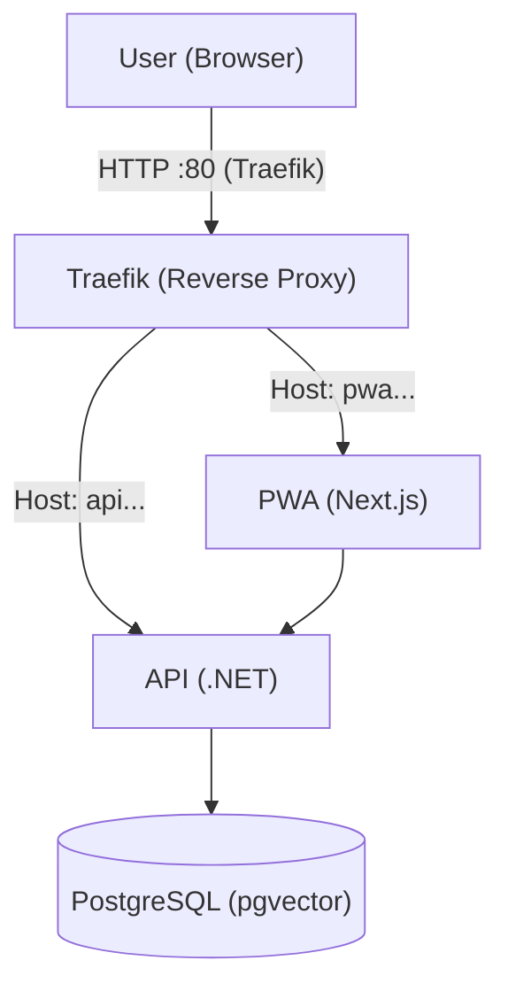

# Local Development Loop & Infrastructure

## Everyday commit and push flow

Select Node 26.12.1 from `.nvmrc` using your version manager. For example, with nvm:

```sh
nvm install
nvm use
task hooks:setup
```

`hooks:setup` installs the pinned OpenSpec CLI and Python/PWA/browser dependencies, restores the API test project,
and installs both Git hooks. Use `task hooks:install` when hooks are missing or the adapter itself changes;
an installed adapter reads the current repository configuration on each invocation. Docker must be running for API integration tests; the
push check does not reset the development stack or kill an existing dev server.

Before staging, format or generate only the files required by your change:

```sh
task prepare -- <reviewed-paths>
```

Review and stage the diff, then use ordinary Git commands:

```sh
git add <paths>
git commit -m "Describe the change"
git push
```

Commit runs quick read-only checks selected from staged paths: whitespace, OpenSpec,
harness tests, static contracts/mocks, client freshness and PWA formatting. It does
not generate or stage files, build the application, or run integration/E2E suites.
Use `task check:commit` to run the staged checks manually.

Push selects checks from the complete committed range being pushed. Markdown-only
changes run committed whitespace and introduced-link checks; OpenSpec planning also
runs spec validation. Harness changes run existing tooling tests. API changes run
API checks, PWA changes run production checks with affected E2E capability suites,
and database changes run relational tests plus an isolated disposable smoke stack.
Shared contracts/dependencies and unknown impact retain broader checks. Mixed
changes take the union, so a docs commit after unpushed code still tests that code.

Use the existing command after committing:

```bash
task check:push                        # Affected checks; manual runs compare to upstream
task check:push -- --plan               # Explain the committed range and selection; runs no checks
task check:push -- --base origin/main    # Explicit manual base; hook-supplied refs take precedence
task check:push -- --full               # Force all push checks
```

Without a trustworthy base, validation falls back to full checks rather than
assuming no impact. Deleted files and both sides of renames are included. Execution
requires clean tracked/untracked source and the checked-out pushed revision, and
rechecks them between checks and at completion. Preview does not require a clean
worktree, but still considers committed source only. No success cache is used.

The existing `check:push:pwa` builds once and reuses the CI capability selector;
`task check:push:pwa SUITES="planning household"` runs those suites, while its
default remains all E2E. It keeps the fixed CI auth/build flags and never reuses an
external `BASE_URL`. Push-triggered database smoke calls the existing
`task test:smoke -- --isolated`, with unique project/container/network/volume names
and dynamic loopback ports. Its teardown only removes its owned resources. The
legacy explicit `task test:smoke` retains its development-stack reset behavior.
No hook reinstall is needed for an already installed pre-commit adapter.

Both gates stop on failure. Fix, prepare, stage and commit again before retrying a
push. CI repeats platform/build tests and adds Docker/security validation. A local
pass does not establish Linux, Docker-image or deployment acceptance. The Docker
image currently uses its separately maintained Node base; `.nvmrc` pins local and
GitHub-hosted Node commands.

## Repository tooling setup

Run `task init:python` once after cloning, or when `scripts/requirements.txt` changes.
Taskfile's Python tooling uses `.venv/bin/python` without shell activation. To use the
same interpreter for direct Python/npm helper commands, run `source .venv/bin/activate`.
An explicit Task variable such as `PYTHON=python3` can select an already-provisioned
interpreter in CI or another managed environment. Do not install into Homebrew's
externally managed system Python.

`task spec:check` validates capability specs and active changes with the strict,
non-interactive OpenSpec version pinned by `OPENSPEC_VERSION` in `Taskfile.yml`
(currently 1.15.0). `task hooks:setup` installs that pin. The reusable CI validation
workflow also validates specs for documentation-only changes. Spec validity is
separate from implementation or deployment acceptance.


This is a contributor guide for local development, service orchestration, and discovery. It is not a Synology installation guide; see the current [Synology operator guide](release-template/synology/README.md), for deployment and recovery procedures; local checks do not qualify a physical NAS.

## Service Dependencies (Internal Network)



## Discovery Rules
- **Tooling**: Always check [.agents/agent-toolbox.md](.agents/agent-toolbox.md) for custom scripts.
- **Environment**: Infrastructure variables live in `docker/.env`. Local overrides in `docker/.env.local`.
- **Migrations**: `api/database/schema.sql` is the authoritative source for schema changes (via `psqldef`).
- **Paths**: All infrastructure commands (Task, Docker) MUST be run from the project root.

---

## 1. Setup: Install Task

First, install [Task](https://taskfile.dev/installation/):

```bash
# macOS
brew install go-task

# Linux
curl -sL https://taskfile.dev/install.sh | sh

# Windows
choco install task
# or download from: https://github.com/go-task/task/releases
```

Verify installation:
```bash
task --version
```

---

## Local Development Commands

All commands run from project root using Task:

### Quick Reference

View all tasks:
```bash
task -l
# or just
task
```

**Most common tasks:**

| Task | Description |
|------|-------------|
| `task up` | Start all Phase 0 services (Traefik) 🚀 |
| `task down` | Stop all modular services ⛔ |
| `task dev:api` | Start API with hot reload |
| `task dev:pwa` | Start PWA with hot reload |
| `task gate` | Fast feedback; stops dev/test processes before checking impact |
| `task review` | 🔒 Application validation (unit/API tests; no E2E) |
| `task test` | Run all tests 🧪 |
| `task test:smoke` | Shared local/CI Docker smoke checks; resets development containers and volumes |
| `task gen:client` | 🔄 Regenerate Kiota API client from spec |
| `task agent:drift` | 🤖 Check route, schema, and mock drift |
| `task agent:drift:routes` | 🤖 Static controller route vs OpenAPI check |
| `task agent:api` | 🤖 View full API controller mapping |
| `task agent:slice` | 🤖 Vertical Slice Viewer (Route Context) |
| `task health` | Check if services are running 🏥 |
| `task dev:db:sync` | 🔄 Full Docker DB refresh (Forces Rebuild) |
| `task dev:clean:sync` | 🛑 Nuclear Reset (Wipe all + Rebuild) |
| `task clean` | Clean everything up 🧹 |

**Detailed usage:**

```bash
# First time setup
task init              # Initialize project (installs deps, starts services)

# Development
task up               # Start all services
task dev:api           # API with hot reload
task dev:pwa           # PWA with hot reload
task dev:db            # Only database (for local API/PWA dev)

# Testing
task test              # Run all tests (API + PWA unit + E2E)
task test:api          # API tests only
task test:api:watch    # API tests in watch mode
task test:unit         # PWA unit tests (Vitest — fast, no server)
task test:unit:watch   # PWA unit tests in watch mode
task test:e2e          # Playwright manages a local dev server by default
task check:push:pwa    # Isolated production server, build and all E2E
task test:database    # Owned PostgreSQL integration test databases
task test:smoke -- --isolated # Fresh smoke stack with owned names and dynamic ports

# Building & Publishing
task build             # Force rebuild all images (No-cache + Image removal) 📦
task publish           # Build & Push (if PUSH=true)
task publish:api       # Build API image
task publish:pwa       # Build PWA image
task publish:migration # Build migration image

# Container management
task ps                # Show running containers
task restart           # Restart all containers
task down              # Stop all containers

# Logging & debugging
task logs              # View all logs (streaming)
task logs:api          # View API logs
task logs:pwa          # View PWA logs
task logs:db           # View database logs
task logs:tail         # View last 50 lines from all services

# Database
task migrate           # Run migrations (psqldef)
task seed              # Populate test data
task db:schema:pull    # Update schema.sql from live DB
task db:schema:push    # Apply schema.sql to live DB
task db:backup         # Backup database
task db:restore        # Restore from backup

# Container shells
task shell:api         # Bash in API container
task shell:pwa         # Shell in PWA container
task shell:db          # psql in database

# Code quality
task format            # Format API, PWA and Markdown (preserves prose wrapping)
task lint              # Lint all code
task typecheck         # Type check TypeScript
task gen:client        # Regenerate Kiota API client from spec
task gen:client:check  # Verify Kiota client is up to date (CI guard)

# Health & diagnostics
task health            # Check all services
task env               # Show environment vars

# Cleanup
task dev:db:sync       # 🔄 Full Docker DB refresh (Build + Migrate + Seed)
task dev:clean:sync    # 🛑 Nuclear reset (Wipe volumes + Rebuild)
task clean             # Delete containers, volumes, caches
task clean:all         # Deep clean (includes node_modules)

# Workflows & Git Hooks
task init              # Initialize project (first-time setup)
task hooks:install     # Install commit + pre-push hooks
task check:commit      # Quick staged checks
task check:push        # Affected committed-range validation (clean source required)
task ship              # Final ship checklist
task tag               # Annotated stable release on main; beta on other branches
```

`task test:smoke -- --isolated` uses the shared smoke runner with an owned
Compose project, unique container/image/network/volume names, and dynamically
assigned loopback ports. Push validation uses this mode. It needs Docker Compose
and the repository Python environment (`task init:python`). Migration, PostgreSQL,
API/PWA health and live OpenAPI parity checks run against that disposable stack;
success, failure and handled interruption attempt teardown. No seed data is mounted.
Build images/cache may remain locally after teardown.

The legacy explicit `task test:smoke` resets the development `whats-for-supper`
Compose containers and volumes and needs ports 9001 and 3000. Use it only when that
reset is intended; restore development seed data afterward with `task dev:db:sync`.
Smoke is distinct from relational behavior tests (`task test:database`) and browser
coverage. Ordinary CI uses AMD smoke for database/container inputs; release tags
smoke the exact release candidates on native AMD and ARM runners.

---

## Local Development Loop: Fast Feedback

### Workflow 1: Full Stack (Docker)

**Best for testing complete end-to-end flows:**

```bash
# Terminal 1: Start all services
task up

# Terminal 2: Watch API logs
task logs:api

# Terminal 3: Watch PWA logs
task logs:pwa

# Browser: http://pwa.wfs.localhost
# API: http://api.wfs.localhost
```

**Feedback loop:**
- Edit code → Docker auto-reloads (via `dotnet watch` and Next.js HMR)
- Refresh browser → See changes immediately
- Check logs → `task logs:api` or `task logs:pwa`

**When to use:** Testing complete flows, integration testing, or when you want everything in containers.

---

### Workflow 2: API + PWA (Local Dev Servers)

**FASTEST for rapid iteration:**

```bash
# Terminal 1: Start just the database
task dev:db

# Terminal 2: Start API with hot reload
task dev:api

# Terminal 3: Start PWA with hot reload
task dev:pwa

# Browser: http://localhost:3000
```

**Why this is faster:**
- ⚡ API changes: instant recompile (dotnet watch)
- ⚡ PWA changes: instant HMR (Next.js dev server)
- ⚡ No Docker rebuild needed
- 🐛 Better IDE integration (breakpoints, debugging)
- 🎯 Exact error messages (not buried in docker logs)

The local API task binds to `http://localhost:9001` and uses the configured
PostgreSQL credentials from the Taskfile environment. Configure `pwa/.env.local`
for that API when using the local PWA server; keep `HEARTH_SECRET` consistent.
Containerized PWA requests use the internal API service URL. Compose combines
`docker/.env` with `docker/.env.local` overrides.

**When to use:** Daily development, debugging, feature work.

---

### Workflow 3: Testing Mode

**For writing & running tests:**

```bash
# Run all tests once
task test

# Run API tests in watch mode
task test:api:watch

# Run PWA unit tests in watch mode
task test:unit:watch

# Run both in watch mode (separate terminals)
task test:api:watch &
task test:unit:watch &
```

**When to use:** TDD, debugging test failures, before committing.

---

### Workflow 4: Quick Commands

**Before committing:**
```bash
task check:commit
```

**After committing, before pushing:**
```bash
task check:push
```

**Full ship checklist:**
```bash
# Review + Build + Dev + Health check
task ship
```

### Workflow 5: Contract-First Development (The Elite Loop)

**When modifying API endpoints or DTOs:**

1. **Update Spec**: Edit `specs/openapi.yaml` first.
2. **Verify Route Drift**: Run `task agent:drift:routes` to compare C# controller routes against `specs/openapi.yaml` without starting the API.
3. **Align Backend**: Update C# DTOs/Controllers to match.
4. **Verify All Drift**: `task agent:drift` should report no route, schema, or mock drift. An unavailable live API is blocked evidence; it does not establish parity.
5. **Regenerate Client**: Run `task gen:client` to regenerate the Kiota TypeScript client.
6. **Run Gate**: `task gate` — catches stale client and type errors immediately.

**Integrity Checks:**
- `task agent:drift:routes`: Static no-server check that fails when a controller route is missing from `specs/openapi.yaml`, or a spec route is missing from controllers.
- `task agent:drift:endpoints`: Live generated OpenAPI diff against `specs/openapi.yaml`; use when the API is running and reachable.
- `task agent:drift:schemas`: Validates that backend DTOs match the OpenAPI contract (nullability, names, types).
- `task agent:drift:mocks`: Validates E2E mock ID and builder compliance.
- `task agent:drift`: Runs route drift, live endpoint drift when reachable, schema drift, and mock drift.
- `task agent:api`: Prints the full controller mapping for investigation; use this for discovery, not as the pass/fail drift gate.
- `task agent:slice`: Provides a unified view of a route across Spec, Backend, and Client.
- `task gen:client:check`: Fails if the Kiota client is out of sync with the spec (used in `gate` and `review`).

---

## Local Loop Best Practices

### 1. **Database Migrations (psqldef)**
This project uses `psqldef` for declarative schema management.
- **Run Migrations**: `task migrate` (runs the migration container).
- **Manual Control**:
    - `task db:schema:pull`: Pulls the current live schema into `api/database/schema.sql`.
    - `task db:schema:push`: Validates and applies local `schema.sql` to the database.
- **Safety**: Always run `task db:backup` before manual schema pushes.

### 2. **Test Data**
Always have test families and recipes:
```bash
task seed
```

### 3. **Hot Reload Setup**
Both API and PWA are configured for hot reload by default:

**API:** Uses `dotnet watch run`
```bash
task dev:api
```

**PWA:** Uses Next.js dev server (HMR enabled by default)
```bash
task dev:pwa
```

### 4. **Environment Variables**

This project uses a **Dual-Config Strategy** to separate your ecosystem settings (Docker) from your service-specific settings (Local PWA dev).

- **`docker/.env`**: The primary source of truth for the entire ecosystem (Traefik, API, DB, PWA).
- **`pwa/.env.local`**: Only used when running `task dev:pwa` (Next.js dev server outside Docker).
- **`.env.test`**: Shared overrides for Playwright and unit tests.

**Key Variables:**
- `HEARTH_SECRET`: The family passphrase for onboarding. **Must be the same** in all active config files for authentication to work across services.
- `NEXT_PUBLIC_API_BASE_URL`: 
  - Set to `http://api.wfs.localhost` (Docker) or `http://localhost:9001` (Local).
  - Leave empty or unset in production behind Traefik (including Cloudflare Tunnel); Traefik routes same-origin `/api/*` requests directly to the API.

**Initialize local overrides:**
```bash
# Create local override file for Docker
cp docker/.env.example docker/.env.local

# Create local override for PWA (if not using Docker for frontend)
cp pwa/.env.local.example pwa/.env.local
```

### 5. **Git hooks**

Use `task hooks:install` to install commit and push hooks. `task check:commit`
checks staged content without rewriting it. `task check:push` validates clean,
committed source using affected checks and the shared CI E2E suite selector.
See the everyday flow at the top of this guide for setup and failure recovery.

### 6. **Know Your Workflows**
Use Task's built-in workflows:
```bash
# Prepare formatting/generation, inspect the diff, then validate
task prepare -- <reviewed-paths>
task review

# Ship checklist (full validation)
task ship
```

---

## GitHub Actions: Cloud Loop

The workflow files are executable owners; avoid copying their YAML into this guide.

| Workflow | Trigger and responsibility |
|---|---|
| [ci.yml](.github/workflows/ci.yml) | Branch pushes and PRs to main; invokes affected validation. CodeQL retains main/PR scope. |
| [validate.yml](.github/workflows/validate.yml) | Reusable spec, tooling, API, contract and PWA checks selected by changed inputs. Database/container changes run AMD smoke. |
| [container-candidate.yml](.github/workflows/container-candidate.yml) | Tag-publication helper: native AMD/ARM builds, exact-image smoke and archived candidate images. |
| [publish-dockerhub.yml](.github/workflows/publish-dockerhub.yml) | Annotated `dockerhub/v*` tags; reuses successful exact-commit source CI or validates once, then builds, smokes and publishes the same images. |
| [install-identity-validation.yml](.github/workflows/install-identity-validation.yml) | Targeted identity/manifest/icon/channel/dependency/container PR inputs and manual runs; stable/beta with demo off/on. |
| [codeql.yml](.github/workflows/codeql.yml) | Security analysis via CI and its own scheduled run. |

PWA E2E uses affected capability suites (tonight, planning, recipes, household),
one production build, separate runners, and a merged report. Shared or uncertain
PWA impact selects all suites. The original `PWA — build & E2E` aggregate check
requires the build, selected suites and report to pass. Live-service qualification
remains separate from mocked E2E.

Container packaging happens for tags. Both architectures build and smoke in
parallel; publication loads retained images and assembles final manifests by digest
without rebuilding. Main produces stable releases and other branches produce beta.
Use `task tag` only when intentionally creating and pushing a release tag. The
manual PDF preview workflow is retired; its tests and qualification scripts remain.
See [CI image promotion](docs/development/ci-image-promotion.md) for artifact and
failure behavior. Hosted qualification and measured runtime savings remain separate
from local/static checks.

### Local → CI

```bash
# After preparing, reviewing and committing the intended changes:
task check:push -- --plan
git push origin feature-branch
```

The installed hook validates the committed push range. CI then runs affected Linux
validation; an ordinary PWA correction does not automatically package every image.

### Pulling changes

```bash
git pull origin main
# Select .nvmrc, refresh changed dependencies, then inspect failures with:
task logs:api
task logs:pwa
task shell:db
```

Local and hosted checks exercise different runtimes; success in one is not evidence
that the other ran.

---

## Example: Complete Development Session

### Setup (first time)
```bash
# Clone repo
git clone https://github.com/AlexandreBrisebois/whats-for-supper.git
cd whats-for-supper

# Install Task if you haven't already
brew install go-task  # or your OS equivalent

# One-command setup (installs deps, starts services, seeds data)
task init
```

### Development (iterative)
```bash
# Terminal 1: Watch API
task dev:api

# Terminal 2: Watch PWA
task dev:pwa

# Terminal 3: Watch logs
task logs

# Or use the agent tools for discovery
task agent:summary

# Edit code → see changes in browser instantly
# Tests fail → fix issue → tests pass
```

### Testing before commit
```bash
# Fast inner loop — catch what changed
task gate

# OpenSpec tracks tasks; prepare when needed, review the diff, then verify once
task prepare -- <reviewed-paths>
task verify -- <complete-task-paths>

# If tests fail, check logs
task logs:api
task logs:pwa

# Debug in container
task shell:db

# If everything passes
git add <reviewed-paths>
git commit -m "feature: add hint system"
git push

# GitHub Actions takes over:
# - Runs affected source checks and E2E suites
# - Smokes database/container inputs when selected
# - Packages ARM/AMD images only for release tags
```

### Cleanup
```bash
# Stop everything (keep data)
task down

# Or full reset (delete containers, volumes, caches)
task clean
```

---

## Performance Optimization

### Slow Local Loop? Try This:

1. **Use local dev servers (FASTEST):**
   ```bash
   task dev:db      # Just database
   task dev:api     # API with hot reload (much faster!)
   task dev:pwa     # PWA with hot reload
   ```
   This skips Docker rebuilds and gives instant feedback.

2. **Run only the service you're testing:**
   ```bash
   # Only testing PWA?
   task test:unit
   
   # Only testing API?
   task test:api
   ```

3. **Run specific test file for quick feedback:**
   ```bash
   task test:unit -- src/lib/server/deployment-identity.test.ts
   task test:api -- --filter FullyQualifiedName~CaptureTests
   ```

4. **Clear caches if build seems stuck:**
   ```bash
   # npm cache
   cd pwa && npm cache clean --force
   
   # dotnet cache
   cd api && dotnet nuget locals all --clear
   ```

---

## Troubleshooting Local Loop

| Problem | Solution |
|---------|----------|
| Port 80 in use | Another web server is running. Inspect the listener and development Compose port mapping before changing it |
| Traefik returns 404 | Inspect `task health`, `task logs` and the configured file-provider routes |
| Database won't start | Inspect `task logs:db`; reserve volume resets for an intentional recovery operation |
| API can't connect to DB | Check `POSTGRES_CONNECTION_STRING` in `.env`. Ensure DB is healthy. |
| PWA can't reach API | Check `NEXT_PUBLIC_API_BASE_URL` - should be `http://api.wfs.localhost` |
| Check service health | `task health` (the single source of truth) |
| Need to inspect database | `task shell:db` (opens psql) |
| Lost test data | `task seed` to repopulate |
| API throwing errors | `task logs:api` to see stack traces |

---

## Maintenance & Observability

1. ✅ **Taskfile.yml**: Centralized task runner.
2. ✅ **LOCAL_DEV_LOOP.md**: This document.
3. ✅ **.env.example**: Environment template in `docker/`.
4. ✅ **ci.yml**: PR validation and smoke tests.
5. ✅ **publish-dockerhub.yml**: GitHub-hosted Docker Hub image publication.
6. ⏭️ **Observability**: Add Prometheus/Grafana dashboard tasks.

## Working with AI Agents

This repository is optimized for **Universal Agent Protocol (UAP)** and includes a specialized toolbox in [.agents/agent-toolbox.md](.agents/agent-toolbox.md).

### Agent Toolbox Quick Start

| Task | AI Utility |
|------|------------|
| `task agent:summary` | Prints compact source/spec navigation without loading resume context or the skill registry. |
| `task agent:status` | Explicitly reads HANDOVER for resumption or active-state ambiguity. |
| `task agent:api` | Maps all C# endpoints to a markdown table (low token cost). |
| `task agent:drift` | Runs route, live endpoint, schema and mock drift checks; evidence has separate scopes. |
| `task agent:slice` | Shows the full "vertical slice" (Spec ↔ Backend ↔ Client) for a route. |
| `task agent:audit` | Scans PWA tests for brittle selectors (missing `data-testid`). |
| `task agent:test:impact` | Advisory worktree-based selection; unknown impact runs all E2E. Push uses committed refs instead. |

### Master Rules
See [AGENT.md](AGENT.md) for core architectural constraints and agent instructions.

## 7. Troubleshooting

<details>
<summary>Port already in use (bind: address already in use)</summary>

Another process is using port 5432, 80, or 8080. Since we use Traefik as a reverse proxy, port 80 must be available.
If you need to change the host ports, edit `docker/compose/infrastructure.yml`.
</details>

<details>
<summary>API not responding</summary>

Check logs with `task logs:api`. Ensure Postgres is healthy first with `task health`.
</details>

<details>
<summary>PWA shows "Network Error" when making API calls</summary>

The browser makes requests to `NEXT_PUBLIC_API_BASE_URL`. In Docker mode this is `http://api.wfs.localhost`.
Check `docker/.env` has `NEXT_PUBLIC_API_BASE_URL=http://api.wfs.localhost`.
</details>

<details>
<summary>Camera not working in browser</summary>

- Requires a secure context (`https`) or `localhost`.
- On headless CI or non-camera machines, use the **Gallery** option.
</details>

---

## 8. Environment Variables Reference

| Variable | Default | Description |
|----------|---------|-------------|
| `POSTGRES_USER` | `recipe_app` | PG superuser / app user |
| `POSTGRES_PASSWORD` | `secure_dev_password` | PG password |
| `POSTGRES_DB` | `recipe_app_db` | PG database name |
| `API_PORT` | `9001` | Host-side API port |
| `PWA_PORT` | `3000` | Host-side PWA port |
| `NEXT_PUBLIC_API_BASE_URL` | `http://api.wfs.localhost` | API base URL visible to the browser |

See `docker/.env.example` for the full list.

## 9. Quick Start Checklist
- [x] Install Task: `brew install go-task`
- [x] Verify Task: `task --version`
- [x] View all tasks: `task -l`
- [x] First run: `task init`
- [x] Check if services are healthy: `task health`
- [ ] Open http://pwa.wfs.localhost in browser
- [ ] During dev: `task gate` (fast loop)
- [ ] Install hooks: `task hooks:install`
- [ ] Before committing: `task check:commit`
- [ ] After committing: `task check:push` (affected local gate; `-- --full` forces all checks)
