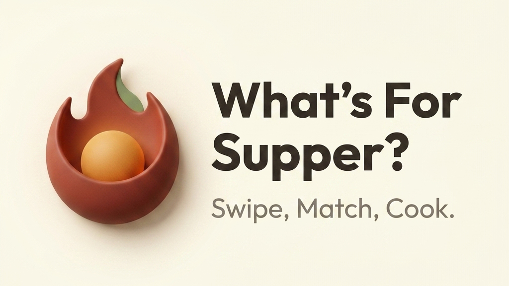
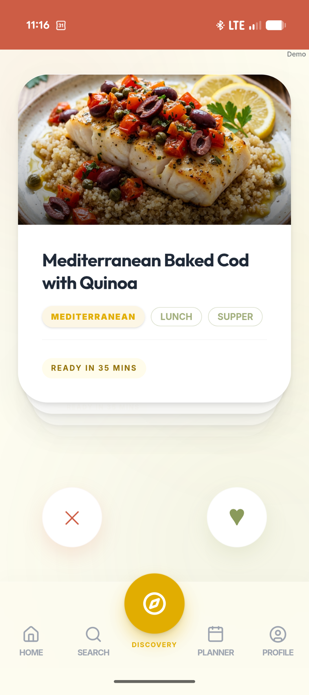
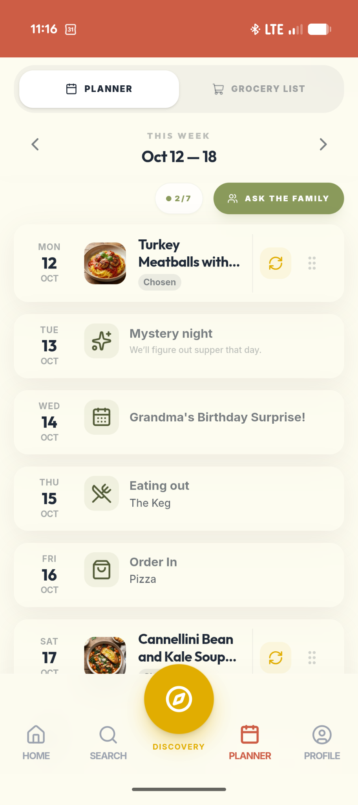
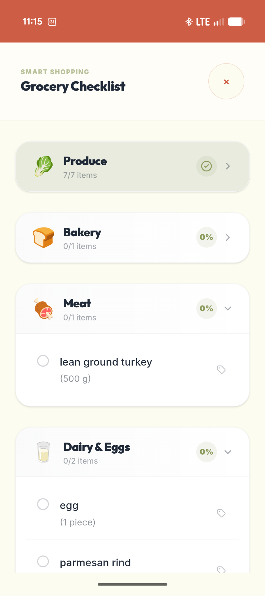
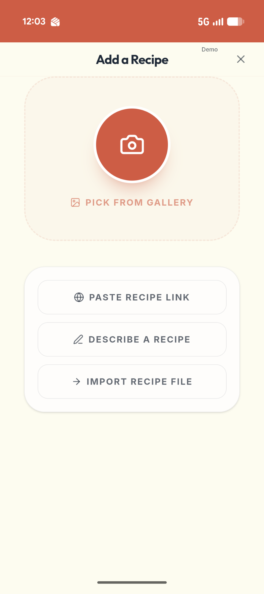
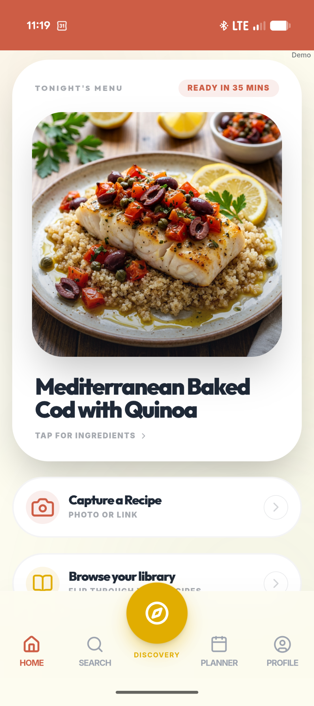
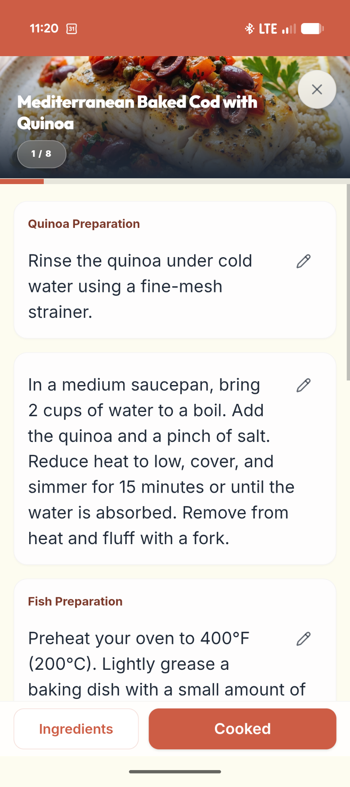

  

# What's for Supper?

**Swipe, Match, Cook!**

## A supper plan the family helps choose

What's for Supper? helps you **involve the whole family in choosing what’s for supper**. Bring your favourite recipes, weekly meal plan, and shared grocery list together in a self-hosted app for your household.

**Built by your home, for your home.** Your household curates the collection, one recipe at a time. Keep the meals you love, add new favourites, and let it grow with you.

Every household's collection will look different. Vegetarian favourites, food intolerances, a tight grocery budget, or simply different tastes. What matters is that the collection reflects the people around your table, including the recipes and traditions passed down through generations.

## From family favourites to supper on the table

- **Choose together.** Swipe and vote on recipes in Discovery, then turn those choices into the week’s supper plan. Figure out the week's meals together as a family, even when you're on the go.
- **Plan for real life.** See the week at a glance and adjust when plans change.
- **Shop from one shared list.** Planned suppers become a grocery list that stays in sync as the household shops.
- **Cook your way.** Read **All steps** or choose **Step by step** in **Cook's Mode**, or use **View original** to keep the saved recipe card beside you.
- **Find your next supper.** Browse your collection, search for a favourite, or look for similar dishes.

Have a favourite on a handwritten recipe card? Take a photo to add it to your collection. AI helps turn it into a digital recipe and can generate an image of the dish. That image is an illustration, not a photo of a meal you cooked. Check the extracted ingredients and steps against the original before cooking. You can also add recipes from a link or a short description.

Your recipe collection and meal plans are stored on your own server. AI features use Gemini; self-hosting does not mean all processing happens locally. There are no individual accounts to manage; your household shares access through a family passphrase.

## A look inside

These screenshots show the demo app. Select an image to see it at full size.

<table>
  <tr>
    <td align="center" valign="top"></td>
    <td align="center" valign="top"></td>
    <td align="center" valign="top"></td>
  </tr>
  <tr>
    <td align="center">Choose together.</td>
    <td align="center">Plan your week.</td>
    <td align="center">Shop from one list.</td>
  </tr>
  <tr>
    <td align="center" valign="top"></td>
    <td align="center" valign="top"></td>
    <td align="center" valign="top"></td>
  </tr>
  <tr>
    <td align="center">Add your family favourites.</td>
    <td align="center">See tonight’s supper.</td>
    <td align="center">Cook step by step.</td>
  </tr>
</table>

## Try the demo

[Try the demo](https://dm.srvrlss.dev) before setting it up at home. The shared demo family passphrase is **welcome-demo**.

## Run it at home

**Start with the [quick installation guide](docs/install/quick-start.md).** It walks you through downloading the matching installation package and setting up your home server.

[Latest stable release](https://github.com/AlexandreBrisebois/whats-for-supper/releases/latest) · [Docker Compose and advanced setup](release-template/synology/README.md)

**Updating an existing installation?** Read the [update guide](docs/install/updates.md), including the configuration review needed when moving from 0.1.20 to 0.1.21. Keep your existing private configuration and data.

  
  
  
  
  

## Read on

- [Family guide](docs/user-guide.md) — how planning, shopping, choosing, and cooking fit together.
- [OpenSpec specifications](openspec/specs) — canonical capability requirements; [outstanding baseline work](https://github.com/AlexandreBrisebois/whats-for-supper/issues?q=is%3Aissue+WFS-BL-+in%3Atitle) is tracked in GitHub issues with historical evidence and acceptance criteria.
- [Architecture](docs/architecture.md) — a concise technical view for contributors and operators.
- [Home server installation guide](release-template/synology/README.md) — Docker Compose setup, HTTPS configuration, and platform-specific Synology notes.
- [Local development guide](LOCAL_DEV_LOOP.md) — contributor setup and day-to-day development.
- [Feature flag development and lifecycle](docs/feature-flags.md) — reuse previews, graduate features, and retire individual flags without removing the system.
- [Contributor guide](AGENT.md) — project conventions for human and AI collaborators.

## License

This repository is source-available under the Business Source License 1.1 (BUSL-1.1).

Production use is permitted only for personal, household, or family self-hosting, as described in the [LICENSE](LICENSE).

You may not sell, resell, sublicense, host for third parties, offer as a service, or otherwise operate this project as a commercial or third-party managed service without prior written permission.

On 2030-05-11, this repository will automatically convert to the MIT License.
