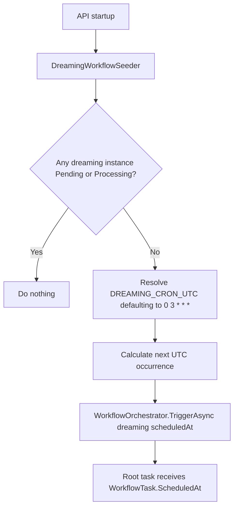
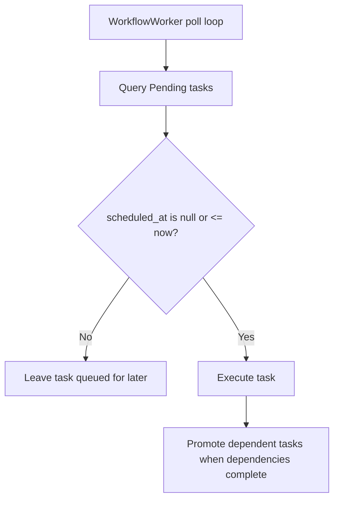
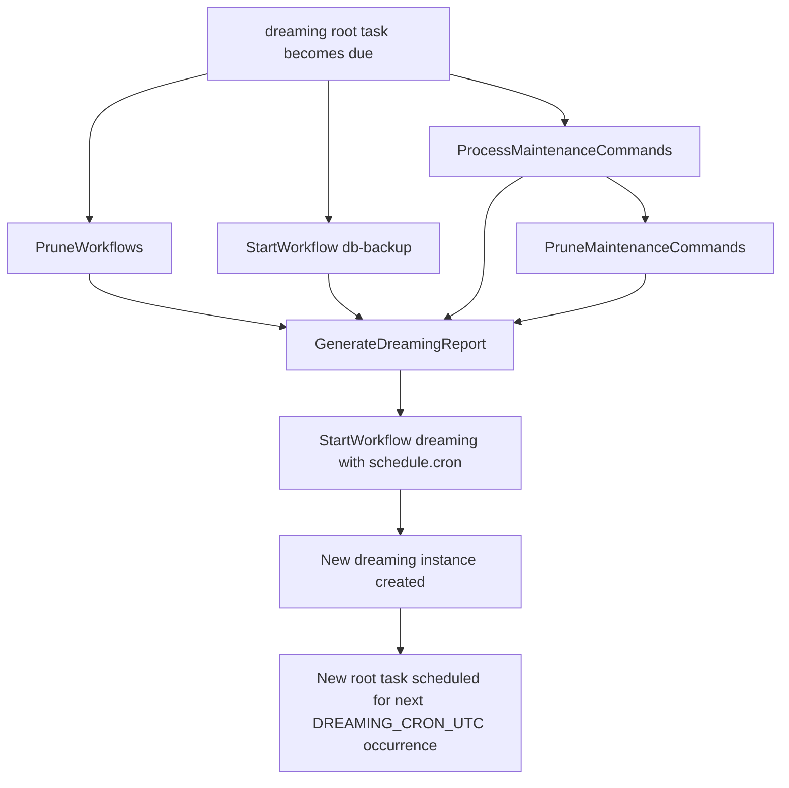

# Dreaming Maintenance Workflow Data Flow

How the recurring Dreaming workflow keeps workflow and completed maintenance-command history lean, flushes backup state to disk, and leaves a human-readable maintenance report.

## Core idea

Dreaming is not a special scheduler outside the workflow system. It is a normal YAML workflow that ends by starting a new `dreaming` workflow instance for the next configured UTC cron occurrence.

The recurring schedule is configured by:

```env
DREAMING_CRON_UTC=0 3 * * *
```

If unset, the default is `0 3 * * *` — every day at 03:00 UTC.

## Startup seed flow

On API startup, the Dreaming seeder ensures the chain exists.



## Scheduled execution flow

The worker already understands delayed task execution through `WorkflowTask.ScheduledAt`.



The workflow instance itself does not need a `scheduled_at` column. Scheduling lives on the root runnable task, matching the existing retry/backoff model.

## Dreaming workflow flow

`api/src/RecipeApi/Workflows/dreaming.yaml`



## Task responsibilities

| Task                         | Processor                    | Responsibility                                                                                                     |
| ---------------------------- | ---------------------------- | ------------------------------------------------------------------------------------------------------------------ |
| `prune`                      | `PruneWorkflows`             | Delete completed/failed workflow instances older than 7 days.                                                      |
| `backup`                     | `StartWorkflow`              | Start the existing `db-backup` workflow instead of duplicating backup logic.                                       |
| `maintenance`                | `ProcessMaintenanceCommands` | Process up to 50 due maintenance commands.                                                                         |
| `prune-maintenance-commands` | `PruneMaintenanceCommands`   | After processing, delete at most 500 completed/skipped commands whose completion time is at least 30 UTC days old. |
| `report`                     | `GenerateDreamingReport`     | Write `DATA_ROOT/reports/dreaming-yyyy-MM-dd.md`.                                                                  |
| `reschedule`                 | `StartWorkflow`              | Start a new `dreaming` instance scheduled by `DREAMING_CRON_UTC`.                                                  |

## Report output

Reports are written to:

```text
DATA_ROOT/reports/dreaming-yyyy-MM-dd.md
```

Each report includes:

- pruned workflow instance count,
- pruned workflow task count,
- pruned terminal maintenance-command count and initialized legacy timestamps,
- latest `db-backup` status,
- workflows that failed in the last 24 hours,
- workflows that have been pending or processing for more than 1 hour.

## Failure behavior

If workflow pruning, backup, maintenance processing, maintenance-command pruning,
reporting or rescheduling fails, normal workflow retry/failure behavior applies.
The report waits for command pruning, so a failed or cancelled transaction cannot
be presented as a successful deletion. Each pruning transaction either commits
its completion-time initialization and deletion together or reports no result;
later runs resume from persisted rows.

The most important failure is the final `reschedule` task. If it fails permanently, the recurring chain stops. The last report and workflow telemetry become the human-visible signal that Dreaming needs attention.

## Configuration boundary

`DREAMING_CRON_UTC` is interpreted as UTC only. Local timezone and DST behavior are intentionally out of scope for this version.

Maintenance-command retention is intentionally separate from the seven-day
workflow-history policy. The checked-in Dreaming definition uses 30 days and a
500-row batch. The inclusive cutoff is `IClock.UtcNow - retentionDays`: a terminal
row exactly at the cutoff is eligible. Pending, processing and failed rows are
never pruned by this task. A completed/skipped legacy row with no completion time
is stamped at the current run and retained for a full period; exact recovery does
the same when it invalidates queued commands. Reverting or disabling future runs
does not recreate history already deleted, and household recovery snapshots do
not promise restoration of maintenance-command rows.
