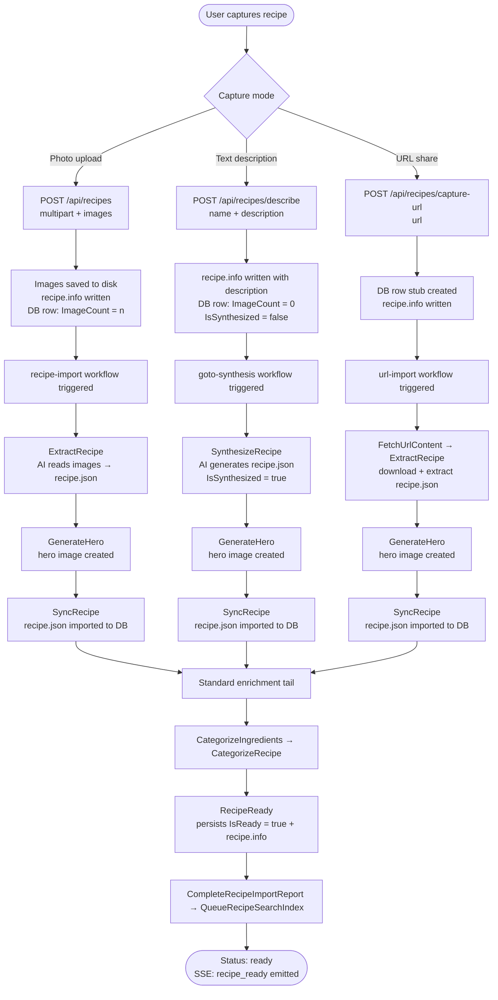

# Recipe Readiness — Data Flow

How a recipe transitions from the moment of capture (image upload or text description) all the way to `ready`.

## Domain definition

A recipe is **ready** when the full capture-to-import pipeline has completed for its path:

**Photo-upload path:**

1. User uploads images → stored in `data/recipes/{id}/original/`, `recipe.info` written, DB row inserted (`ImageCount > 0`)
2. `ExtractRecipe` — AI reads the images and produces `recipe.json`
3. `GenerateHero` — hero image created
4. `SyncRecipe` — `recipe.json` imported to DB (name, ingredients, metadata)
5. `CategorizeIngredients` — LLM normalises ingredient names to grocery sections
6. `CategorizeRecipe` — classifies cuisine, meal types, vegetarian confirmation
7. `RecipeReady` — persists `IsReady = true`, updates `recipe.info`, emits `recipe_ready`
8. `CompleteRecipeImportReport` — closes any linked import report
9. `QueueRecipeSearchIndex` — enqueues background search document/embedding indexing

**Describe path (goto-synthesis):**

1. User submits name + description → `recipe.info` written with description, DB row inserted (`ImageCount = 0`, `IsSynthesized = false`)
2. `SynthesizeRecipe` — AI generates full `recipe.json` from description; sets `IsSynthesized = true`
3. `GenerateHero` — hero image created
4. `SyncRecipe` — `recipe.json` imported to DB (name, ingredients, metadata)
5. `CategorizeIngredients` — LLM normalises ingredient names to grocery sections
6. `CategorizeRecipe` — classifies cuisine, meal types, vegetarian confirmation
7. `RecipeReady` — persists `IsReady = true`, updates `recipe.info`, emits `recipe_ready`
8. `QueueRecipeSearchIndex` — enqueues background search document/embedding indexing

**URL import path:**

1. User shares a recipe URL → DB row stub created, `recipe.info` written
2. `FetchUrlContent` — downloads page, extracts schema.org JSON-LD / readable content
3. `ExtractRecipe` — AI normalises extracted content into `recipe.json`
4. `GenerateHero` — hero image created
5. `SyncRecipe` — extracted metadata imported to DB
6. `CategorizeIngredients` — LLM normalises ingredient names to grocery sections
7. `CategorizeRecipe` — classifies cuisine, meal types, vegetarian confirmation
8. `RecipeReady` — persists `IsReady = true`, updates `recipe.info`, emits `recipe_ready`
9. `CompleteRecipeImportReport` — closes any linked import report
10. `QueueRecipeSearchIndex` — enqueues background search document/embedding indexing

## Persisted readiness

`RecipeReadyProcessor` sets `recipes.is_ready = true` in PostgreSQL (along with `IsDiscoverable`, `RotationSource`, duplicate checks, and `recipe.info`'s `isReady`), and `GET /api/recipes/{id}/status` (`RecipeService.GetRecipeStatus`) reads `recipe.IsReady` directly.

## Full flow — capture to ready

All three import workflows share the same enrichment tail that runs **after** the recipe is synced to the database:

```
→ CategorizeIngredients      (LLM: normalise ingredient names into grocery sections)
→ CategorizeRecipe           (classify cuisine, meal types, vegetarian facts)
→ RecipeReady                (persists IsReady = true, updates recipe.info, emits SSE recipe_ready)
→ CompleteRecipeImportReport (recipe-import and url-import)
→ QueueRecipeSearchIndex     (enqueues search-index workflow)
```

`recipe-description-regeneration` does not run `CategorizeIngredients` or
`RecipeReady`.



## RecipeReadyProcessor

`api/src/RecipeApi/Services/Processors/RecipeReadyProcessor.cs`

Sets `recipe.IsReady = true`, updates `IsDiscoverable` / `RotationSource`, checks for suspected duplicates, writes `isReady` to `recipe.info`, and emits `recipe_ready`.

## Status query

`GET /api/recipes/{id}/status` → `RecipeService.GetRecipeStatus()` reads `recipe.IsReady` directly and returns `RecipeStatusDto { Id, Name, Status, ImageCount, IsSynthesized }`.

## Enrichment processors

| Processor                    | Workflow(s)                               | What it writes                                              |
| ---------------------------- | ----------------------------------------- | ----------------------------------------------------------- |
| `CategorizeIngredients`      | recipe-import, url-import, goto-synthesis | Grocery section per ingredient into `ingredient_categories` |
| `CategorizeRecipe`           | recipe-import, url-import, goto-synthesis | Cuisine, meal types, and vegetarian classification          |
| `RecipeReady`                | recipe-import, url-import, goto-synthesis | Sets `IsReady = true`, updates `recipe.info`, emits SSE     |
| `CompleteRecipeImportReport` | recipe-import, url-import                 | Resolves open import report if triggered from repair        |
| `QueueRecipeSearchIndex`     | recipe-import, url-import, goto-synthesis | Enqueues background `index-recipe-search` workflow          |
