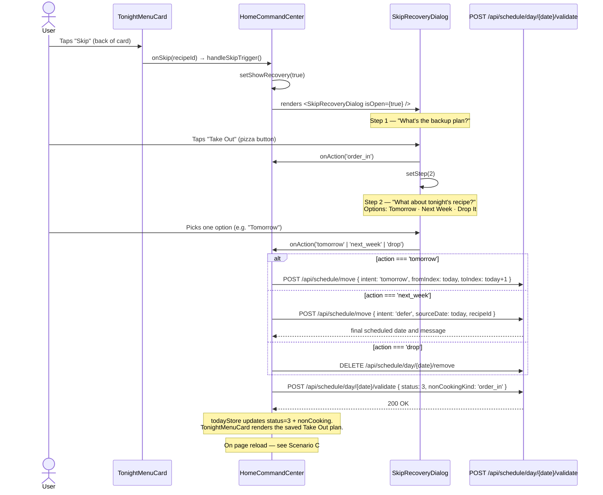
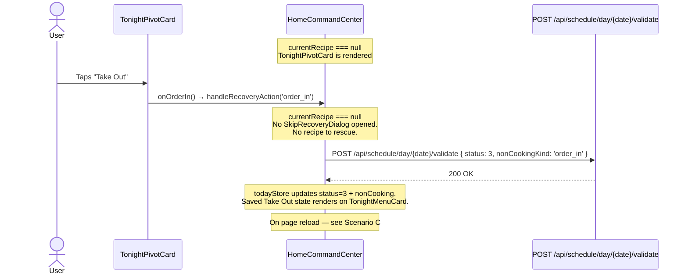
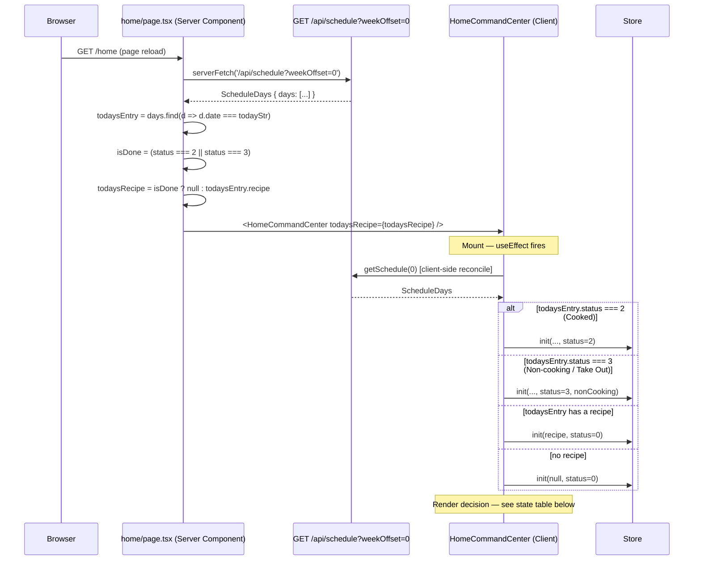

# Take Out Flow

**What's for Supper — PWA**
Documents the two paths a user can take to log a "Take Out" night, plus how that state persists across a page reload via SSR.

---

## Scenario A — Take Out from TonightMenuCard (recipe is planned)

The user has a recipe scheduled for tonight. They open the ingredient flip-side of the card and tap **Skip**.

> **Note on `status: 3`:** The validate call with `status: 3` (Skipped) is made for the "Take Out" branch regardless of which recipe-rescue option the user picks. The recipe-rescue action (tomorrow / next_week / drop) runs first. For **Next Week**, the server starts on the following Monday and chooses the first date without a calendar entry; when that week is full, it continues into later weeks and returns the final destination message.

---

## Scenario B — Take Out from TonightPivotCard (no recipe planned)

The user has no recipe scheduled tonight. The pivot card is already showing. They tap **Take Out** directly.

> **Key difference from Scenario A:** Because `currentRecipe === null`, the `if (currentRecipe)` guard in `handleRecoveryAction` is false — the validate call still fires (status 3 is always written), but no recipe-rescue dialog or move call is made.

---

## Scenario C — State Persistence via SSR

Shows how `home/page.tsx` reads today's schedule status on the server and how `HomeCommandCenter` initialises its local state from that on mount.

---

## State Decision Table

What `HomeCommandCenter` renders for each `todayStatus` value via `todayStore`:

| `todaysEntry.status`          | `nonCooking`        | Card shown                                                         |
| ----------------------------- | ------------------- | ------------------------------------------------------------------ |
| `0` — Draft (recipe assigned) | `null`              | **TonightMenuCard** (planned recipe)                               |
| `0` — Draft (no recipe)       | `null`              | **TonightPivotCard** (empty / Go-To prompt)                        |
| `2` — Cooked                  | `null`              | **CookedSuccessCard**                                              |
| `3` — Non-cooking plan        | `order_in` / etc.   | **TonightMenuCard** (saved non-cooking plan + `Edit supper plan`)  |
| `3` — Mystery night (empty)   | `mystery`           | **TonightPivotCard** (saved Mystery night without ready suggestion)|
