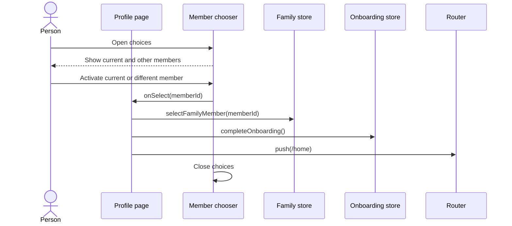

# Flow: "Table's Set!" — Profile Member Selection

## Purpose

Profile displays the current household member and lets a person choose the current
member again or switch to another member. Its reading order is the title and
Settings, the member chooser, then language controls. The titles remain exactly
`Table's Set!` in English and `À table !` in French. There is no instructional
subtitle or separate Continue-as action, including while loading or when the
selected ID does not match a loaded member.

## Member chooser states

| State | Presentation and available actions |
|---|---|
| Loaded selected member | The chooser displays the member's complete name and a localised active-member label. Opening it exposes the household choices and marks the current member with a check and accessible current-member state. |
| Family loading | A stable placeholder provides a localised loading description. Settings and available language controls remain usable. |
| No matching selected member | The chooser displays `Select member` or `Choisir un membre`, without inventing an active name. Settings and language controls remain available. |
| Open chooser | Choices scroll when necessary. Keyboard users can reach each choice; Escape closes the chooser and returns focus to its trigger. |

Opening Profile does not navigate automatically. Toggling the chooser closed,
clicking outside it or pressing Escape dismisses choices without requesting member
selection, completing onboarding or navigating.

## Selection and Home

Both current-member and different-member choices invoke the same page callback.
Choosing the current member requests selection again, marks onboarding complete
and requests Home. It is not a navigation-only shortcut. The chooser closes after
invoking the callback. Settings requests `/profile/settings`.

The page does not await the asynchronous selection request before requesting Home.
These calls describe the implementation; they do not guarantee cookie handoff,
request ordering at the server, durable identity or successful Home initialization.
Mocked browser acceptance verifies the selection request and Home navigation, not
live cookie durability, PostgreSQL persistence or SSE reconnection. Those require
separate integration qualification.

## Language preference

Both language buttons retain their selected-state cues. With a selected member,
changing language uses the existing preference request. Without a selected member,
the language choice remains browser-local and makes no preference update. A
rejected preference save retains the existing reconciliation behavior and makes
no saved claim. Removing the subtitle and separate action does not change this
policy.

## Layout and accessibility acceptance

The existing cream canvas, rounded surfaces and control styling remain. Complete
member names wrap at narrow widths and enlarged text. Settings, the chooser and
both language controls retain their touch targets and keyboard reachability above
or through scrolling past fixed navigation. Overflowing choices remain scrollable.
Reduced motion retains loading and expanded-state information without entrance
staging or chooser animation.

## Test evidence boundaries

| Scenario | Owner |
|---|---|
| Exact EN/FR loaded titles, no subtitle or separate action, retained controls | `pwa/e2e/profile.spec.ts` |
| Loading and unmatched-member composition | Adjacent Profile page unit test and isolated real-page browser fixture in `profile.spec.ts` |
| Current/different-member selection and Home request; dismissal without selection/navigation | `profile.spec.ts`, Profile page and dropdown unit tests |
| Language success, rejection and local-only choice | `profile.spec.ts` and language-selection unit tests |
| Narrow/tablet viewports, long names, 200% text, keyboard and reduced motion | `profile.spec.ts` |

The unselected/loading browser fixture deliberately mounts the real page outside
the production identity guard. It qualifies the rendered state and client seams,
not first-use production routing. Screenshots support browser layout inspection;
they do not establish physical-device behavior or live identity guarantees.
