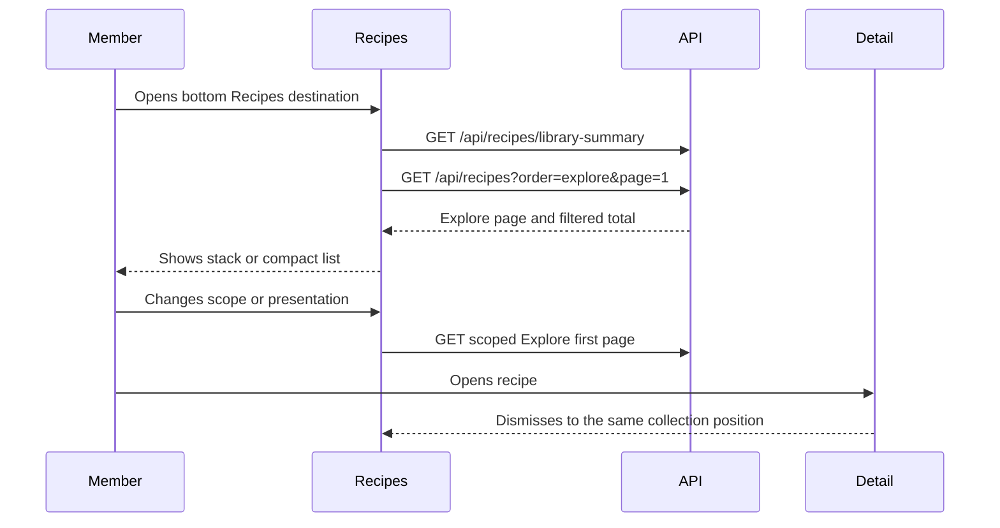

# User Flow: Recipe Library Browse

The Recipes destination at `/recipes` opens the household library in Explore order. It begins with Search controls collapsed, All scope, and the selected member's saved stack or list presentation. The bottom app navigation stays visible. Search is the first toolbar action, followed by All/Discovery, Go-To, stack/list, and Recycle bin.

Explore retains its complete pagination and history behavior. Stack pages contain 20 recipes; list pages contain 12. Both directions traverse full and partial pages. The stack wraps at the collection ends; list scrolling loads further pages. Pending or failed page retrieval retains the current card, and history expiry offers a restart. The selected member's presentation preference is saved through the existing preference API.

All/Discovery and Go-To filter the library without changing its Explore order. The Go-To toolbar star filters membership; the star on a recipe detail changes membership. Discoverability controls remain separate from the bottom Discovery voting journey.

Opening Search reveals its controls below the toolbar without changing the current collection by itself. The controls can be hidden while the Recipes session remains mounted. Leaving Recipes ends the transient session; a normal return starts fresh in Explore with the saved presentation.
