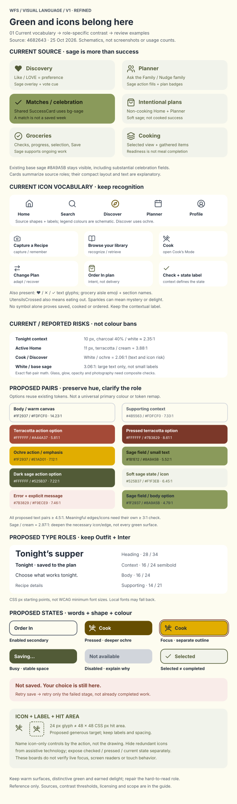

# Solar Earth visual language · v1

**Review reference, not an implementation specification.** This guide makes design
intent visible without changing the app, its palette, components or behavior.
Read it on demand for visual decisions; it is not a new startup requirement.

Source snapshot: [`ba8dca2`](https://github.com/AlexandreBrisebois/whats-for-supper/tree/ba8dca21c83000d03ce03dbe51bd7542daa76b88),
25 October 2026. **Current** means verified in source unless explicitly described
as observed or reported. **Proposed** means a reviewable visual/copy choice, not
shipped UI or permission to implement it. The boards are schematic, not screenshots.

## Start with the pictures

[Open board 1 at full size](visual-language/01-roles-type-states.svg).

*Board 1: keep the warm cream, terracotta, ochre and sage identity; change the role
or existing shade when a foreground/background pairing cannot carry its meaning.
The font specimens use Outfit/Inter when available and system fallbacks otherwise;
they are not font-fidelity proofs. Current control specimens simplify geometry.*

[Open board 2 at full size](visual-language/02-home-state-map.svg).

*Board 2: proposed hierarchy over source-verified state meanings, with a deliberately
separate conceptual suggestion. Cards omit imagery/navigation and simplify current
placement: Cook and Change Plan currently sit on the recipe card's reverse;
Edit supper plan is currently the accessible intent of the whole non-cooking card,
not a separate visible button. Sample recipe/context text is illustrative copy.*

## Seven principles for consistent decisions

1. **Lead with the truth about the task.** Make tonight's state, the next action and
   its consequence visible before decoration. A candidate, a saved meal and a
   cooked meal are different facts. Success should let the household leave.
2. **Assign colour a job, not a personality test.** Cream is the warm canvas;
   charcoal carries reading; terracotta identifies action; ochre adds emphasis;
   sage supports positive status. Pair state with words/icons, not colour alone.
   The same hue can serve different roles when the context remains unambiguous.
3. **Choose readable pairs, not attractive swatches.** Measure actual text and
   control states on their composite backgrounds. Reuse darker existing variants
   before inventing colours. Pale surfaces can stay; faint essential text cannot.
4. **Use type to explain hierarchy.** Preserve Outfit headings and Inter body/data.
   Prefer sentence case and clear context over tiny, tracked all-caps labels.
   Visual size is not semantic heading level; the document outline still matters.
5. **Make controls look as available as they are.** Enabled secondary actions are
   not disabled actions. Distinguish pressed, selected, busy, unavailable and error
   with the relevant label, shape/edge and feedback; keep controls stable while busy.
6. **Design for hands and changing space.** Prioritize iPhone, Pixel and iPad touch
   use, text growth and safe areas before incidental desktop polish. Content should
   wrap and remain reachable rather than shrink to fit a fixed card.
7. **Say what happens, in both languages.** Use familiar action verbs, preserve
   meaningful choices, explain partial completion, and avoid promises the product
   cannot substantiate. English and French need equivalent meaning, not equal length.

These are WFS recommendations informed by the official references below, not an
import of another brand's visual style or a claim of accessibility certification.
They support the [North Star](creative-direction-north-star.md) and
[designer judgment](agent-designer-identity.md), which retain their existing roles.

## Colour and type: how to use board 1

All proposed values already exist in [globals.css](../pwa/src/app/globals.css).
These are **role recommendations**, not new runtime tokens or blanket replacements.

| Proposed role | Foreground / background | Ratio |
|---|---|---:|
| Body on warm canvas | charcoal `#1F2937` / cream `#FDFCF0` | 14.23:1 |
| Supporting context | charcoal-600 `#4B5563` / cream | 7.33:1 |
| Primary action label | white / terracotta-600 `#A44A37` | 5.81:1 |
| Pressed action label | white / terracotta-700 `#7B3829` | 8.61:1 |
| Ochre emphasis label | charcoal / ochre `#E1AD01` | 7.12:1 |
| Positive status | sage-700 `#525B37` / sage-50 `#F1F3EB` | 6.45:1 |
| Error with explicit message | terracotta-700 / terracotta-50 `#F9ECE9` | 7.46:1 |

Ratios use WCAG sRGB relative luminance, `(Llighter + .05)/(Ldarker + .05)`,
rounded to two decimals **after** comparison. The opaque pairs above clear 4.5:1.
Normal text needs **4.5:1**; large text needs **3:1** (at least 18 pt regular or
14 pt bold, approximately 24 / 18.67 CSS px). A 10 or 11 px bold label is not large.
Meaningful control boundaries, state indicators and graphical objects need **3:1**
against adjacent colours where WCAG 1.4.11 applies; not every decorative card border
does. Text contrast does not prove non-text contrast or overall conformance.

For example, terracotta-600 against cream is 5.63:1, but ochre against cream is only
2.00:1. If an ochre control needs its boundary to identify it, give it an appropriate
contrasting edge; charcoal text alone does not fix that edge. The board's proposed
secondary control uses charcoal-600 for text and edge. The separated terracotta-700
focus outline is a visual recommendation, not evidence of implemented keyboard support.

**Current risks, not a ban on brand colours:** the supplied Demo 0.1.25 inspection
reported Tonight context at 10 px/900, charcoal 40% on white (2.35:1); active Home at
11 px, terracotta on cream (3.88:1); and enabled Cook at 10 px, white on ochre
(2.06:1). Source classes corroborate those roles. The independent opaque calculations
reproduce the latter two ratios; compositing charcoal at 40% over white also yields
approximately 2.35:1. These are below the normal-text threshold. The reported 30 px
charcoal recipe title on white is 14.68:1: preserve that strength. A different
viewport, overlay or glass background requires a new measurement.

**Proposed type starting points:** heading 28/34, context 16/24 semibold, body 16/24,
supporting text 14/21 (size/line height in CSS px). These are review examples, not
minimum WCAG font sizes or a replacement scale. Current `globals.css` owns body
line height 1.5 and heading line height 1.2; components also override these. Verify
long recipe names, larger text and French wrapping before adopting a role.

**States to review where applicable:** default, hover on pointer devices, pressed,
focus, selected, busy, disabled, success and error. Inactive controls have contrast
exceptions in WCAG, but should still be understandable with a reason. Do not use
the disabled exception for an enabled Order In control. For busy/error states,
retain the action's place and describe the actual stage; do not manufacture success.

## Home: preserve meanings while discussing visual hierarchy

Source-verified behavior is owned by the Home components and Today store below;
[tonight-meal-decisions](../openspec/specs/tonight-meal-decisions/spec.md) owns its
approved requirements. Board 2 is a discussion aid, not a new state machine.

- **Unplanned:** no assigned recipe. A ready GOTO offers **Make This Tonight**;
  preparing/checking/no-GOTO variants are distinct. **Quick Find** opens recipe
  selection, not a cooking-duration filter ([issue #338](https://github.com/AlexandreBrisebois/whats-for-supper/issues/338)).
  Existing labels such as **Find Something Quick** do not establish a quick-cook guarantee.
- **Suggested:** the dedicated suggested Home card is **conceptual only**. Current
  GOTO availability and pending replacement choices must not be confused with a
  confirmed assigned meal. The proposed **Choose for tonight** label is not current copy.
- **Saved / planned:** **Cook** opens Cook's Mode; it does not mark cooked on entry.
  **Change Plan** opens recovery. The current localized backup choice is **Find
  Something Quick** (the source fallback says **Pick Something Else**); then the
  original meal's disposition is resolved before a retained replacement is saved.
  Partial failure distinguishes completed disposition from an unsaved or unknown
  replacement. **Retry save** and **Retry check** are not interchangeable.
- **Non-cooking:** **Order In** records a non-cooking intention, not a blank night
  and not a food-delivery order. With no recipe the current handler updates locally
  while status validation runs in the background; local appearance is not proof of
  persistence. With a planned recipe, recovery asks what happens to the original.
  The non-cooking Home card opens Planner; **Leave this day unplanned** is Planner's
  separate blank-day action. Mystery night still offers supper choices on Home.
- **Cooked:** the success card offers **Dismiss**; dismissing compacts it without
  undoing cooking. The compact badge can reopen Cook's Mode. Do not imply all
  planning or household work is complete.

Anonymous designer feedback reported that Capture and Browse were clear, but Home
context was confusing, Order In looked disabled and yellow/light-grey treatments
were hard to read. This guides the examples; it is not a representative user study.
Preserve **Capture a Recipe** and **Browse your library** as recognizable routes,
not new required steps. Do not claim ingredient inventory from a saved plan: existing
recovery copy saying “We have the ingredients” is not evidence of stock knowledge.

## Mobile application and bilingual review

These are **proposed review targets**, not completed app checks:

- Use a generous **48 × 48 CSS px** touch-target starting point for primary and
  secondary actions, with separation and room for wrapped labels. WCAG 2.5.8's
  24 × 24 CSS px floor has exceptions; Apple recommends 44 × 44 **pt**, Android
  48 × 48 **dp**. The units and guidance are not interchangeable.
- At narrow widths, prefer one clear reading column. Check 320 CSS px reflow,
  200% text enlargement, long content and iPad portrait/landscape rather than
  scaling a desktop composition down. Current root viewport settings restrict
  user zoom; this reference does not claim the app already supports those checks.
- Reuse current safe-area utilities and navigation inset handling. Keep essential
  sheet actions above the keyboard/home indicator, and let content scroll without
  clipping the title, error or recovery action. Keep close/cancel intent explicit;
  recovery dismissal must respect pending and partially completed work.
- Glass, rounded cards and food imagery remain Solar Earth strengths. Place essential
  text on a stable readable surface; test the worst composite, not only a flat swatch.
  Reuse established motion; avoid motion as the only status signal.
- Keyboard implementation work is deferred in this touch-first review, not removed
  from the chosen WCAG target. Contrast is not deferred. Static boards verify neither
  focus order nor keyboard/screen-reader interaction.

| Content example | English | French | Status |
|---|---|---|---|
| Cook action | Cook | Cuisiner | Current locale values |
| Change intention | Change Plan | Changer le plan | Current locale values |
| Non-cooking action | Order In | Commander | Current; clarify it records a plan, not an order |
| Blank day | Leave this day unplanned | Laisser cette journée sans plan | Current Planner copy |
| Unsaved suggestion | Suggestion — not saved | Suggestion — non enregistrée | Proposed; language review required |
| Clearer recipe search | Choose another recipe | Choisir une autre recette | Proposed alternative, not a duration claim |

Allow French expansion and preserve the complete action instead of truncating it.
Locale files own implemented strings; several Home strings remain hard-coded.
This guide does not assert bilingual completeness or change any copy.

## Ownership and keeping the reference useful

| Canonical owner | What it owns |
|---|---|
| [globals.css](../pwa/src/app/globals.css), cross-check [tailwind.config.ts](../pwa/tailwind.config.ts) | Implemented colours, utility surfaces, safe areas and theme configuration |
| [Root layout](../pwa/src/app/layout.tsx) | Outfit/Inter loading and viewport setup |
| [Button primitive](../pwa/src/components/ui/button.tsx), [common re-export](../pwa/src/components/common/Button.tsx) | Existing shared button variants; not all Home controls use them |
| [Navigation](../pwa/src/components/common/Navigation.tsx) | Navigation appearance, active state and bottom inset |
| [HomeCommandCenter](../pwa/src/components/home/HomeCommandCenter.tsx), [todayStore](../pwa/src/store/todayStore.ts) | Current Home branches and action orchestration / Today state |
| [TonightMenuCard](../pwa/src/components/home/TonightMenuCard.tsx), [TonightPivotCard](../pwa/src/components/home/TonightPivotCard.tsx), [HomeSections](../pwa/src/components/home/HomeSections.tsx) | Recipe/reverse card, unplanned/GOTO choices, Capture/Browse/success |
| [SkipRecoveryDialog](../pwa/src/components/home/SkipRecoveryDialog.tsx) | Recovery presentation and stage-specific feedback |
| [English](../pwa/src/locales/en/common.json), [French](../pwa/src/locales/fr/common.json) | Localized strings, not proof every component uses them |

Maintain this guide with the affected designer/component owner when an accepted
visual decision changes its examples. Record the date, source and **Current** or
**Proposed** status; document intentional exceptions with their reason rather than
silently copying an old board. Runtime owners and approved specifications win if
this snapshot drifts. No new governance, framework, Storybook dependency, global
palette change or mandatory reading cascade is introduced.

Before an implementation decision, review the relevant board, state meaning,
actual pair/state measurements, small-screen/text-growth behavior and EN/FR copy.
Then seek the applicable implementation approval. This PR changes documentation
and static reference assets only; it is not acceptance evidence for a live redesign.

## Official grounding

Reviewed 25 October 2026. Use the practices, not another system's brand assets.

- GC Design System: [colour roles and accessible use](https://design-system.canada.ca/en/styles/colour/),
  [typographic hierarchy](https://design-system.canada.ca/en/styles/typography/),
  [buttons](https://design-system.canada.ca/en/components/button/) and
  [button content/design guidance](https://design-system.canada.ca/en/components/button/design/).
- Canada: [build accessibility in from the start](https://www.canada.ca/en/government/system/digital-government/government-canada-digital-standards/build-accessibility-start.html).
- W3C WCAG 2.2: [text contrast](https://www.w3.org/WAI/WCAG22/Understanding/contrast-minimum.html),
  [non-text contrast](https://www.w3.org/WAI/WCAG22/Understanding/non-text-contrast.html),
  [not colour alone](https://www.w3.org/WAI/WCAG22/Understanding/use-of-color.html),
  [target size](https://www.w3.org/WAI/WCAG22/Understanding/target-size-minimum.html),
  [reflow](https://www.w3.org/WAI/WCAG22/Understanding/reflow.html) and
  [resize text](https://www.w3.org/WAI/WCAG22/Understanding/resize-text.html).
- Apple: [touch and legibility tips](https://developer.apple.com/design/tips/) and
  [layout and safe areas](https://developer.apple.com/design/human-interface-guidelines/layout).
  Android: [accessible touch targets](https://developer.android.com/develop/ui/compose/accessibility/api-defaults).

WCAG 2.2 AA is the project's chosen web target. These partial contrast calculations
and static illustrations establish neither whole-app conformance nor legal compliance.
