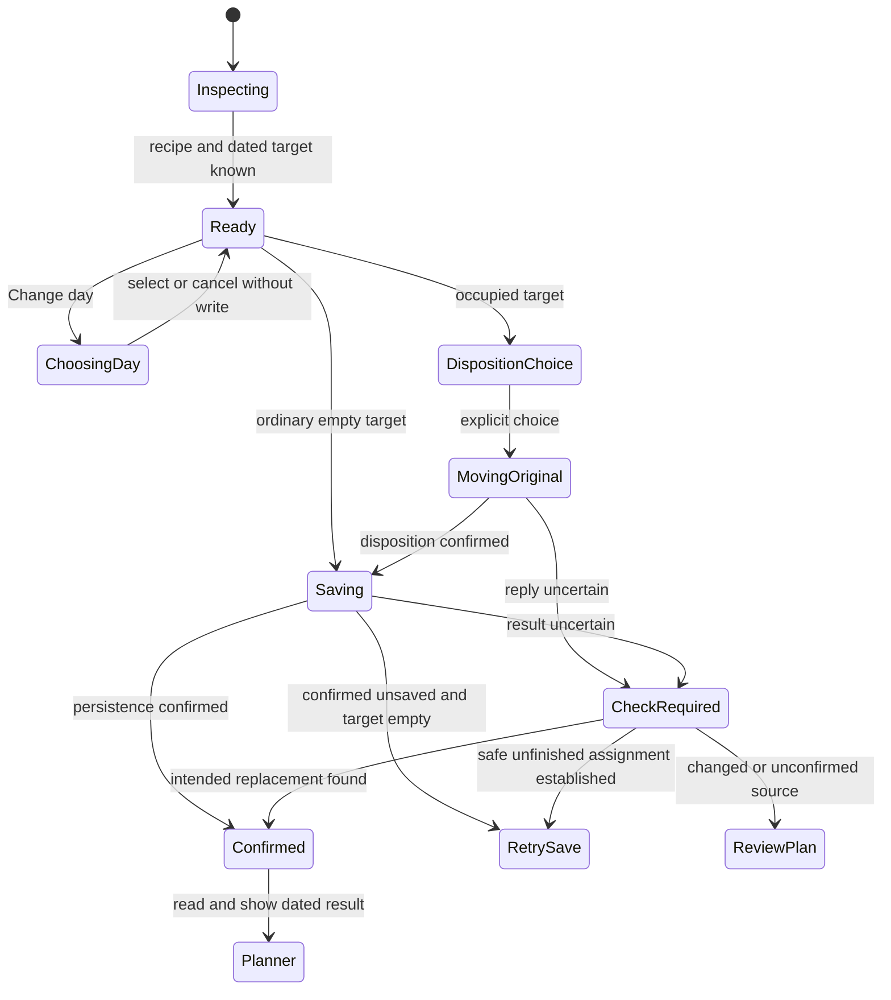

# Design

## Context and Existing Ownership

The [proposal](proposal.md) bounds the change. This document consolidates the conversation and turns the accepted journey into implementation slices; it is not evidence of a rendered redesign or implementation approval.

### Decision recap

| Topic | Direction | Decision status |
|---|---|---|
| Main outcome | Find a recipe, act without searching for the action, finish and return to family | Explicit user priority |
| Reading | Ingredients and instructions together; Cook's Mode remains separate | Explicit user choice |
| Primary library action | Add to meal plan, not starting cooking | Explicit user choice |
| Rating | Near the title, optional, visibly operable | User preference; existing recipe-level semantics preserved |
| Known destination | Preserve the Planner/Home-selected day through Search | Included in the accepted proposition |
| Free library entry | Suggest Tonight if empty, otherwise next open date; show it before saving; allow Change day | Combined user choices and accepted proposition |
| Finish | Open chosen Planner day with clear recipe/date confirmation | Explicit user choice |
| Original recipe | Following day, Next Week, or remove from that day; select replacement first | Accepted after current-flow review |
| Full next week | Continue to next available date; confirm actual date and spillover | Explicit user choice |
| Non-cooking plans | Skip automatically; ask before explicitly replacing | Explicit user choice |
| Visual character | Existing Solar Earth refined family cookbook; no new theme or fonts | Requested repo visual language |
| Presentation | Full-screen phone, bounded spacious tablet/desktop dialog; notes after instructions with a Family notes shortcut when present | Presentation to assess in mockups; notes shortcut explicitly agreed |
| Family features | GOTO near title, distinct appreciation, existing Ask the Family toggle and wording preserved in stack/detail | Explicit review decisions |
| Conditional removal | Add a small optional precondition to protect stale recovery deletes | Engineering proposal from this planning pass, not an earlier user-selected feature |

### Source-observed current behavior

- `pwa/src/components/recipes/RecipeDetailSheet.tsx`: a 90vh inset dialog, 16:9 hero, ingredients beside notes/rating on wide screens, Steps opening `CooksMode`, and a bottom Cook This pivot. Its planning catch displays calendar errors but logs other errors. Its header has GOTO, Share, gear and Close.
- `pwa/src/app/(app)/recipes/RecipesExperience.tsx`: explicit Planner target survives Search; ordinary Cook Tonight targets today; Plan for Later scans from tomorrow. Both use `slotAssignment.assignRecipeToEmptySlot`, which currently does not pass `requireEmpty=true`. Search recovery awaits disposition but does not generally retain completed stages.
- `pwa/src/app/(app)/planner/page.tsx`: replacement uses exact-source defer for Next Week and remembers completed disposition. Standalone Save for Next Week still uses bounded cross-week push. Planner-open detail supplies an empty planning callback.
- `pwa/src/components/home/HomeCommandCenter.tsx`: its Pick Something Else recovery retains disposition/save stages, reconciles unknown persistence and uses guarded `todayStore.saveRecoveryRecipe`. Preserve that behavior and its existing direct-Home return conventions.
- `pwa/src/lib/planner/slotAssignment.ts`: Tomorrow suppresses duplicate/uncertain replay. Next Week selects either defer or legacy push according to the caller. Date deletion currently carries no expected-plan precondition.
- `api/src/RecipeApi/Services/ScheduleService.Tomorrow.cs`: atomic exact-source chain shift through supper gaps across weeks, with Cooked/consensus rejection and separate moved/refreshComplete results. Keep the algorithm.
- `ScheduleService.MoveCrossWeekAsync` returns no movement on a full target week; the controller can still return a “Recipe moved” message. Search recovery does not check a committed destination before assigning. This establishes a control-flow risk; meal loss has not been reproduced in this session.
- `ScheduleService.DeferRecipeAsync` starts at an explicit relative destination week, skips stored entries, continues into later weeks and returns scheduledDate/scheduledWeekOffset. Delete and defer follow-ups can fail after persistence; a rejected response alone does not prove no change.
- `pwa/src/lib/cooking/stepParser.ts` already parses string steps, flat HowToStep and HowToSection arrays. Recipe detail already receives recipeInstructions. Reuse these representations rather than add an extraction API or a second interpretation.

Current inspection started from a clean worktree. The separate `integrate-client-journey-telemetry` change is outside this scope. Local browser access reached onboarding with a profile-load 404; no complete live journey or mobile visual assessment is claimed.

## Decisions and Tradeoffs

### One destination and one primary action

Pass an explicit detail context: selected recipe, origin, optional source Planner date, and optional target reference/week/day. Keep the primary action reachable outside the reading scroller. When a target exists, resolve and display its full local date. Invalid partial URL context shows correction/retry, never an implicit Tonight write. Legacy valid links without a reference obtain one from the authoritative calendar before becoming actionable.

For untargeted entry, reuse calendar/schedule reads and existing first-open traversal, including Tonight. An automatic candidate is a future-or-today ordinary empty supper with no persisted supper entry; the proposed removalToken distinguishes persisted content from an absent supper entry. Skip recipe, non-cooking, cooked and consensus content. A failed/missing week cannot prove the first available date, so recommendation stops with retry. Retain the existing 520-week bound and offer Choose day on exhaustion. Do not copy recommendation, affinity or search eligibility policy into the PWA.

The alternative of always opening a calendar adds a decision to every empty-day path; silently assigning the first available day hides consequences. Showing a dated suggestion combines the accepted shortcuts with explicit choice. Recommendation and recipe reads can proceed independently; a slow calendar read must not hide the recipe.

Day chooser shows the current week and existing plans, with week navigation and full localized dates. Selecting a day updates the visible action; it does not save. Cancelling retains the previous target and recipe. If the selected recipe already occupies that date, show Already planned, View plan and Change day; no write. Cooked/consensus targets route to review rather than resetting state. Planner-origin reading identifies its source date, prioritises Cook's Mode and offers a working Plan another day path, not a no-op callback.

### Reuse staged recovery instead of another planning engine

Keep visual presentation in `SkipRecoveryDialog` and orchestration in a cohesive recovery owner extracted from Home's existing session only to the extent shared callers need it. A session captures reference Monday, source date/identity/state, replacement, disposition choice, confirmed destination and acknowledged stages. Home, Planner and Recipes supply adapters for local reconciliation and completion navigation. Business movement stays server-owned; avoid a generic workflow framework or a second store reimplementing schedule policy.

All Next Week UI callers use exact-source defer starting the source offset plus one. Do not change legacy swap/push APIs or drag behavior. Require a valid returned destination before progressing. Tomorrow uses its existing operation, including source-next-day rather than wall-clock tomorrow for future dates. Drop explicitly removes only the selected day, retaining the recipe library record. Choosing a non-cooking date offers confirmation and another-date escape, not recipe-disposition choices for a nonexistent recipe.

### Guard removal as well as the subsequent assignment

Guarded assignment already prevents the final write from overwriting a competing supper. A pre-read alone cannot protect date-only deletion of the old plan: another member could change that date between read and DELETE. Propose the following additive contract rather than claim a safety guarantee the current API cannot provide:

| Boundary | Proposed addition / retained contract |
|---|---|
| Schedule day DTO | Optional nullable `removalToken`; populated for a persisted supper entry, null for absence; unrelated meal slots do not supply a supper token |
| Token representation | Server-generated `v1.` plus base64url SHA-256 of a canonical persisted supper snapshot including event ID/date/slot, recipe, status, non-cooking kind/label, votes and candidate content. Clients treat it as opaque. No token storage or schema migration. |
| `DELETE /api/schedule/day/{date}/remove` | Optional bounded `expectedPlanToken` query; malformed supplied token returns 400; valid stale/missing source returns 409; matching source is removed atomically; omitted token retains legacy behavior |
| Atomic boundary | Compare the current source fingerprint and delete in a relational transaction that detects a concurrent source change; map serialization conflicts to 409. Keep grocery/publication follow-ups outside the committed deletion. |
| Defer | Existing exact sourceDate/recipeId, captured reference and targetWeekOffset; no new destination-selection policy or response shape |
| Assignment | Existing JSON weekOffset/dayIndex/recipeId/requireEmpty=true with explicit reference Monday; no name/image data in the body; no transport replay |

This is an engineering recommendation for review. It is included as a bounded recovery prerequisite, not a general optimistic-concurrency platform. Legacy delete and assignment contracts remain available. Shared recovery must fail closed when a required removal token is absent, offering a fresh read rather than an unguarded fallback.

## First Observable Slice

After the documentation/mockup group, implement one known empty-day path: Planner chooses Wednesday → Search → open recipe → immediately reachable Add for Wednesday → guarded POST → real schedule/grocery persistence → Planner reads and explicitly confirms that recipe/date. Test the duplicate and competing-fill cases before adding automatic recommendation or broad visual changes.

Affected seams: `RecipesExperience` → `RecipeDetailSheet` → assignment helper → generated Kiota assign operation → controller → `ScheduleService`/PostgreSQL → schedule read → Planner confirmation. Mocked Playwright proves browser integration with stateful handlers; real API/database and separate browser acceptance prove actual internal persistence. No AI call is involved.

## State, Concurrency and Recovery

Disable duplicate actions during a pending stage. Recipe/target changes retire old read completions. Captured calendar references pin writes across midnight/week rollover. An unrelated newer plan must not be overwritten by stale state application. Query flags alone do not create a success acknowledgement.

Retry save runs only an unfinished guarded assignment. Unknown defer is not replayed merely because the source is empty: without a confirmed destination, show Review plan. Unknown removal can be reconciled against the expected captured source; do not DELETE again. If a new plan occupies the source, stop with conflict. Confirmed movement/deletion is never undone by a failed refresh or by closing recovery.

Pending mutation cannot be silently dismissed. Once settled, leaving partial recovery explains that completed original changes remain and the replacement is unsaved or unconfirmed. This requirement covers the mounted session; durable cross-reload recovery is outside this increment and must not be implied. On return after reload, read the current plan rather than replaying a former session.

## Persistence and Side Effects

Replacement remains ordered separate operations, not a transaction spanning move/delete plus assignment. Tomorrow keeps its existing atomic chain boundary. Deferral retains existing exact-source behavior and grocery follow-ups. Conditional deletion commits the expected supper removal before follow-ups. New assignment uses the existing atomic empty-supper guard.

Reconcile calendar state after uncertain replies because grocery recomputation/publication can fail after a write. A confirmed saved meal with failed view refresh stays saved; Retry refresh is a read, never another movement. Reconcile affected week stores/Today only when their captured date/week matches. Grocery correctness and independent second-client updates require real acceptance; local optimism or mocked publication is insufficient.

## User Experience

### Page composition

1. Persistent quiet toolbar: named recipe actions, available Share, Close.
2. Generous food photograph, prominent Outfit title, quiet duration/category information and stable View original control. Preserve source provenance; a generated illustration is not original recipe evidence.
3. Compact existing recipe appreciation and GOTO near the title, visually distinct from each other and family voting. Preserve recipe-level rating semantics. Keep the existing Ask the Family toggle directly visible near this recipe information; its stack-browser control, wording and eligibility behavior stay unchanged. Do not rename it Include in family voting or move it below the whole recipe. Visible EN/FR labels and selected state; no faded enabled choices.
4. Nonempty short description, then Ingredients with the read-only original serving basis until the portions companion supplies a dated projection, followed by numbered Instructions. Use meaningful section headings. On wide screens, two readable columns are allowed; mobile remains one continuous flow, without tabs.
5. Saved notes visible after preparation; a quiet Family notes shortcut near recipe information jumps to that section when saved notes or a nonempty retained draft exist, with meaningful keyboard focus and no popup. When empty, Add a note in the notes section expands the existing autosaving editor. Preserve retained drafts and saved/error/retry distinctions. Keep Find Similar available without making it a competing primary action.
6. Persistent dated planning area: rich terracotta/light text primary, quieter Change day and Cook's Mode where appropriate. Planner-origin reading instead prioritises Cook's Mode and a working Plan another day. The bottom area remains compact but grows with text rather than truncating labels.

Full-screen detail at widths below 768 CSS px or short heights below 500 CSS px; bounded dialog otherwise. These are proposed responsive implementation defaults, not new device-detection logic. The modal may cover the underlying app dock while open; the dock and library state return on Close. This is an explicit exception to library navigation visibility, not a redesign of the app shell. Use one measured action-area clearance and preserve intentional scrolling on constrained screens.

Use existing fonts/tokens/icons and warm white/cream surfaces, soft layered shadows, generous image rounding and readable sentence-case headings. No serif theme, fake paper, extra ornamental badges, new animation library or enforced glass treatment. Inspect actual composite contrast, including light/dark real food photos; passing ratios alone do not establish cookbook refinement.

### Planning and completion

Known empty target: one planning activation from loaded detail. Free entry: automatically shown dated recommendation, one activation if accepted. Chosen other date: choose it, then activate the updated dated action. Replacement: retain the new recipe while asking what happens to the named original. Non-cooking: explicit confirm removal, then guarded recipe save.

Success opens the captured Planner day and says which recipe was added. If replacement, include original removal or actual movement date and any Next Week spillover. No rating prompt or forced next task. Keep confirmation in the current navigation session, not fabricated from URL flags after reload; re-read before presenting a restored acknowledgement. Incomplete confirmation does not require reopening Search.

### Acceptance matrix

| Path/state | Required evidence |
|---|---|
| Targeted and untargeted planning | Correct visible dates, no silent fallback, guarded writes, persisted chosen recipe, explicit Planner result |
| Tonight full / Sunday / future week | First genuinely empty date, source-relative Next Week, captured reference across rollover |
| Non-cooking / same recipe / Cooked / consensus | Skip automatic targets; explicit non-cooking consent; no accidental duplicate or state reset |
| Tomorrow / Next Week / removal | Original conserved or intentionally removed, no replacement after rejected/unconfirmed disposition, correct actual destination |
| Partial/unknown write | Retained replacement, stage counts prove no replay, authoritative check/read-only refresh, clear departure consequences |
| Second client changes a slot | Conditional removal and guarded assignment reject stale writes; both clients reconcile actual dated content |
| Reading and management | Instructions/ingredients together; no cooking side effects; notes, rating, originals, edit, share and issue flows preserved |
| Phone/tablet/accessibility | EN/FR, light/dark food photos, missing image/instructions, long title, 320 px, 200% text, short landscape, iPad portrait/landscape, keyboard and reduced motion |

## Application Order

Apply this change first, groups 1–6 in order, then the portions companion groups 1–7. This establishes dated detail context, the guarded planning/recovery path and the final reading composition before portions consumers extend them. Group selection remains explicit; this order does not authorise implementation. Sync/archive, when separately requested, use the same change order because the companion extends shared requirements.

This first change preserves current completion behavior. The companion owns Already prepared, actual preparation dates, dated portion projections and the cooking/lifecycle contract changes; do not implement a competing completion solution here. The Ingredients badge preserves original basis only when no dated projection is active, so applying the companion requires no contradictory non-scaling promise.

## Compatibility, Rollout and Reversal

Sequence the additive removal contract/generated clients/stateful mocks before any guarded-removal consumer. Legacy omission remains valid; do not ship the new UI against an older backend that cannot enforce its guard. Missing token is a visible read/retry state, not permission to remove unsafely. Existing legacy swap/push and unguarded assignment consumers outside the selected path retain compatibility.

No bulk data edits, schema migration, feature-flag infrastructure or deployment is planned. A later code rollback cannot restore meals already intentionally moved or removed; review current authoritative plans rather than replay historical operations. Keep each task group's diff independently reviewable and stop at the user-selected implementation boundary.

## Group 1 checkpoint — 2026-11-04

Baseline source: branch `recipe-view-redesign`, HEAD `2841ab17fd7cefb650acaaae4991f74f436298fc`, clean before this group. Runtime image identities: PWA `sha256:dd59a879f83d84f1e7fbb78a7b7d2a25d10f6f99a1eee7b771c8073b63626214`, API `sha256:20ce3da323fcfc8171d7da6a19b1af9fe9fbd3cf06d0eb4a357b430ff7a592e7`; these identify the observed containers, not proof that their source equals HEAD.

A read-only native Edge walkthrough loaded `http://pwa.wfs.localhost:3310/recipes?addToDay=2&weekOffset=0` in the existing local Docker stack. Bare `localhost:3310` returned Traefik 404 because routing requires a configured host. UI locale was English, recipe content was Fajitas au bœuf haché. Native screenshots are available in the session tool transcript (1000 × 1898 image pixels); exact browser CSS viewport and device scale were not measured and must not be inferred from image dimensions.

Observed actions after navigation: one recipe-open activation, then two native page-scroll actions to expose Plan for Wednesday. Initial detail showed photo/title/description and the start of Ingredients; the dated action was below ingredients, notes and rating. Ask the Family was at the bottom in this baseline. No schedule, note, appreciation or family-toggle write was submitted. The Search-query submission, assignment/recovery and returned Planner result were not exercised. Current Docker API binds the repository `data` directory and uses the existing database: this read-only observation is not the required isolated seeded journey. This limited shared-stack observation is supplemented by the isolated mocked baseline below; it is not persistence evidence.

[Local composition artifact and restorable HTML](compositions.md) records EN phone and FR tablet observations and the completed matrix. It contains known empty, suggested, occupied, non-cooking, saved, unknown and complete-reading compositions. The HTML was rendered locally; its controls are static fixture selectors. Source availability of a state is not evidence of a rendered pass. The completed comparison uses existing light/dark cookbook-image fixtures with identical recipe text, clearly identified as contrast fixtures rather than original evidence for this recipe. No agreed behavior changed, so proposal and capability deltas need no semantic revision in this checkpoint.

Group 1 behavioral red/green and persistence checks are not applicable to these documentation/composition edits. Production tasks remain unstarted. Group 1 is a design/baseline qualification, with physical-device and real persistence acceptance still reserved for the later implementation slices.

### Isolated baseline and group 1 completion

An owned Next test server ran at loopback 3311 with test environment/secret, blank same-origin browser API base and SSR API pointed at unused 3312. The existing fixture intercepted all browser API calls with stateful mocks and blocked unhandled API calls; service workers were disabled. Existing household Docker services/data/tunnel were not touched. The initial sandbox Chromium launch was blocked by macOS Mach-port permissions, so it established no application result. The approved run passed all three selected existing tests in 5.1 seconds:

`BASE_URL=http://127.0.0.1:3311 HEARTH_SECRET=Paris-Montreal task test:e2e -- unified-recipes.spec.ts --grep 'compact planning context|planner entry resolves' --workers=1 --reporter=line --trace=on --output=../.task/recipe-detail-review/baseline-approved`

- English targeted Search context: 393 × 852, compact banner before Search; two observed activations hide Search then cancel back to Planner; screenshot `compact-planning.png` retained in its output directory.
- French targeted context: 320 × 640 at 200% text; no horizontal overflow and reachable cancel; one observed Search-disclosure activation. Fixture browser time is Monday 2026-05-04T12:00:00Z.
- Occupied known-day journey: English 1280 × 720, reference Monday 2026-05-04, week offset 1/day index 2 (Wednesday May 13). It seeded an occupied mock target, entered targeted Search, opened detail, planned and chose Drop, then returned to the exact Planner week/day/reference URL. Three observed activations: recipe card, dated action, Drop. It asserted zero assignment before the choice and exactly one DELETE plus one assignment afterward. Traces contain screencast frames; no query submission was needed in this targeted journey. This proves the observed browser/mock integration only, not database conservation or real grocery updates.

Traces and screenshot are under `.task/recipe-detail-review/baseline-approved/`. The separate file-only composition matrix passed 48/48 in 10.6 seconds; see the linked artifact for size/locale/state coverage, reviewed refinements, contrast, image provenance and limitations. Full-screen phone/bounded tablet, complete reading, saved notes, visible dated action and distinct family/appreciation controls are represented. Prototype-only refinements require no capability/proposal behavior change. Behavior red/green and database checks are not applicable to this documentation/mockup group.

## Group 2 implementation checkpoint — 2026-11-04

The known explicit empty-day slice now crosses `RecipesExperience` → persistent detail action → `slotAssignment` → existing generated assignment client/API → PostgreSQL and grocery reads → Planner. No API contract or backend production behavior needed changing: `assignRecipeToDay` already supports the empty-supper guard and disables transport retries when guarded; the shared empty-slot helper now enables it. The existing stateful mock already retained assignments and rejected occupied guarded writes; this slice adds target validation and preserves assigned recipe names on later reads.

Targeted detail shows its complete localized date outside the reading scroller. Invalid/partial targets cannot pivot to Tonight; legacy targets without a reference resolve calendar context before submission. Pending planning suppresses duplicate callbacks and dismissal. Generic failures remain visible with the recipe/date retained. Unknown saves retain the captured attempt and expose Retry check; a failed check cannot replay assignment, and a confirmed matching meal navigates without another write. Completed/non-cooking targets are held for Planner review until their later selected task group supplies the full interaction.

`planningResult` stores only the current navigation-session acknowledgement and validates its date against reference/week/day. Planner requires this receipt plus a fresh schedule read; `success=1` alone cannot invent confirmation. Matching reads update the existing concurrency-aware week store and show recipe/date; changed results and failed refreshes have distinct feedback. Navigation retires prior context, late reads are ignored, and reduced motion is respected. A receipt is not a durable recovery workflow or proof that a later remote change did not occur.

Observed test-first evidence:

- Required four-file unit command initially failed **7 behavior cases / 184 passed** before production edits (`.task/recipe-detail-review/group2-unit-red.log`): visible generic failure, guarded assignment, invalid target correction, captured guarded save and session-confirmed Planner result. A test-only `scrollIntoView` shim removed an initial environment failure before this recorded red.
- Further review cycles observed red for stale/incoherent Planner acknowledgement (**2 failed / 79 passed**), unpropagated refresh (**1 failed / 80 passed**), Retry check labeling (**1 failed / 39 passed**) and mismatched absolute target read (**1 failed / 18 passed**). Logs named `group2-confirmation-departure-red`, `group2-confirmation-refresh-red`, `group2-check-label-red` and `group2-target-date-red` are retained in the same local directory. The final focused unit run passed **196/196**; its log is `group2-unit-green.log`.
- Four added mocked browser scenarios passed **4/4**, asserting first-view reachable May 13 action, one guarded POST/reference, pending dismissal suppression, competing weekday/Sunday fills retained, and saved-but-refresh-failed feedback without replay. Complete `unified-recipes.spec.ts` passed **62/62** in 1.1 minutes (`group2-unified-all.log`). The prior complete run passed 61 with one `net::ERR_ABORTED` during repeated viewport navigation; it was a navigation failure, not accepted as a passing run. Fixtures used owned loopback 3311, blank browser API base, unused SSR upstream 3312, test secret/environment, disabled service workers and intercepted browser API calls. Household ports/data/tunnel were untouched.
- `task test:database -- --filter FullyQualifiedName~RecipeDetailPlanningPostgresTests` passed **2/2, zero skipped**. Record `.task/database-tests/runs/7235c747f3564cb8ab55b0cc2253b2f1/result.json`, tested identity `51acb73f4af2a5b0969f0e44dc2a663d09fc0254cdf081fe0df0a09dc1940b91`. Executed `RecipeDetailPlanning_EmptyDatedTargetPersistsAndReadsGroceries` and `RecipeDetailPlanning_CompetingGuardedSavesKeepOneWinnerAndSundayUnchanged`. PostgreSQL 18/pgvector and pinned Linux .NET SDK used disposable owned containers/network, all removed. TRX records October 7 recipe `660e8400-e29b-41d4-a716-446655440012`; carrot and potato grocery rows with their real recipe IDs; a single October 8 concurrent winner, one 409, and unchanged occupied Sunday.
- `WFS_CALENDAR_LIVE=1 task test:api -- --filter FullyQualifiedName~LiveBrowser_RecipeDetailPlanningAndTwoClientRecovery` ran separately with an explicitly isolated temporary PostgreSQL admin connection. It passed **1/1, zero skipped**, including an actual generated-client browser write, fresh API/database/grocery read and independent second-browser reloads. A competing actual API save between read and POST returned 409 and retained October 8 recipe `660e8400-e29b-41d4-a716-446655440011`. `recipe-detail-planning-live.trx` under `.task/recipe-detail-review/live-results/` records dates, IDs, groceries and owned gateway/PWA addresses. Runtime/source manifest is `.task/recipe-detail-review/group2-live-runtime.json`; host .NET 11 RC3/Node 26 and disposable pgvector PostgreSQL 18 were used, and the owned server/database were removed. This is persistence/browser integration evidence; group 3's movement/failure recovery and later SSE-specific extensions remain separate.

Scope review: production changes are limited to the explicit dated assignment/confirmation seam, required detail action reachability, shared empty-slot guard and EN/FR feedback. New tests cover that seam and reuse existing PostgreSQL fixture boundaries. Group 1 documentation/compositions are preserved. No schema migration, contract/client regeneration, dependency upgrade, shared database change, deployment, commit, push, merge, sync or archive occurred. Broad reading redesign, automatic suggestion/day chooser and replacement stages remain in groups 3–5. Final scoped harness verification is recorded separately in its returned run record; no physical-device qualification is claimed here.

Final-gate follow-up: initial scoped run `.task/agent-finish/runs/3712dc4e8b7b42559ede1bc8971f5c36.json` passed documentation/spec/style/lint/format/types, then found a missing `common.refresh` translation (1 failed / 1463 passed units). The entry was added in both EN/FR. That run also reported identity mutation and stopped later checks; it is not completion evidence. Initial unprivileged API preparation failed on the macOS .NET named-pipe sandbox restriction; preparation was subsequently rerun with host permission before repeating verification. No failing result is relabeled passed.

The next scoped gate `.task/agent-finish/runs/203957dbb66147349f2b40a91896f1d1.json` passed all 1,464 units but again detected identity mutation and did not run remaining checks. A bounded before/after manifest experiment around full units then passed with no source/runtime mutation; the subsequent complete gate likewise remained stable, so no guard was weakened or harness change made. That complete run `.task/agent-finish/runs/7ca48435b739459fa7e39fc2da0596b6.json` used identity `a70b7796f1d4a87cb73cf840fb949e35b327460950ffcf03fa8b30839626f910`, passed units 1,464, API 1,340 (190 opt-in skips), and static contracts/client checks, but browser acceptance was 767 passed / 4 failed / 49 opt-in skips. The failures identified in-scope stale test dependencies: `action-pivot.spec.ts` expected the old generic schedule name; Planner's two emphasis tests fabricated URL-only success; its round-trip fixture accepted assignments without retaining them. These fixtures now use canonical recipe naming, acknowledged positive and unacknowledged negative confirmation cases, and a method-sensitive guarded assignment with subsequent reads. All four affected cases passed in 16.2 seconds (`group2-fixture-green.log`). This extends the reviewed test scope to those two files; it does not change replacement production behavior or bypass persistence confirmation. Final broad rerun follows their scoped preparation/review.

Final semantic review found three narrow regressions introduced in this slice: rejecting Locked status alongside completed/non-cooking content, retaining an old success ring after a changed-result refresh, and labeling an unusable confirmation read as a changed plan. `group2-semantic-review-red.log` records the intended red (3 failed / 124 passed). The implementation now preserves Locked recipe recovery, clears old success emphasis when refreshed content changes or cannot be read, and distinguishes unavailable schedule data from a changed saved meal. Added status cases retain Cooked/Skipped/AwaitingConsensus protection with zero assignments; the complete focused suite is **202/202 passed** (`group2-unit-green.log`). The confirmation unit fixture also supplies browser `matchMedia`, rather than accidentally exercising its absence through error recovery.

The superseded final gate was deliberately interrupted after successful static/unit phases and a failure-free partial browser sweep because it could not qualify the pending corrections. Its owned child exited with 130; remaining browser/API/contract checks for that attempt are **not-run**, not passed. No verification children remained before source edits. The prior fully completed gate record and all observed task-specific persistence results remain separately identified above. Preparation, final real-live acceptance and a fresh complete gate follow this final semantic scope review; no group 3 implementation is included.

## Guarded Drop tracer checkpoint — group 3.1–3.2 (2026-11-04)

Contract-first addition: `ScheduleDayDto.removalToken` is nullable for absent supper and opaque `v1.` plus base64url SHA-256 for a persisted supper. Its canonical ordered snapshot contains occurrence ID, date, meal slot, recipe, status, non-cooking kind/label, votes and candidate IDs. No migration or token storage. Optional DELETE `expectedPlanToken` rejects malformed supplied values (including empty) with 400 and changed/missing supper with 409; omitted query retains the existing legacy operation.

The bounded `ScheduleService.Removal.cs` owner reads an untracked persisted supper inside a serializable relational transaction, compares before deletion, and maps existing serialization/deadlock races to conflict. A matching deletion and cooked-history recalculation commit before existing grocery/publication follow-ups. A prior tracked snapshot cannot substitute for current persisted fields. Schedule reads select supper slot zero; another meal slot has no supper token. Legacy date deletion retains its existing selection and follow-up behavior. Current recipe records are preserved.

`getPlannerSlot` carries the authoritative token; Planner retains it in its recovery source, and the shared Drop helper fails closed without it and sends the generated DELETE query with transport retries disabled. Home's existing replacement removal stage reads the captured dated source, verifies original recipe identity, and sends its authoritative token without transport replay. This tracer does not claim the later retained-stage integration complete. Stateful GET/DELETE mocks and non-cooking fixture ownership expose tokens, reject malformed/stale guards without mutation, retain legacy omission, and reflect successful removal on reread. A prior request-count assertion now examines the URL pathname because the query is part of the contract.

Observed red before production edits: focused Drop units **3 failed / 18 passed**, Home guarded-original cases **2 failed / 58 passed**, API malformed-token case **1 failed / 5 opt-in skips**, and actual Linux/PostgreSQL **3 failed / 2 passed / zero skipped**, record `.task/database-tests/runs/41d21ea7d7b449b683c28d296ee5630f/result.json`. Commands and logs are `.task/recipe-detail-review/group3-{drop-unit,home-drop,api,postgres}-red.log`. The first API attempt could not bind the test-runner socket; the first database attempt could not access Docker; sandboxed client generation timed out. Those are tooling failures, not behavioral red; permission-enabled reruns supplied the cited actual results.

Review added `RecipeDetailPlanning_GuardedRemovalDoesNotTrustAnEarlierTrackedRead`: service read → second-context recipe change → same service conditional removal. It failed with no exception before the untracked-read correction (`group3-tracked-red.log`). The actual PostgreSQL counterpart is retained. An earlier green database attempt remains failed: one fixture violated the existing non-cooking constraint and concurrent client generation invalidated source identity. Corrected constraint-compliant fixture and stable-source reruns supersede neither that failure nor the original red.

Final focused acceptance after preparation: `task test:api -- --filter FullyQualifiedName~RecipeDetailPlanningPostgresTests` **2 passed / 6 opt-in skipped**, with relational/live cases separately qualified; four recovery unit files **208/208 passed**; `task test:database -- --filter FullyQualifiedName~RecipeDetailPlanningPostgresTests` **7 passed / zero skipped**, record `.task/database-tests/runs/bfc3847868d749a895bcfeffb7adcde3/result.json`; `BASE_URL=http://127.0.0.1:3311 task test:e2e -- recipe-recovery.spec.ts planner-non-cooking-days.spec.ts` **34/34 passed**. The stale-original browser submits the captured token, observes 409, performs zero replacement assignments, and rereads the concurrent recipe unchanged. PostgreSQL proves changing persisted content/occurrence invalidates tokens, absent supper despite another meal slot, one committed Take Out delete and one competing 409, preservation of library/lunch, then Sunday replacement and actual potato groceries. `task gen:client:check` passes. Live generated endpoint parity passes against the isolated in-memory test API on 5097; it establishes endpoint coverage only. Final cumulative scoped gate is reported by the session outcome; its immutable result path supplies content identity.

Scope review preserved all prior group 1–2 changes. New behavior is limited to guarded removal and its consumers/mocks; no Next Week behavior, retained-stage extraction, deployment, schema migration or dependency change. Groups 3.3–3.6 remain unchecked. Post-commit failure/reconciliation and separate real two-client/SSE recovery acceptance remain required there; this tracer's mocked browser and real database checks do not establish that live acceptance. The owned 3311 PWA and 5097 in-memory API are stopped at handoff. Existing household Docker services, retained data and tunnel are unchanged.

Final gate follow-up: record `39c8d771f71e4e6d87adc57612d314ad` remains failed: Planner's inline recovery-state type omitted the new token (corrected), and the full unit run generated seven Vitest module-cache files under installed runtime inputs after passing 1,474 tests. The original-identity diagnostic wrapper identified these exact inputs; earlier calls were stable. Run full units after the final preparation to settle that generated cache, then rerun every selected check under the unchanged verifier/mutation guard. This is runtime preparation, not a check waiver or harness change. Final result is reported separately.

## Retained replacement checkpoint — group 3.3–3.6 (in progress, 2026-11-04)

The required four-file test-first command observed **12 intended behavior failures / 205 passed** before this session's production edits (`.task/recipe-detail-review/group3-retained-unit-red.log`). These cover exact-source Search/Browse deferral, future-source/full following-week spillover, unusable/no-op destinations, retained acknowledgement, lost defer/delete/assignment replies and no replay. Tasks 3.3–3.4 are complete at the bounded handoff below; 3.5–3.6 remain unchecked until their acceptance is complete. Additional observed reds cover an impossible returned civil date, Planner's previously unguarded store assignment, both-outcome Planner confirmation and returning to the selected recipe after pre-mutation dismissal. Failed/intermediate attempts are retained under `.task/recipe-detail-review/`.

The first integrated green checkpoint passed **221/221** across `slotAssignment`, Home, Planner and Recipes; TypeScript passed. `slotAssignment` now has one Next Week operation: exact source date and recipe, captured reference and source offset plus one, validated returned civil date/offset, zero transport retries and per-source retained acknowledgement/pending/unknown state. An empty source cannot establish an unknown move destination. Existing Tomorrow chain ownership and its retained acknowledgement remain intact.

`replacementSession` extracts Home's bounded original-disposition/new-save stages with explicit read/dispose/save dependencies and acknowledged/unknown outcomes. `useReplacementRecovery` supplies mounted lifetime, duplicate suppression, feedback, partial departure and caller adapters for Recipes/Planner; Home uses the same engine with its existing store adapter. Replacement assignment uses the existing requireEmpty helper in every caller, including Planner, where the legacy store assignment did not enable the guard. Confirmed saves remain confirmed across refresh failures. Lost removal replies may be reconciled by authoritative absence from the captured day before a guarded save; lost move/deferral replies stay unconfirmed unless their destination is established. Selection stays visible with Retry check and Review plan; no destination is inferred from an empty source.

The shared dialog names the original recipe/source date, following date, full-week continuation and library-preserving removal in EN/FR. Session receipts carry the original's actual disposition into Planner's independently read replacement confirmation. Partial departure reports unsaved versus unconfirmed work and keeps completed changes explicit. This is a mounted recovery session, not an atomic multi-request transaction or durable workflow.

Stateful mock handlers now support an explicit test-only post-commit response-loss callback for assign/defer/Tomorrow/remove; mutation and subsequent reads/publication retain the normal model. Browser behavioral red was observed before wiring the callback (three lost-stage failures; a separate consumed-injection assertion also made lost assignment fail). The complete focused `recipe-recovery.spec.ts` then passed **8/8** in 11.9 seconds (`group3-recovery-browser-green.log`): full following-week spillover/rejected replacement, no repeated disposition, lost delete/save reconciliation and uncertain defer/Tomorrow check/review/partial departure. This qualifies browser/mock integration only. The broader four-file browser sweep, real PostgreSQL composition and three live two-client fixtures remain separate pending acceptance; no persistence or SSE delivery is inferred from these mocks.

Retained-session bounded handoff: tasks **3.3–3.4 complete, 11/22 total**; 3.5–3.6 remain unchecked. The required four-browser sweep passed **244/244** (`.task/recipe-detail-review/group3-required-browser-final.log`) after six stale Home/Planner cases were corrected and passed independently. Its earlier 238-pass/6-failure run is preserved (`group3-required-browser.log`). That sweep predates the final Home opening-token correction; it does not qualify the complete final identity.

Parent review found that Home could adopt a newer same-recipe removal token immediately before deletion. A meaningful unit red and actual stateful browser red observed the concurrent original becoming Cooked and being removed (expected 409, actual 204), preserved in `group3-home-same-id-red.log` and `group3-home-same-id-browser-red2.log`. Home now captures its authoritative token when recovery opens, checks the captured recipe/status, and submits only that original snapshot. A concurrent Cooked/vote/candidate change is rejected by the existing server token guard. Another red (`group3-home-retired-opening-red.log`) exposed a late opening-read completion after unmount; the disposition adapter now checks active lifetime before deletion. Final focused units **224/224**, TypeScript, and focused recovery browser **9/9** pass after these corrections (`group3-retained-handoff-{units,types,browser}.log`). The unprivileged final browser attempt failed before tests at Chromium's macOS Mach-port initialization; its separate `group3-retained-handoff-browser-sandbox-failed.log` is retained. The authorized permission-enabled rerun supplied the nine actual passing cases.

The required three relational suites ran separately and passed **20/20, zero skipped**, record `.task/database-tests/runs/08a03be330724dd4a5b360c0117cf1ab/result.json`, tested identity `8786de41d45688375bbdb947d4d4d63edb5e3307f0218e2c20677d931c2ac52f`. New future-source composition persists October 14 → October 26 (offset 3) after the full following week, preserves the original occurrence ID and 37 votes, October 20 non-cooking content and a competing guarded replacement winner. Actual potato/carrot grocery rows and the retained carrot check are asserted. Existing Tomorrow/Sunday/rollback and Tonight concurrency cases also pass. This record qualifies its frozen snapshot, before the final Home-only changes; Docker-owned database/SDK/network were removed.

Remaining acceptance is explicit: the extended real API/PWA/PostgreSQL/two-client/SSE fixture is authored but **not executed**, and neither existing Tomorrow nor Tonight live fixture was run in this session. No current cumulative final gate was run. A fresh bounded acceptance session owns 3.5–3.6, semantic review, full required browser rerun on final source, live fixtures and cumulative preparation/verification. Inspect the authored live changes before execution. The ignored runner `.task/recipe-detail-review/run-retained-live.py` provisions disposable PostgreSQL 18 and runs all three named live tests sequentially; exact command is `python3 -B .task/recipe-detail-review/run-retained-live.py` from repository root with host Docker/browser permission. It records logs/TRX/source manifest under `.task/recipe-detail-review/retained-live/`, stops after first failure and removes owned resources. Stop the owned 3311 dev server first because each live fixture owns `.next`. Current cumulative candidate paths are `.task/recipe-detail-review/group3-retained-paths.json`; review and include all selected changed/evidence files before final prepare/verify. Prewarm full units after final preparation to settle Vitest runtime-cache inputs without changing the verifier's mutation guard. No group 4 work, physical-device qualification, shared data/service/tunnel change, commit, push, merge, sync or archive occurred.

## Group 3 final acceptance — tasks 3.5–3.6 (2026-11-04)

The prepared final recovery source passed the required stateful browser command: `BASE_URL=http://127.0.0.1:3311 task test:e2e -- recipe-recovery.spec.ts unified-recipes.spec.ts planner.spec.ts home-recipe.spec.ts`, **245/245 passed** in 2.3 minutes (`.task/recipe-detail-review/group3-acceptance-browser.log`). This includes the final Home same-recipe Cooked/vote guard correction and authoritative rereads after response loss. These mocked boundary checks establish browser integration; independent persistence and SSE evidence follows.

The required selected PostgreSQL command passed **20/20, zero skipped**: `task test:database -- --filter 'FullyQualifiedName~RecipeDetailPlanningPostgresTests|FullyQualifiedName~TomorrowPushPostgresTests|FullyQualifiedName~TonightReplacementPostgresTests'`. Record `.task/database-tests/runs/caf72490ac67438b848767c83285a2f6/result.json` retains executed names, TRX, Linux SDK/PostgreSQL runtime and tested identity `f74a5de4635fa5063d66d1884626779cc184a99a78288df1b16d8dc70e2d770f`. It verifies original occurrence/votes, full following-week spillover, preserved non-cooking/other-slot content, guarded concurrent writes, Sunday conservation and actual potato/carrot groceries with retained carrot check. Subsequent application-input changes comprise the live browser fixture correction described below and scoped formatting; final repository verification separately qualifies the cumulative source. All owned database/SDK/network resources were removed.

The final sequential actual API/PWA/PostgreSQL/browser batch passed all three required live fixtures, **3/3 with zero skips**: `LiveBrowser_RecipeDetailPlanningAndTwoClientRecovery`, `LiveBrowser_TomorrowPushGeneratedClientAndTwoClientUpdates` and `LiveBrowser_TonightReplacementGeneratedClientAndTwoClientUpdates`. `.task/recipe-detail-review/retained-live-final/result.json` and its three named TRX files retain runtime/output; stable application manifest identity is `be10e00e4e4316b6656b4f76c2913ddbc7382c6026453c86b0ae1a8861581a31`. Host .NET 11 RC3, Node 26 and owned pgvector PostgreSQL 18 were used; database cleanup and source stability are confirmed.

The extended recipe-detail live fixture records actual October 7 persistence and October 8 competing winner; following-week spillover into October 26; a known rejected replacement followed by exactly one defer and two assignment attempts; committed-but-lost assignment, removal, defer and Tomorrow replies with no repeated stage; and a second-client source winner after acknowledged original disposition. It independently receives real `week_updated` SSE snapshots and reads the persisted source/destination plans, actual grocery rows and retained `carrot: true`. Unknown movement remains unconfirmed without an established destination and does not assign. The two existing fixtures independently retain Tomorrow conservation and Home retry/rollover/conflict/postcommit grocery coverage.

The initial live batch passed recipe detail and Tomorrow but Tonight timed out with an animated recovery control below the viewport. A 90-second budget and omitting only the backward clock reset each reproduced it; neither is retained as a fix. A geometry probe found the modal still translated 598 px with negative native animation times. Removing the Tonight fixture's Playwright browser Date stubs, while retaining its API-owned Sunday/Monday rollover, Tokyo timezone, real interactions and every persistence/request/SSE/grocery assertion, passed in 18 seconds and again in the final batch. The browser wall clock remains independent of deployment dates. Failed initial and diagnostic records remain under `retained-live/` and `retained-tonight-{timeout90,no-rewind,geometry}/`; these are failures, not completion evidence. No product change was needed. Initial sandbox Docker/network limitations also remain tooling failures.

Scope review: the cumulative forty changed paths preserve groups 1–2 and the guarded-removal tracer, and contain the retained recovery engine, bounded caller adapters, original-disposition receipts, EN/FR copy, contract/generated-client closure and their behavior tests. Review confirmed captured original ownership, non-idempotent no-replay behavior, guarded replacement and explicit unknown/partial outcomes; no additional product defect was found. The acceptance session changed only the Tonight live test fixture and task/evidence records after scoped preparation. Full unit prewarm passed **1,490/1,490** after final preparation. Strict selected OpenSpec validation passed. Final cumulative repository verification is recorded separately by its immutable returned run record; no success is inferred before that run. No group 4 implementation, schema migration, dependency change, physical-device qualification, shared service/data/tunnel change, deployment, commit, push, merge, sync or archive occurred.

Cumulative gate runtime correction: the first acceptance-session gate was explicitly interrupted after observing three `install-identity.spec.ts` authentication failures. Those tests sign the canonical repository test secret while this writer's owned 3311 host used a different test secret; fixture-based tests used the supplied environment and did not expose the mismatch. No test or product assertion was changed. Specification checks passed 38 items and units passed 1,490 before interruption; the browser sweep and subsequently started API child were interrupted without a completed result, and later database/contract checks are not-run for that attempt. Its log and explicit interruption record are `.task/recipe-detail-review/group3-acceptance-verify.log` and `group3-acceptance-interrupted.json`; termination occurred before a verifier result was serialized. Only the identified owned verifier/API/browser groups and owned 3311 host were stopped and confirmed absent. The preview is restarted with canonical test authentication; focused identity acceptance and a fresh complete cumulative gate follow. This failed/interrupted attempt is not completion evidence.

The canonical-auth focused check first passed the access-policy test but reproduced development reload/navigation aborts in three presentation cases, including a sequential warm-server attempt. No other Next process used this checkout. Retaining the owned ignored `.next` cache and starting a clean canonical 3311 runtime resolved them: `BASE_URL=http://127.0.0.1:3311 task test:e2e -- install-identity.spec.ts --workers=1` passed **5/5 in 4.2 seconds**, with unchanged tests. Logs are `group3-canonical-identity{,-stable,-clean}.log` under `.task/recipe-detail-review/`; failed attempts retain their actual results. Canonical-environment full unit prewarm also passed **1,490/1,490**. The final gate uses this corrected clean runtime.

## Bounded cumulative-verification handoff (2026-11-04)

The complete canonical-runtime gate finished as **failed**, with stable full identity `0dfe4581ce03019f149f49c42cade179918a840430233cd4c82c9ab9456b371b`: `.task/agent-finish/runs/861436c09f0649ec809689f0f3032d4c.json`. Actual passes: documentation/specifications (38 items), formatting, types, **1,490 units**, **1,342 API tests** (194 opt-in skips), static contracts/generated client, live endpoint parity and **221 PostgreSQL tests, zero skipped** (`.task/database-tests/runs/9bc0089d754c452081327847e46e6c47/result.json`). Browser result: **775 passed / 3 failed / 49 opt-in skipped**. Lint: **12 errors / 1 warning**. Those failures prevent claiming cumulative scope complete even though required 3.5–3.6 acceptance passed separately.

The three browser failures were Planner/Search/Browse Tomorrow conflict tests expecting a disabled disposition button while the retained-stage UI now shows pending feedback instead. `tomorrow-push.spec.ts` now asserts pending status, a disabled Close, absent disposition actions, exactly one movement request and zero assignments; after rejection it requires retained conflict feedback, Review plan, no save/check retry and an authoritative read proving the original remains on Sunday. Home's existing Take Out pending/conflict expectations remain. A bounded search across all E2E recovery selectors, disabled-action assertions, conflict/toast copy and Tonight/ingredient headings found no other stale behavior expectations; the retained legacy Home expectation is intentional. The new test-only file expands the cumulative path set to **41**, `.task/recipe-detail-review/group3-acceptance-paths.json`.

The focused command `BASE_URL=http://127.0.0.1:3311 task test:e2e -- tomorrow-push.spec.ts` remains **3 failed / 2 passed** (`group3-tomorrow-stale-green.log`), now exposing a real error-boundary gap rather than the old pending selector. Pending and no-write assertions pass; the expected known conflict instead becomes unknown. `slotAssignment.ts:303–311` recognises HTTP 409, then throws a new `TomorrowMoveError` that preserves the message but drops `responseStatusCode`. `replacementSession.ts` classifies by that property and therefore shows “original meal could not be confirmed” and Retry check. The known 409 must remain a known no-write conflict. No production correction or weakened unknown-result expectation was made in this bounded session. The next writer must first add/observe the smallest meaningful status-propagation regression, preserve status through the wrapper, then rerun the focused caller acceptance and existing unknown/no-replay coverage.

Remaining lint evidence is copied verbatim to `.task/recipe-detail-review/group3-lint-diagnostics.txt`. Home diagnostics cover ref reads during render, compiler immutability/memoization around retained session callbacks, a self-referencing search callback and synchronous Take Out error reset in an effect. The new shared recovery hook synchronously resets feedback/abandon state in a slot-change effect. Recipes also reports the search-lifecycle cleanup ref warning. Inspect ownership/state/lifetime and correct narrowly without suppressing lint or weakening the stale-original/unmount protections. This session did not begin that refactor or run another broad gate after the test-only correction.

Next bounded session: status-propagation red/green, narrow lint/state-lifetime correction with existing behavior protection, affected units/browser and actual live acceptance, then scoped preparation, full unit prewarm and a fresh complete cumulative gate before group 4. The source after this handoff is recorded in ignored `group3-acceptance-handoff-source.json`; the failed gate identity belongs only to its earlier 40-path snapshot. Owned 3311 Next and 5097 endpoint host are stopped and both ports are free; all owned disposable database resources are removed. Shared household services, data, credentials and tunnel were untouched. No group 4 code, deployment, commit, push, merge, sync or archive.

## Bounded retained-recovery corrections (2026-11-04)

Task 3.4 was reopened while the known Tomorrow status boundary was incorrect, then rechecked only after the correction and caller acceptance passed. The smallest status-propagation regression ran before production edits: `task test:unit -- src/lib/planner/slotAssignment.test.ts` observed **4 intended failures / 28 passed**, one each for the existing known 400/401/403/409 rejections (`.task/recipe-detail-review/group3-status-red.log`). `TomorrowMoveError` now carries the recognized HTTP status through its existing user-facing wrapper. Unknown replies remain unconfirmed and retain their no-replay behavior; no contract or Tomorrow movement algorithm changed.

The four affected slotAssignment/Home/Planner/Recipes unit suites passed **228/228** after the status fix and again after the behavior-preserving React refactor (`group3-status-green.log`, `group3-corrections-unit.log`); TypeScript passed (`group3-corrections-types.log`). The focused real Chromium/mock caller command covering `tomorrow-push.spec.ts recipe-recovery.spec.ts` passed **14/14** (`group3-corrections-focused-browser.log`), including known conflicts, pending guards, authoritative readback and unknown disposition/save checks. The conflict assertions were preserved, rather than changed to accept unknown feedback.

Home now stores the captured original recipe in render-safe state, with its same opening-token promise and status guard. Recovery refs are declared before consumers and their unmount cleanup follows the mutation handlers; the search retry callback has an explicit local function name. Take Out failure state records its source and retires when that source changes. The shared hook conditionally resets slot-dependent feedback/departure view state during rendering and retains effect-owned session retirement, mounted checks and duplicate suppression. Existing stale-original, late-opening-read and unmount regressions remain. This is a green/refactor/green correction, with no new product behavior beyond preserving known status.

Full PWA lint passed **zero errors / one existing Recipes cleanup warning** (`group3-corrections-lint-full.log`), without suppression or edits to that unrelated warning. Scoped preparation passed (`group3-corrections-prepare-host.log`); its initial restricted Kiota timeout is retained as a tooling failure in `group3-corrections-prepare.log`. Comparison against the exact prior 41-path handoff found only four changed application/test files: HomeCommandCenter, useReplacementRecovery, slotAssignment and slotAssignment tests; all other application, contract, generated-client and fixture bytes were preserved. Source/lifetime review found no additional concrete regression. Fresh required browser/live acceptance and cumulative verification follow below; earlier acceptance and failed gate records remain evidence only for their recorded identities.

Fresh correction acceptance passed the required four-file browser sweep **245/245** in 2.3 minutes (`.task/recipe-detail-review/group3-corrections-browser.log`). The three actual live fixtures passed **3/3, zero skips** in `.task/recipe-detail-review/corrections-live/result.json`, source manifest `e955fb3ea985c8db5d9910db0d830372704208f38f39b049e0f4e23afb1bdeef`, with stable source and confirmed disposable PostgreSQL removal. Their named TRX/logs retain recipe-detail lost-reply/rejected-replacement/second-client recovery, Tomorrow conservation and Tonight guarded opening-token/rollover coverage. The proven Tonight native-clock fixture remains unchanged. No timeout or forced-click weakening was introduced.

Final scope review reconciles all 41 cumulative paths with the earlier groups' recorded ownership and the exact handoff hashes. This session changes only four application/test files and these design/HANDOVER evidence additions; every other application/contract/client/test path retains its handed-off bytes. The correction preserves captured original/reference/date, same-recipe token conflict, active-lifetime retirement, acknowledged stages, no transport replay, requireEmpty replacement and partial departure. No new dependency, backend behavior, contract change, warning suppression or successor work was introduced. Required relational behavior is unchanged from the cited 20-test acceptance; the fresh final cumulative gate independently reruns the complete PostgreSQL suite. Final repository status and identity are reported directly from that immutable gate record after these evidence files are frozen. Physical-device qualification and final household preview remain not-run in this bounded session.

## Dated selection checkpoint — group 4 (2026-11-04)

Tasks 4.1–4.2 complete; 4.3 remains pending real acceptance. Initial required four-file unit run observed 12 failures / 220 passes; expanded red observed 16 / 219 (`group4-unit-red{,-full}.log` under `.task/recipe-detail-review/`). Missing visible proposal/chooser, persisted/protected candidate classification, absent-week stop, bound and non-cooking metadata were observed before production edits. Two new fixture errors (malformed synthetic recipe UUID and a noncanonical non-cooking enum) were corrected; their initial failures are not claimed as valid behavioral red. Initial required browser run observed the intended missing visible proposal/cancellation case, 1 failure / 93 passes (`group4-browser-red.log`). Later focused reds separately cover partial occupied weeks, stale echoed reference, unrelated global calendar-read retirement, unknown recipe A → recipe B context, external target change during consent, and named non-cooking recovery after a lost removal reply. All failure/intermediate records are retained.

`PlannerSlot` now retains authoritative non-cooking content. First-open traversal begins at deployment-local Tonight, requires seven ordered dated days and captured reference parity, excludes every persisted/token-backed, recipe, non-cooking, Cooked and consensus entry, and preserves the 520-week bound. Missing/rejected/malformed weeks fail closed. Recipes owns a visible captured proposal, explicit chosen target, read lifetime, and an ordinary guarded save; it no longer writes through the old untargeted Tonight/Plan later pivot. Direct `loadDeploymentCalendar` owns the detail calendar read: `todayStore.ensureCalendar` can retire a concurrent read on SSE reconnection, which caused three failures in a full browser run despite isolated passes. A specific red established that detail must use its own authoritative read rather than that unrelated store acceptance lifetime. No browser-local date or silent fallback is used.

The dated chooser reads current plans and navigates weeks without mutation. Reference/week keyed results and retirement prevent stale rows; select updates the visible destination, cancel retains it and the recipe. Recipe/entry/target keyed uncertainty prevents a departed recipe A result from being presented as recipe B. Child chooser/consent lifetimes retire with external context changes. Identical recipes expose Already planned / View plan; Cooked and consensus expose Review plan. Fresh submission reads preserve the captured date and never silently redirect a competing fill.

Explicit non-cooking consent shows its actual label/date and uses `useReplacementRecovery` for the existing captured guarded Drop then requireEmpty save, including uncertain replies and partial departure. No second stage engine was added. Non-cooking names also survive reconciled lost-removal receipts. Planner captures source date/week/reference, displays the date with Cook's Mode and routes intentional Plan another day to the retained recipe; closing preserves its displayed week. Existing capture/Cook's Mode entry behavior and the group 5 reading/layout work remain outside this slice.

Focused four-file units passed 240/240 after calendar/reference/context corrections (`group4-unit-green-final.log`), with an additional small shared receipt-name correction qualified in the later `group4-unit-acceptance.log`. Required mocked browser command `HEARTH_SECRET=Paris-Montreal BASE_URL=http://127.0.0.1:3311 task test:e2e -- unified-recipes.spec.ts planner-non-cooking-days.spec.ts` passed **97/97** (`group4-browser-calendar-owner.log`). It proves displayed alternate May 15 persistence and source context, Sunday → Monday May 11 persistence, identical no-write, chooser cancellation and explicit non-cooking cancel/token/remove/save. Earlier 94/97 and focused failures remain failures. A clean task-owned Next cache was used; no household service/data/tunnel was changed. Focused ESLint has zero errors and the existing unrelated searchLifecycle cleanup warning; TypeScript passed before the latest receipt-name refinement.

The existing actual API/PWA/PostgreSQL two-client fixture is extended for independently read first-open recommendation, alternate November 11 persistence and actual potato groceries, source context, identical zero writes, and November 12 named non-cooking cancellation/guarded replacement. It is not yet executed at this checkpoint. Required final live, semantic review, cumulative preparation and verification remain pending; mocks do not establish actual persistence or SSE. No group 5, deployment, commit, push, merge, sync or archive.

### Group 4 final acceptance and scope review

Tasks 4.1–4.3 are complete, **16/22** overall. Final focused four-file units passed **243/243** (`group4-unit-final-owners.log`), and the final expanded required browser/affected regression sweep passed **123/123** (`group4-browser-acceptance-final.log`): unified Recipes, non-cooking days, action pivot, Tomorrow, deployment calendar and installation identity. Lint has zero errors and the pre-existing searchLifecycle cleanup warning; TypeScript passed. New week/date validation messages are localized in EN/FR.

Actual live acceptance passed on the final application source: `LiveBrowser_RecipeDetailPlanningAndTwoClientRecovery`, **1/1 with zero skips**, `.task/recipe-detail-review/group4-live/result.json`, application/test manifest identity `b26eac2b0adc7dcb1d9667350a1d9df34d185156efb9d46ec14482a6247b2a5a`. The fixture independently reads first availability and persists **October 15**, explicitly chooses and persists **November 11** with actual potato groceries, retains Planner source context, performs **zero** identical-recipe writes, and replaces named non-cooking **November 12** with cancellation **zero** mutations followed by exactly **one** captured-token delete and **one** guarded assignment. A second real client reads the saved result; earlier real two-client/SSE/recovery assertions remain active. The initial actual run exposed generated Kiota's truthy empty `nonCooking` DTO for null: it incorrectly opened Take Out confirmation for an ordinary empty day. A focused representation red (`group4-empty-generated-red.log`) preceded normalization by authoritative kind and passed with **242** focused cases (`group4-unit-generated-green.log`). The failed actual result remains in `group4-live-empty-dto-failed/`.

The affected existing opt-in `LiveBrowser_UsesRealApiPostgresAndGeneratedClient` also passed, **1/1 C# / 9/9 real browser cases**, with zero skips: `.task/recipe-detail-review/group4-calendar-live/result.json`, stable identity `7bd96860750c34497cb16ceff7527c5640fb81b69ac20c07e32163090c86c73c`. This directly exercises the updated real Search/Browse Tonight and chosen-later controls plus existing Home, Planner, cooking, Take Out and two-zone cases. Manifest comparison against the preceding recipe-detail live record differs only in three E2E fixture files (`action-pivot`, `deployment-calendar-live`, `tomorrow-push`); **application bytes are identical**. Both actual runners removed their disposable PostgreSQL resources. Their named TRX files retain actual database/browser output.

Semantic review removed the old Recipes untargeted write handlers, retained shared recovery/guards/receipt ownership, and reconciled the URL banner with the same direct authoritative calendar reader as detail. Its specific stale Retry regression is `group4-banner-owner-red.log`. The mock now supplies schema-shaped schedule GET at the generated API boundary too: concurrent dynamic imports could exercise that real wrapper rather than the shallow module mock; diagnostic logs identify that fixture omission, and temporary console probes were removed. Child modal context scoping, complete seven-day validation, echoed-reference parity and recipe-keyed uncertainty all retain their meaningful red/green regressions.

Stale tests now assert the approved visible destination and explicit choice rather than the removed hidden pivot. Browse recovery deliberately selects original October 11 from the suggested following-week chooser; the calendar opt-in fixture now acknowledges Home's existing focus query and returns intentionally from Planner to Home before reloading. Existing request/date/recipe/grocery/conflict assertions remain. Initial failed expanded sweeps and focused failures are retained, not counted as passes. The unchanged French 200% stack geometry assertion failed intermittently, then passed unchanged in isolation and in the final 123-case sweep. Parent's independent HEAD snapshot also passed; `.task/recipe-detail-review/group4-head-french-result.json` records the limited Webpack baseline comparison (temporary symlink resolution prevented Turbopack). Layout classes, family label and stack controls were unchanged. No root cause or baseline failure is claimed, and no ratio or assertion was weakened.

The reviewed cumulative scope is **46 changed paths**, all included in `.task/recipe-detail-review/group4-paths.json`, with no excluded dirty paths. New application owners are only `PlanningDayChooser` and the non-cooking consent view, both calling established calendar/focus/recovery owners. Existing capture/Cook's Mode fallback entry flows are preserved. No dependency, schema, deployment, ranking or unrelated layout change was added; group 5 remains unstarted. Final scoped preparation, full-unit cache prewarm and one immutable cumulative repository gate follow this frozen record. Its actual returned run record and identity are reported in the session outcome; focused/live results do not substitute for that gate. Physical-device/final household preview remain not-run and reserved for the authorized final preview after both changes.

Final prewarm found one catalog-integrity failure (1 failed / 1,516 passed, `group4-unit-prewarm.log`): new chooser/consent fallback keys `planner.previousWeek` and `common.back` lacked catalog entries. Added their EN/FR values; this **catalog-only** change follows the real application records above. Calendar, write/recovery logic, components and actual live fixtures are unchanged. The live records retain their exact original identities; final repository verification qualifies the added translations. Final preparation and a fresh full-unit prewarm follow, without weakening locale integrity.

## Group 5 reading/presentation checkpoint — 2026-11-04

Task 5.1 observed behavioral red before production: **8 failed / 104 passed** in the three prescribed unit files (`.task/recipe-detail-review/group5-unit-red.log`). Missing behaviors were inline supported instructions/sections and honest absence, order of appreciation/family/reading/notes, conditional notes shortcut/focus, Add a note and active original modal. Focused green is **112/112** (`group5-unit-green2.log`); notes acknowledgment/debounce/flush/retry, rating PATCH, editing, source URL, sharing, issue reporting and cooking behavior tests remain. New source-viewer focus return was subsequently qualified in the actual browser after jsdom could not expose inert focus retirement.

The required seven-file browser sweep passed **191/191** (`group5-browser-first.log`) on owned loopback3311, canonical test secret, blank browser API base, dead SSR3312 and method-sensitive fixture mocks. This is browser/mock evidence; real API/database and final frozen-source qualification remain separate. `recipe-detail-layout.spec.ts` adds meaningful reading/dated-action reachability, notes focus/end clearance, EN/FR wrapping, source modal/return, keyboard trap/return, reduced-motion context, constrained edit viewport, chooser and non-cooking-consent checks. The first matrix exposed actual source focus-return loss and chooser320px/200% overflow. Explicit returnFocus reuses the original modal owner; chooser navigation now wraps. A later canonical non-cooking fixture measured French consent overflow at320px/200% (one failed/one passed), preceding bounded responsive padding/button wrapping. Initial diagnostic matrices also mistakenly counted read-only Search POST as mutation and required an entire enlarged textarea to fit; those assertions were corrected to exclude the read-only endpoint and inspect final scroller clearance, matching group1's accepted scrolling model. Failures remain recorded, not relabeled passed.

Implementation preserves all group4 dated/source/context callbacks and orchestration. `parseRecipeSteps` plus its existing sectionTitle/editableInstruction and paragraph formatter supply the reading representation; no second extraction/parser or progress/completion write is added. Existing notes/rating/media/edit/share owners remain. The unreachable legacy Cook This/Plan for Later pivot and three capture no-op PlanForLater props were removed; capture detail now remains read-only without an enabled no-operation plan action. Stable test IDs are retained for working controls. EN/FR labels and the visual reference distinguish local source treatment from proposed compositions and runtime evidence. Matrix completion, qualitative comparison and final checks follow; no blanket accessibility, physical-device or user-approval claim is made.

### Group 5 final visual corrections and measured comparison

The screenshot comparison caught a second real focus/scroll defect: `overflow-hidden` let the browser programmatically scroll the flex dialog itself when revealing enlarged notes. A regression observed panel scrollTop **176** instead of zero in both locales (`group5-panel-scroll-red.log`). The panel now uses non-scrollable clipping, while the notes shortcut scrolls only the existing reading region and focuses the section with preventScroll. Post-focus checks require panel scrollTop zero and Close still in the viewport. Toolbar icon controls retain **48 CSS px** targets independently of enlarged text; at320×740/200% French this increases the measured reading region from119 to **278 CSS px**, while the action area remains capped at333px (45dvh). Text remains enlarged. The footer and consent use bounded rounded rectangles rather than tall pills when labels wrap. Consent keeps natural French words with physical16px small-screen padding. These refinements change presentation only.

Appreciation now immediately follows the title; distinct GOTO, stable source and the conditional notes shortcut form the next identity group, ahead of metadata and the unchanged family toggle. A source-observed contrast correction uses existing darker token variants for metadata/notes and a detail-only helper-color prop; the shared stack toggle retains its original default presentation, wording and eligibility. Original-viewer fit/zoom respects prefers-reduced-motion through the existing media-query hook. `group5-motion-red.log` observed the missing reduced-motion behavior before implementation; the complete focused final three-file unit command passes **113/113** (`group5-unit-qualified-final.log`). Final TypeScript and scoped ESLint logs are `group5-types-qualified-final.log` / `group5-lint-qualified-final.log`, both clean. `git diff --check` passes. No contract, API, persistence, planning callback or family-voting rule changed in group5.

The final rendering matrix uses the group1 Fajitas recipe, original/light/dark photograph IDs, localized ingredient/section/step/note content and390×844,320×740,844×390,834×1112,1112×834 CSS-pixel viewports. It compares EN/FR and100%/200% text, plus long content, missing hero/instructions, both photo contrast fixtures at phone/tablet, original modal/focus return, chooser/consent reflow, and constrained edit actions. The existing fixture's authoritative target is May6 rather than the static composition's November4; it remains a dated Wednesday, and no persistence claim comes from that mock. Runtime captures are viewport screenshots under `.task/recipe-detail-review/group5-renders/`; the JSON measurements are `group5-en-metrics.json` and `group5-fr-metrics.json`. Earlier failed screenshots are not final acceptance. A reduced390px-high viewport approximates keyboard clearance; a physical on-screen keyboard is not claimed.

Qualitative comparison against the accepted compositions: food and Outfit identity remain prominent at ordinary text; compact labeled appreciation reads as a separate choice from ochre GOTO, and the quiet source/notes controls sit on stable cream/white surfaces. The tablet retains meaningful ingredient/step columns and notes follow all instructions. Preparation numbers are continuous and meaningful section headings are not repeated inside the instruction text. The action area stays visually separate and reachable. At200%/320px, labels wrap with intentional scrolling; all large content need not fit simultaneously. Close and source return remain reachable after actual focus transitions. Missing hero preserves identity and source access without synthetic imagery; missing steps have an honest message and reporting remains in Recipe actions. The available hover/pressed/focus/selected/busy/error controls retain their existing state meanings. These findings are an agent visual assessment, not user approval or blanket accessibility qualification.

Actual rendered text/background colors were composited through ancestor layers in Chromium over both light/dark cookbook-photo fixtures (`group5-contrast.log`, **2/2**). Measured ratios: source14.68:1; cuisine7.17; meal-type7.22; selected rating7.46; unselected rating14.68; detail family helper6.39; notes label7.56; primary white/terracotta4.76. Stable surfaces make these ratios identical across the two photos. This measures the named surfaces, not every pixel or disabled state. Native-device, OS keyboard, screen-reader and final Docker/tunnel qualification remain **not-run** and are reserved for final deployment; no device equivalence is inferred from browser emulation.

The initial required seven-file browser sweep passed191/191. A later combined run passed202 and timed out in the existing unrelated French-list pending-continuation case; that unchanged test passed1/1 in isolation (`group5-existing-list-isolated.log`). Its failure is retained. The subsequent complete final-source required sweep and task5.3/5.4 results are recorded below when settled. Group6 full relational/live acceptance, cumulative preparation and final gate are pending at this bounded session boundary.

### Group 5 acceptance complete and scope review

Tasks5.1–5.4 are complete, **20/22** overall. Final stable-source command:

`HEARTH_SECRET=Paris-Montreal BASE_URL=http://127.0.0.1:3311 task test:e2e -- recipes.spec.ts unified-recipes.spec.ts recipe-notes-recovery.spec.ts recipe-original-viewer.spec.ts recipe-share.spec.ts recipe-import-reporting.spec.ts cook-mode-steps.spec.ts recipe-detail-layout.spec.ts --workers=1 --reporter=line`

passed **203/203** in4.6minutes (`.task/recipe-detail-review/group5-browser-qualified-final.log`). This includes all191 prescribed regression cases and12 layout/interaction cases. The final matrix measured20 base viewport/locale/text combinations and retained52 viewport/photo/consent screenshots; minimum available reading height is117CSSpx in short enlarged landscape, zero measured horizontal overflow, and320×740 French200% reading height278px with333px action cap. Post-notes-focus panel scroll remains zero and Close stays reachable. Source-modal Escape/focus return, chooser/consent cancellation without mutation, keyboard trapping/return, constrained edit controls and actual no-write reading all pass. Bright/dark photography is clearly a contrast fixture with unchanged recipe content, as in group1. The final screenshots were regenerated after the last composition/scroll corrections and visually reviewed against the accepted static references; earlier failed and diagnostic results remain separately recorded.

Semantic scope review: the cumulative53-path set is `.task/recipe-detail-review/group5-paths.json`. Group5 adds/changes only detail presentation, its existing action/source/notes owners, local labels/docs, focused behavior tests, one layout spec, the measured chooser/consent reflow and three dead capture callback props. The added optional discovery helper class defaults to the original shared stack treatment; no stack toggle semantics or presentation change is adopted. Hash comparison against `group4-final-outcome.json` found **zero** changed prior-group paths outside the explicitly authorized overlaps. All group4 dated/source props, captured references/tokens, retained stages, uncertainty/consent retirement, calendar normalization and real API/backend/generated-client bytes are preserved. No dependency, extraction API, schema, migration, assignment/completion policy or unrelated telemetry change was introduced. Reused parser/store/media ownership avoids a second interpretation or recovery engine.

The application/test source manifest and identity are recorded in `group5-qualified-application-source.json`; final outcome records resource closure and the final manifest. Source remained stable across the final203-case acceptance. Group6's full relational and actual two-client acceptance, final cumulative `task prepare`, full-unit prewarm and `task verify` are explicitly **not-run** in this session, reserved for continuation after the usage reset. The earlier group4 gate qualifies its own snapshot only. Physical-device/OSkeyboard/screen-reader/final Docker preview remain not-run. Group5 acceptance is not a claim that the first change or both ordered changes are complete.

## Group 6 acceptance reconciliation — 2026-11-04

This final integration session owns tasks6.1–6.2 only. Entry comparison matched every one of the53 group5 handoff hashes; no application, contract or fixture edit was needed for acceptance. Historical red/green logs above retain the identity and scope of their own slice; fresh final-source integration below complements them rather than relabeling earlier results.

| Acceptance-matrix path/state | Actual reconciled evidence and limits |
|---|---|
| Targeted and untargeted planning | Group2 observed7behavior reds and final202focused units; group4 observed16expanded unit reds and proposal browser red. Stateful unified/affected browser acceptance123/123 in group4 and final group5 required/layout203/203 retain visible dates, invalid/legacy context, duplicate guards, captured destination and explicit independently read Planner confirmation. Fresh group6 recipe-detail real fixture persists October7 and recommended October15, then chosen November11 with actual potato groceries and second-client readback. |
| Tonight full / Sunday / future week | Group4 slot/Recipes/Planner reds and243focused green retain complete seven-day/reference checks, missing-week fail-closed,520-week exhaustion and late-read retirement. Group3 relational future-source case conserves the October14 occurrence/votes at October26 after a full following week. Fresh full PostgreSQL221/221 and real recipe-detail/Tomorrow/Tonight fixtures retain Sunday rollover and source-relative destinations; these do not turn unit-only exhaustion/read-lifetime cases into live claims. |
| Non-cooking / same recipe / Cooked / consensus | Group3 guarded-Drop relational red/green and group4 classification/consent reds; final stateful non-cooking/unified browser cases and group5 chooser/consent reflow pass. Fresh recipe-detail live proves identical-recipe zero writes and November12 named non-cooking cancellation zero mutations, then one captured-token removal and one guarded save. Full relational suite retains Take Out/lunch/library preservation. Cooked/consensus and missing-week UI protections retain their unit/mocked coverage; no device equivalence is claimed. |
| Tomorrow / Next Week / removal | Group3 observed12retained-stage unit reds plus bounded token/status reds before implementation. The final245-case four-file recovery/browser sweep and actual relational20-case composition qualified original conservation, spillover and grocery checks. Fresh group6 real fixtures repeat actual destination/conservation and request counts through generated client/API/PostgreSQL; full relational221/221 repeats all affected suites, zero skips. Legacy omission and malformed/stale conditional delete remain covered independently of the browser. |
| Partial/unknown write | Group3 post-commit mock reds and9-case focused recovery green plus245-case final caller sweep retain staged no-replay, reconciliation and explicit partial departure. Fresh recipe-detail live injects committed-but-lost assignment/removal/defer/Tomorrow replies and rejected replacement; asserts exactly counted disposition/save requests, retained replacement, actual source/destination and grocery checks. Unknown move destination remains unconfirmed and never enables assignment. Failed authoritative reads/late lifetime cases retain unit/mock evidence rather than an invented real failure. |
| Second client changes a slot | Guarded-removal relational tests prove persisted state/occurrence invalidation, stale tracked-read rejection and one deletion/one409 race. Fresh live fixtures prove competing guarded assignment winner, a second-client winner after acknowledged disposition, and independent real week_updated SSE snapshots for source/destination. Both clients read persisted dated content and retained groceries; mocked SSE is not used as durable-delivery proof. |
| Reading and management | Group5 observed8behavior reds before inline reading/notes/identity changes, panel-scroll and reduced-motion reds before corrections; final113focused units and203browser cases cover supported parser forms, honest missing steps, no reading/completion writes, notes/drafts/save/retry, rating PATCH, originals/focus return, edit, share, issue reporting and Cook's Mode entry. New source/API persistence behavior is not required for these presentation-only cases. Fresh group6 live fixtures exercise planning through this final detail composition. |
| Phone/tablet/accessibility | Group1 compositions and group5 final52screenshots/20base combinations supply qualitative comparison with identical Fajitas/photo/locale/viewports. Final12layout cases within203browser pass cover320px,200%text, short landscape, iPad sizes, EN/FR, missing hero/steps, long content, keyboard trap/return, notes focus, constrained edit and chooser/consent. Actual composited contrast2/2 supplies named-surface ratios4.76–14.68. Reduced viewport approximates keyboard clearance. Physical devices, native OS keyboard and screen reader are **not-run**; final Docker/tunnel and user device validation remain for after both ordered changes. No blanket accessibility approval is claimed. |

Fresh command `task test:database` passed **221/221, zero skipped**, record `.task/database-tests/runs/527c5ef812ad4032a636b8a0bcf3b5c6/result.json`, tested identity `3641f9b1fec5d0cfc92d6ae937cea4cd608bb2fb7b46d79884bfca0e742471fc`. Pinned Linux SDK and disposable PostgreSQL18/pgvector ran on their supported filesystem; owned database/SDK/network were removed. The initial restricted invocation was **blocked** at Docker access (`22b106540e624bed94d5e7ab2f35352a`); the approved host run supplied actual acceptance.

`python3 -B .task/recipe-detail-review/run-group6-live.py` passed **3/3 real fixtures, zero skips**: `LiveBrowser_RecipeDetailPlanningAndTwoClientRecovery`, `LiveBrowser_TomorrowPushGeneratedClientAndTwoClientUpdates`, `LiveBrowser_TonightReplacementGeneratedClientAndTwoClientUpdates`. Record `.task/recipe-detail-review/group6-live/result.json` and named TRX files retain actual assertions/output, host.NET11RC3/Node26 and removed disposable PostgreSQL18. Manifest identity `723be2c516c9e67c078a9b401e504edc23397f29a8c97abf76d35540d8babb75` remained stable. The restricted runner attempt was blocked before tests; its log is retained separately. There was no product/test correction or relaxed assertion.

The affected `LiveBrowser_UsesRealApiPostgresAndGeneratedClient` also passed **1/1 C# fixture /9/9 actual browser cases, zero skips**, record `.task/recipe-detail-review/group6-calendar-live/result.json`. Its source identity `723be2c516c9e67c078a9b401e504edc23397f29a8c97abf76d35540d8babb75` is stable and exactly matches the preceding three-fixture manifest; no application or test bytes changed between runs. It retains real Home, Planner, Search/Browse Tonight/chosen-date, cooking, Take Out and two-zone coverage. Its owned disposable PostgreSQL resources were removed.

Final semantic scope review accounts for all53paths in `.task/recipe-detail-review/group6-paths.json`, excludednone. Contract/controller/DTO/service/removal owner and three generated outputs form the bounded additive token closure. PostgreSQL/live fixtures and stateful mocks/builders exercise that closure. Recipes/Planner/Home, slotAssignment and the bounded recovery/session/receipt/copy owners implement dated selection and retained outcomes. Chooser/consent and detail/original/actions/discovery components implement the agreed interaction/presentation while preserving the shared family toggle default. Three capture dead PlanForLater props are the scoped cleanup. Associated unit/browser regressions, EN/FR catalogs, visual reference, compositions, design/tasks and HANDOVER record those changes. No staged changes, removed file, dependency, migration, harness alteration or unrelated dirty path is adopted. Comparison against group5 confirms all application/test bytes preserved; this session only adds task/design/HANDOVER evidence. The selector search found retained Home-specific Tonight/pivot language intentional, while recipe-detail stale pivot selectors assert absence or use the dated action. No additional actual regression was found.

The diff delivers the authorized date/recovery/reading behavior with the layered evidence above. Ownership remains with existing calendar/parser/API/store/media boundaries and the single bounded recovery engine. Captured original/token/reference, known-versus-unknown status, no transport replay, requireEmpty writes, completed-stage retention and contextual retirement remain intact. Replacement is still separate ordered requests and mounted-session recovery; neither atomic multi-request replacement nor durable cross-reload recovery is claimed. Physical-device/native-keyboard/screen-reader and final Docker preview gaps remain explicit; no new phase approval gate is introduced.

Final complete-path preparation, full-unit prewarm and one cumulative `task verify` follow this frozen evidence. The returned immutable gate record is the authority for its final pass/fail and tested content/runtime identity; earlier group4 gate and focused/live results cannot substitute for it. Task6.2 completion is contingent on that actual gate result, reported directly in the final session outcome without later tracked evidence edits. No companion implementation, deployment, commit, push, merge, sync or archive is performed here.

### Group 6 superseded gate and stale layout fixtures

The first cumulative gate passed specifications38/38, lint0errors/1existing warning, formatting/types,1526units,1342API tests (194opt-in skips), generated-client/static-contract checks and endpoint parity, but its broad browser sweep failed: **789passed /5failed /49opt-in skipped** (`.task/recipe-detail-review/group6-verify.log`). Three `recipe-hero-actions` cases required the previous exact8/24px padding and treated the now-identity-positioned family toggle as the final action; two `search-hardening` GOTO cases required that title-adjacent reading control to remain in the viewport before scrolling. These are stale expectations against the approved group5 composition, not a reason to restore the old presentation. Task6.2 was reopened. This superseded gate was stopped/reaped (owned process group41791, exit143) before test edits; its final database phase is interrupted/not-qualified and no immutable success record was emitted. The earlier separate221-test acceptance remains passed. Its orphaned completed SDK container, disposable PostgreSQL and private network were identified by the owned run8341c60b7de6467f8cd801e87dd16ef2 and removed; household containers were untouched.

Scoped test updates preserve hero-management/source/upload/regeneration and GOTO labels, selected identity, click mutations, overflow, Close and locale/viewport cases. Final-reading Find Similar is revealed/focused and checked above the persistent dated actions; Save/Cancel must be reachable/focused while the independent reading region is scrolled, with panel scrollzero and Close reachable. GOTO is revealed/focused in its approved reading/identity location before the existing full-viewport and selected/unselected click assertions. No application change is needed. A bounded search across E2E closest/parent/padding/scroller/detail/GOTO assumptions found no other stale old-detail dependency: the recipe-servings live checks inspect their actual current reading or edit scroll owner, other remaining exact geometry belongs to unrelated surfaces, and the new group5 layout cases already enforce current panel/action ownership. No numeric tolerance is relaxed to accept the old failures.

The cumulative reviewed path set expands to55 with `pwa/e2e/recipe-hero-actions.spec.ts` and `pwa/e2e/search-hardening.spec.ts`. Application identity remains `a232347bc5b67603a6d0edf58dad8bc423857ef9fafb79c520f47f823c9f0faf`; the actual live source records retain their original test manifests and are not relabeled with the new test bytes. Fresh focused acceptance,55-path preparation/review, full-unit prewarm and a new cumulative gate are required after this correction. The successful final gate is followed by completion-metadata edits and scoped documentation verification, with both identities reported separately.

Focused correction acceptance passed **21/21**: `HEARTH_SECRET=Paris-Montreal BASE_URL=http://127.0.0.1:3311 task test:e2e -- recipe-hero-actions.spec.ts search-hardening.spec.ts --workers=1 --reporter=line`, log `.task/recipe-detail-review/group6-stale-green.log`. The five stale failures were observed before test updates; no production behavior was edited, so a new production red/green cycle is not applicable. The test update restores coverage of the accepted layout without changing the persistence, API or live fixtures. All original application and named live-fixture hashes match their fresh group6 acceptance manifests; final full verification independently reruns API/database and the broad browser sweep on the55-path scope.

### Group 6 final qualification

The fresh complete55-path `task prepare` passed (`group6-prepare-final.log`) with application/generated-client bytes unchanged. Final semantic review accepted only the two scoped stale-layout fixture updates; the shared application owners, API contract and named actual-live fixtures remain exactly as qualified above (`group6-live-reuse-proof.json`). Full unit prewarm passed1526/1526 after preparation. The final complete-path `task verify` passed every applicable automated check, immutable record `.task/agent-finish/runs/2734038d3e1e40bc81bf5c708abcf3ed.json`, stable full content/runtime identity `25518374059cc213e56401798d36cc9de6234c178a0ec09abb95cdb01489b2d5`. Actual counts: specifications38/38; units **1526/1526**; browser **794passed /0failed /49opt-in skipped**; API **1342passed /0failed /194opt-in skipped**; PostgreSQL **221passed /0failed /0skipped**, database record `.task/database-tests/runs/06b913f8e0e04f3487b791df9b0f533d/result.json`. Lint0errors/1previously recorded cleanup-ref warning, formatting/types, generated-client/static contract checks and live endpoint parity passed. `test:agent` is not-applicable to this application/contract scope. Database-owned resources were removed. The actual live3+1 fixtures supply the selected opt-in acceptance separately, with no skip waiver.

Tasks6.1–6.2 are now complete after the observed final gate, **22/22** for this change. Companion remains0/23. Final completion edits affect only this design, tasks and HANDOVER; their scoped documentation verification has its own identity reported in the final outcome. The full gate hash above belongs to its frozen pre-completion-metadata snapshot and is not attached to later document bytes. Application bytes remain identical to the live-qualified group5 application identity `a232347bc5b67603a6d0edf58dad8bc423857ef9fafb79c520f47f823c9f0faf`. Required selected automated/database/live acceptance is passed; physical-device, native OS keyboard, screen-reader and final Docker/tunnel preview remain **not-run**, reserved for the user after both ordered changes. No deployment, commit, push, merge, sync, archive or companion implementation occurred.
