# Design

## Context and Existing Ownership

The [proposal](proposal.md) bounds this companion change. It adds dated portions, ingredient projections and preparation of a captured supper occurrence to the preceding recipe-detail/planning change. Source findings and future acceptance are separate: no feature is implemented or runtime-qualified here.

| Owner | Current finding and planned responsibility |
|---|---|
| `Recipe.Servings`, recipe extraction/sync/update | Nullable original serving basis already exists. Preserve it when changing portions. A corrected basis or changed ingredients must invalidate/recompute affected usable projections. |
| `CalendarEvent`, schedule DTOs | No serving target or actual-preparation field today. Keep dated portions separate from meal assignment; add occurrence preparation metadata without moving the supper date. |
| `SettingsService`, `FamilySetting`, `familyStore` | Generic household settings exist. Use a reserved typed usual-size key with validated writes through the serving owner, not member-profile cardinality. |
| `GroceryRecomputeService`, `UnitNormalizer` | Reads structured `supply` amounts from raw metadata, falling back to ingredient strings; sums quantities after unit conversion. Insert serving projection before aggregation; retain existing ingredient identity/unit policy. |
| `GroceryCheckCoordinator` | Coordinates existing check-map writes/recomputation using fresh contexts. Increased-needs transitions must participate in that ordering and preserve unrelated checks. |
| `RecipeDetailSheet`, `CooksMode` | Read ingredient strings; cooking also parses instruction metadata. Consume a shared structured projection instead of implementing number replacement in JSX. |
| Planner `page.tsx` | Planner/Grocery switch, week arrows/date heading, conditional voting row, then ordered day cards. Insert a separate mode strip without repurposing voting actions. |
| `RecoverySnapshotService`, demo inventory, `ManagementService` | Exact table inventories and ordinary exports are explicit. New date storage must be integrated before shipping, not silently omitted. Demo currently declares only supported setting keys. |

Current `RecipeService.UpdateRecipe` can change ingredient strings independently of raw structured supply. Therefore “the recipe has amounts” does not establish that every current ingredient has a usable scaling basis. This plan adds source-coherence checks and visible unresolved results; it does not claim automatic parsing can resolve every recipe.

## Decisions and Tradeoffs

### Confirmed product decisions

- One household default for portions, adjustable per date and including leftovers. No separate people count, extra-portions field or profile-derived default. The retained change id does not define the product terminology.
- Minimum one; nights away use existing non-cooking plans with no active portions stepper. Preserve dormant dated counts. No guest names, invitation or RSVP feature.
- **At the table** (`À table`) inline mode: date at the side, recipe hero photo, minus/portions/plus, no recipe name. Done returns to Recipes once portions save; groceries update in the background. Cancel returns unchanged.
- A dedicated Recipes / At the table strip below week dates and above voting; the existing Planner/Grocery navigation stays. Ask the Family, Nudge family and Close voting stay visible under their existing state rules, never hidden in a new menu.
- Counts stay on dates through all meal movement. A Wednesday recipe moving from six to a Thursday configured for four uses four; Wednesday retains six for any replacement.
- Increased required grocery totals uncheck affected items and show updated totals. One brief list-level explanation replaces row-level delta amounts or more-needed labels. Preserve unrelated checks and extras.
- No independent recipe-preview calculator. The selected/proposed date determines portions before planning; undated reading uses original quantities.
- Preparing Friday on Tuesday leaves Friday visibly Already prepared / Prepared Tuesday. Eating it Tuesday instead requires moving the plan before cooking.

### Proposed engineering defaults

These choices make the specification concrete without adding new product workflows: counts use the existing positive database integer range; past dates and Cooked/prepared suppers are read-only in this editor; default changes affect current/future inherited counts, while explicit overrides and historical/Cooked snapshots are preserved. A household without a configured usual size or date override retains legacy one-recipe quantities. Initial At the table use offers an inline usual-portions field; it does not invent four or block unrelated planning with onboarding.

Storing the target on CalendarEvent would move portions with the recipe and could not represent an empty Saturday’s selected portions. Use a new `supper_servings` table keyed by absolute supper date, with nullable override, last applied inherited-count snapshot, concurrency version and timestamps. Explicit preparation freezes the effective count, including an explicit original-basis fallback for unconfigured legacy context, so later default changes cannot change what was prepared. Null override means follow the usual size; absent row means no explicit dated state. Capture inherited snapshots when assignments/count changes materialise a dated meal, never as a side effect of GET. Past legacy dates without a snapshot retain their original recipe basis.

Store the usual size in a reserved `family_settings` key `supper_servings_default`, with version. The serving API is its writer; generic settings writes for that key must route to the same validation/recompute owner or reject with guidance to use the typed operation. There must not be a second unchecked mutation path.

Changing the default updates materialised inherited counts for current/future non-Cooked suppers, finds affected weeks from saved entries (not an unbounded future scan), and preserves date overrides. Recipe moves leave serving rows untouched and materialise a destination inherited snapshot when needed before recomputing groceries. Existing movement rejection, recipe identity, Today and grocery-check rules remain authoritative.

### Server-owned amount projection

Extract a cohesive amount reader/projector from the existing grocery supply logic and use it for the projection endpoint and grocery recomputation. It accepts original recipe data and a resolved target, produces ordered structured ingredient lines, scaling/completeness status and issue codes. No network/AI calls. Use numeric operations without intermediate display rounding; reject nonfinite/overflow results as unresolved rather than emitting invalid JSON or fabricated zero. Preserve existing unit families; no density guesses or retail-package rounding.

Structured supply must be demonstrably coherent with its ingredient basis. For existing metadata, compare the retained source ingredient list with current stored ingredients using a deterministic representation; use known import provenance where available. If ingredient editing breaks that relationship, invalidate those quantities until corrected/re-imported, expose current ingredient text and unresolved status, and recompute affected future groceries. Do not replace quantities by regex in PWA text or merge unrelated supplier rows by approximate names. Original recipe/metadata evidence remains retained.

When the basis is missing, retain original content and identify that a count correction is needed. Scale reliable numeric amounts; keep salt to taste, oil for frying and other intentional nonnumeric directions as ordinary text without warnings. Distinguish these from unreliable/missing amounts that genuinely prevent a complete calculated need. A grocery line containing unresolved contributions exposes an incomplete known subtotal, not a complete numeric shopping requirement. Package descriptions and numeric step text remain original; show one concise limitation when reading scaled ingredients with original instruction text and keep adjusted ingredients easy to consult, without per-step warnings or confirmation prompts. Do not scale cooking duration or equipment assumptions.

### Proposed API contracts

Contract definitions and examples precede implementation; paths below are proposed additions, not existing endpoints.

| Boundary | Contract |
|---|---|
| `GET /api/schedule/servings` | `weekOffset` plus explicit/authoritatively resolved reference Monday; envelope includes absolute week, nullable usual count, seven dated effective counts/overrides, editability, serving version and grocery refresh status. Read-only even for an empty week. |
| `PUT /api/schedule/servings` | Body `{ referenceWeekStartDate, weekOffset, expectedVersion, defaultServings?, days: [{ date, servings }] }`; days is a sparse edit set, null servings resets an override. Validate dates belong to captured week, counts are positive integers and targets remain editable. Compare version and commit all count/default edits atomically. 400 validation; 409 stale state; no partial batch. |
| PUT acknowledgement | Acknowledge the committed saved version, dates/default and affected absolute weeks independently of grocery completion; return refresh status/job correlation using existing workflow support. A post-commit refresh failure is not an unsaved batch and does not hold the editor open. |
| `POST /api/schedule/servings/refresh` | Captured absolute affected weeks; recompute/read from current saved serving state without changing counts or replaying the prior batch. Existing household authentication and demo generation apply. |
| `GET /api/recipes/{id}/ingredient-projection` | Require `supperDate` and `context=proposed` or `context=assigned`. Proposed context resolves the date’s portions without requiring this candidate recipe to occupy it; assigned context also requires captured `occurrenceId` and matching recipe/date or returns 409. Return baseServings, targetServings, factor, context/version, status and ordered lines. No arbitrary targetServings input or preview calculator. Existing detail GET stays compatible. |
| Schedule/live projections | Add serving metadata/version and completeness to schedule days/adjuncts without changing existing envelopes or making reads recompute groceries. Existing `RecipeDto.servings` continues to mean the base recipe yield. |
| Grocery data | Retain row totals/state keys/manual-extra identities; add completeness only for genuinely unreliable contributions. A projection version and list-level reset summary support one brief explanation per observed update; no per-row increased-need notice or delta amount. |

Serving-state version includes the relevant usual-size version and dated rows, not recipe-array position. Sparse edits preserve unrelated dates; a concurrent changed relevant snapshot returns conflict rather than last-writer overwrite. After conflict keep drafts with a current saved baseline for review. No guest names or roster are collected.

Persist a serving-projection version with derived weekly grocery data and compare it against current serving inputs. A lost response, worker interruption or later follow-up failure must remain detectable by a fresh read, so a stale grocery list is never shown as current solely because counts loaded successfully. Use the existing schedule/grocery event transport for updated states; version guards prevent late snapshots overwriting newer drafts/results.

### Dated preparation and actual cooking date

Source: `CooksMode.finishCooking` calls `todayStore.markCooked(recipeId)`; `ScheduleService.ValidateDayAsync` records recipe-specific cooking against a date, while `RecalculateLastCookedDateAsync` derives history from Cooked calendar dates. Simply marking a future date Cooked would incorrectly make that future date the cooking-history value. This change explicitly adds preparation metadata rather than relying on that inference.

Use existing Cooked status for a completed planned occurrence, plus nullable server-captured `preparedAtUtc`, deployment-local `preparedOn` and an occurrence-owned frozen `preparedPortions`/original-basis context. Freeze that context at the same commit and use it when projecting a prepared occurrence; it is not a second editable portions control. Future explicit Cooked occurrences render Already prepared / Prepared Tuesday; legacy/overdue Cooked entries without explicit preparation metadata do not invent an actual date. Existing Cooked movement/replacement protections remain, and the portions editor is read-only for prepared meals. Reopening instructions never prompts another completion.

Proposed additive `POST /api/schedule/day/{date}/prepare` carries `occurrenceId`, `recipeId`, `expectedPlanToken` and `expectedServingVersion`; schedule reads expose occurrence identity as well as the companion’s opaque token. Auth/demo boundaries remain. Atomically validate current identity/date/recipe, Planned/Locked eligibility and the displayed portions version, capture actual preparation date/time, mark Cooked, freeze portions and update recipe cooking history. Invalid inputs are 400; stale/missing/changed occurrence or portions are 409 without mutation. Already prepared matching occurrence reads/repeated requests return the original stored outcome without changing preparation time; a recreated same-recipe assignment has a different occurrence identity and cannot be completed by a stale request.

Return occurrence/date, preparedOn, frozen portions and refresh/publication status. Preserve preparation metadata and frozen snapshots in schedule/Today/SSE reads and the guarded-removal fingerprint. Post-commit follow-up failure cannot erase preparation. Unknown replies require an authoritative occurrence read, not blind replay. Today changes only for a matching completed occurrence whose supper date is today, even when another date uses the same recipe. Unscheduled cooking keeps its existing current-day endpoint; a proposed unsaved destination is not a saved occurrence.

History recomputation uses explicit preparedAtUtc when present and the existing midnight-UTC Cooked-date fallback otherwise. Removal and overdue finalization share that calculation; later finalization cannot turn Tuesday’s explicit preparation into Friday cooking. Keep grocery contribution in the planned supper week using frozen portions, without creating a second Tuesday assignment or automatically planning leftover meals. Include metadata in ordinary calendar exports, exact recovery and demo reset in the same slice. Legacy validation remains compatible but must not erase or rewrite existing explicit preparation metadata on a repeated completion.

## First Observable Slice

A known two-serving recipe contributes 200 g pasta. In At the table set Wednesday to six and Done. The request crosses generated client → serving API → dated PostgreSQL state → shared amount projection → persisted weekly grocery lines/check map → Planner/Grocery read. The outcome is Wednesday six and pasta 600 g; if the prior four-serving 400 g line was checked, it is now unchecked with one brief list-level explanation. Saved recipe basis stays two/200 g and voting state is unchanged.

Land the dated store/API, minimal inline consumer, check transition and required lifecycle inventory together for this tracer. Extend usual-size editing, multiple-day drafts, unknown quantities, proposed-date and saved-date ingredient projections and complex movement only after this path works. Each slice carries its tests and affected documentation, not separate backend/frontend/test phases.

## State, Concurrency and Recovery

```mermaid
stateDiagram-v2
    Recipes --> TableDraft: At the table
    TableDraft --> Recipes: Cancel without write
    TableDraft --> Saving: Done
    Saving --> Recipes: portions persistence confirmed
    Recipes --> GroceryUpdating: open groceries while refresh pending
    GroceryUpdating --> Recipes: return to recipes
    GroceryUpdating --> GroceryCurrent: recompute/read succeeds
    GroceryUpdating --> GroceryNeedsRetry: refresh fails
    Saving --> CheckSavedState: reply uncertain
    Saving --> TableDraft: validation or stale-version conflict
    CheckSavedState --> Recipes: desired portions confirmed; refresh state retained
    CheckSavedState --> TableDraft: changed or unconfirmed state
    GroceryNeedsRetry --> GroceryUpdating: explicit read/recompute retry
```

While editing, −/+ and numeric entry change local drafts only. One Done captures default edits and dated edits. Duplicate Done is disabled while pending. Newer remote counts do not erase drafts; saving against the old baseline conflicts. Changing week, opening Groceries or leaving Planner with a dirty draft offers inline save-and-continue, discard or keep editing. Keep voting actions visible and operational; their updates cannot silently discard the portions draft.

Compare old/new grocery totals in canonical ingredient/unit buckets under the existing fresh grocery-check coordination. If a known requirement increases and is checked at that processing position, set it false and record a list-level reset summary for that projection version. Show one brief localized explanation, not row-level extra amounts or labels. Repeated reads/recomputes of the same version do not repeat it. An unchanged recompute must not reset a later check. A decrease preserves check state and never automatically marks shopping complete. Unresolved changes expose review feedback rather than claim proof of a numeric increase. Preserve manual extras and unrelated check entries.

After a lost PUT response, read authoritative serving state/version and grocery freshness. Desired counts already saved are not written again. A known conflict does not authorise automatic overwrite with the draft. Read/recompute recovery is explicit; a failed refresh never becomes an invitation to apply the same increase again.

Cooking receives captured absolute date and recipe identity, not just recipe ID. If a remote count changes mid-session, show updated quantities available and refresh explicitly, retaining reading position, check work and unsaved instruction edits. Two uses of the same recipe on different dates must not share a serving target by recipe ID alone.

## Persistence and Side Effects

Portions/default writes and a durable existing-workflow refresh request are one commit boundary. The response acknowledges that commit; grocery recalculation/publication execute afterward using the existing background workflow/worker support; they are not falsely presented as one atomic transaction with it. Coordinate per-week grocery/check changes on fresh data. Record stale projection metadata before exposing saved counts and clear it only after successful recomputation. Reuse WorkflowOrchestrator/WorkflowWorker persistence and execution rather than adding a new job framework. TriggerAsync currently starts its own transaction; extract/reuse bounded instance construction so portion writes, freshness and refresh work enlist in one context/transaction without nesting that call. Coalesce/version affected-week refresh work and retain explicit read/refresh recovery after worker failure. An awaited request that waits for all grocery work would violate Done returning after portion persistence; an untracked in-process fire-and-forget task would lose work on restart.

Assignment, Tomorrow, swap, defer, removal, recipe-basis correction and ingredient changes invalidate affected serving projections. Reuse existing affected-week discovery and server-owned calendar rules. Actual ingredient/grocery quantities depend on the destination date after movement, not a copied recipe multiplier. Counts neither clear non-cooking plans nor change votes; no portions count implies a meal was cooked.

Source math examples: base 2, amount 200 g → target 4 gives 400 g; target 6 gives 600 g. Both occurrences in the same week total 1000 g. Recompute from original data is invariant under repetition. Mass and volume buckets stay separate; names, package descriptors, original ingredient text and instructions stay original unless their existing explicit editing operation changes them.

## User Experience

Normal Planner remains recipe-focused. Layout order is Planner/Grocery navigation → week dates/arrows/Back to this week → dedicated Recipes / At the table strip → existing visible voting actions → day rows. At the table reuses the strip for Cancel/Done. Each row keeps its date at the side and hero photo next to minus/portions/plus, without a visible recipe name. Missing photos and empty dates use a neutral fallback; non-cooking dates use their existing recognizable icon/accessible description and no active stepper. Do not fabricate food imagery. Preserve scroll anchor, responsive reading order and usable space; do not add a popup, permanent per-card stepper, weekly recipe-count badge or voting menu.

Use **At the table / À table**, **Recipes / Recettes**, and **How many portions? / Combien de portions ?**, with brief **Include extra for leftovers / Prévoyez des portions pour plus tard** guidance. Show the usual size once in the inline editor, with reset-to-usual available for a chosen date; do not repeat a default explanation on seven recipe cards. The number is the total to prepare, including leftovers; four people wanting two lunches enter six. Existing non-cooking choices handle nights away; recipe-free dates still allow future portions configuration. Past/Cooked dates are read-only in this editor.

Show the selected/proposed date and its portions together, for example Friday · 6 portions, before Add to Friday. Changing day updates the server projection without assignment. There is no separate quantity calculator. Undated reading shows original basis/amounts. A link to At the table preserves selected recipe/date/origin and provides a return to detail after Done/Cancel; it never assigns implicitly. Prepared dates are read-only. Original basis remains available in serving details rather than as a competing prominent target.

Reuse Solar Earth tokens, Outfit/Inter and existing control primitives. No new font/animation/icon system. Test ordinary phone, 320 px, short landscape, tablet portrait/landscape, EN/FR and 200% text. Count buttons need named date/value context and 48 CSS px targets; visible focus, keyboard numeric entry, reduced motion and actual-surface contrast remain necessary. Button placement/hierarchy and voting prominence require rendered assessment, not just DOM assertions.

## Compatibility, Rollout and Reversal

Add migration/model mappings for `supper_servings`, projection freshness and explicit preparation metadata on calendar occurrences. Legacy households without configuration stay at original quantities; reads do not derive a count from profiles. Add API/client/mock support before enabling consumers. Only configured positive targets scale; unavailable basis remains visibly unresolved. No ingredient rescaling/backfill or AI inference modifies saved recipes during migration.

Ordinary `supper-servings.json` includes default and dated rows because ordinary exports do not currently provide a general family-settings snapshot. Validate complete serving artifacts before applying them; absent legacy artifacts preserve destination intent. Exact recovery includes the new table/default and schema/version preflight; unsupported older schemas fail before live publication rather than pretending to be complete. Include demo clear-table policy for visitor dated rows and explicitly allow/restore the prepared default setting. Never accept arbitrary settings merely to make a demo baseline pass.

Deploying or resetting any real environment is outside this request. A rollback cannot silently discard saved portions or restore old checked states; retain the data/export and use an intentional compatibility path. Real PostgreSQL, generated-client browser, independent second-client updates and backup/demo acceptance are required before qualifying implementation.

### Integration with the recipe-detail companion

Apply `redesign-recipe-detail-planning` groups 1–6 first, then this change’s groups 1–7. Its context, guarded assignment/removal and reading layout are prerequisites for this combined delivery; no alternative legacy-detail UI branch is planned. The companion’s badge wording now explicitly allows this dated projection. Main specs remain untouched in this update. When separately authorised, sync/archive the detail change first and this one second; its meal-rescheduling delta carries forward the earlier guarded-delete semantics before extending history handling.

## Review Revision Evidence

The review established product decisions only. Earlier strict validation predates these revisions; rerun strict validation and scoped documentation checks after updating all artifacts. No application, database, browser or rendered acceptance is claimed here.

## Acceptance Map

| Area | Required cases |
|---|---|
| Counts | default/override/reset; empty date; minimum one; invalid entire batch; unset legacy; past/Cooked preservation |
| Inline layout | stable strip; no popup; both modes; visible Ask/Nudge/Close; narrow EN/FR; keyboard; dirty navigation |
| Math/source | 2→4→6; repeated occurrences; mixed units; fractions; unknown basis/amount; package text; independently edited ingredients |
| Groceries | increased checked need becomes unchecked; explanatory notice; unchanged/decreased totals; concurrent later check; extras preserved; read detects stale projection; Done returns before refresh; background worker interruption |
| Movement | Tomorrow chain and Sunday; swap; Next Week spillover; drop/replacement; counts remain on dates; all affected weeks recomputed |
| Reading/cooking | proposed-date projection no write and no calculator; dated identity conflict; same recipe/different dates; original step amounts unchanged; remote change retains cooking work; Tuesday preparation for Friday; same recipe two dates; actual-date history and retries |
| Durability | stale version; invalid batch; lost response; commit then failed groceries; SSE two-client convergence; ordinary/exact restore; demo reset |

## Group 1 foundation implementation checkpoint — 2026-11-04

Tasks 1.1–1.3 implement the bounded Wednesday tracer; tasks 1.4–1.5 remain unfinished. This new persistence is **not yet fully usable**: ordinary serving export/merge, exact inventory/schema preflight and declared demo lifecycle are not implemented or qualified, and the actual generated-client/two-client browser fixture is not authored/run. No household migration or deployment, commit, push, merge, sync or archive occurred.

The typed `SupperServingsService` owns absolute-date state, original-basis preservation, opaque default/date versions, sparse JSON presence and enlisted refresh creation. `supper_servings` has positive nullable override/inherited counts, version and timestamps; additive weekly-plan columns retain pending/applied projection input, status, workflow identity and reset-summary identity. `WorkflowOrchestrator.ConstructInstance` is the bounded shared construction seam; count writes and its one-task `RefreshSupperGroceries` workflow commit together. The response does not run or await grocery work. Fresh coordinated recomputation applies original amount × target/basis before existing unit aggregation, then persists totals/check transitions, applied version and the actual reset-summary identity. A later unchanged recompute preserves a shopper's later check. An old failing worker marks failure only through a conditional database ownership/unapplied-version update. This does not present count persistence and later grocery execution as one transaction.

The generated Kiota GET/PUT/refresh consumer disables automatic mutation replay. Planner has a separate inline Recipes / At the table strip above the existing visible voting row, local count drafts, date/photo/stepper rows without recipe names and Done/Cancel. Successful count acknowledgement closes editing while the grocery view exposes updating or Retry. The list gives one dismissible summary identity and retains existing row totals. New mode-entry and save promises are bounded to their captured view lifetime; opening another week clears the previous loaded rows before its read. Full usual-size editing, multi-date draft/navigation/conflict recovery, contextual recipe/cooking projections, source completeness/coherence and complex movement remain in their later numbered groups. The existing ordinary Planner, recipe-detail and voting owners are preserved.

Observed red evidence under `.task/supper-servings/`: `group1-unit-red.log` has the missing mode control (1 failed/86 passed); `group1-unit-save-red.log` adds sparse-save behavior (2 failed/86 passed). `group1-api-red-qualified.log` has the checked-increase regression (1 failed/34 passed; 2 relational opt-in skips are not database evidence). Stable real PostgreSQL red is `.task/database-tests/runs/9271cbb18dfd4f13a13b62585958ccf5/result.json` (2 expected missing-endpoint failures, zero skipped). Initial restricted API socket failure and the first database wrapper's concurrent unit-cache mutation establish no red and are retained in their logs. The initial implementation database attempts exposed a missing fresh-schema table insertion and an incorrectly past fixture Wednesday; those failures were diagnosed and corrected without weakening editability. The fixture now captures reference October 12 / Wednesday October 14 against the existing deployment clock.

Review regressions were test-first: the schema's optional affected weeks incorrectly serialized null (`f9bfb3ab347449e5aa4f58a3bdc6aec2`); omission now matches the contract. The deterministic stale-worker test produced expected updating / actual failed in `f890e042ac69406e8c1e9c312a82ca52` before the conditional ownership fix; the other two tracer cases passed on that snapshot. Deferred old GET and old save acknowledgement produced 2 failures/88 passes in `group1-ui-lifetime-red-2.log` before lifetime guards. A retained old-week row during a new read produced 1 failure/90 passes in `group1-retained-context-red.log` before clearing loaded state on new entry. Ordinary null/omission tests characterize the actual server and generated serializer boundary; they are not presented as additional missing-behavior TDD cycles.

Focused green: `group1-unit-contract-final.log` has 157/157 across Planner, generated serving serialization, stateful mock and GroceryList suites. `group1-api-qualified.log` has 44 passed and 4 explicitly opt-in relational skips, including grocery and workflow construction regression suites. Types pass (`group1-types-contract-final.log`); lint has zero errors and the one pre-existing RecipesExperience cleanup warning (`group1-lint-final-qualified.log`). `group1-client-final-check.log` confirms Kiota is current. `group1-browser-contract-final.log` has both mocked Chromium serving journeys passing against the prepared isolated 3311 test PWA, including save-before-refresh, 600 g, selective uncheck, one list explanation, later check and failed-refresh Retry without another PUT. Earlier browser attempts diagnosed missing member identity, the desktop-only tab layout and an existing completed-aisle collapse; the final fixture uses the standard member cookie, phone viewport and explicitly opens Pantry before asserting its row. Browser DOM/state evidence does not qualify the later responsive/rendered matrix or physical devices.

Real PostgreSQL final record `.task/database-tests/runs/d6987b048c7b42f4b343f206429e8baf/result.json` passed all four named tests with zero skips: save acknowledgement before work + application restart/resumed task + persisted 600 g + check/basis/date/vote preservation; read-only empty GET and reserved-key rejection; old-worker/new-save race; omitted default preserved versus explicit null unset. SDK/PostgreSQL/network resources were removed. It qualifies the backend snapshot in `group1-qualified-source.json`; later UI lifetime corrections retain explicit byte-equivalence proof for all API/SQL/backend-fixture inputs in `group1-backend-reuse-proof.json`. Final UI checks qualify their own later source; no broad gate or complete lifecycle/live qualification is claimed. Scoped preparation passed for the reviewed 39-path foundation set and then bounded context/Retry corrections and the final contract metadata generation. The final outcome/manifest and task path inventory are recorded under `.task/supper-servings/group1-final-outcome.json` and `group1-final-paths.json`. All first-change files outside authorized overlaps match the verified 55-path before-images. Only owned Next 3311 was started and stopped; household services, data, credentials and tunnel were preserved.

A final related Retry lifetime regression produced 2 failures/59 passes in `group1-grocery-retry-lifetime-red.log`: an old week's Retry acknowledgement overwrote a new week or newer same-week freshness/summary. Success/error feedback now checks the captured absolute week and saved freshness object before applying. Its final focused suite is included in the 157-unit result. An unsupported Testing Library `exact` test option was corrected after types identified it; this was a test-only tooling issue, not a behavior change. The final contract review documented the already-enforced demo generation/412 and recovery/503 guards on serving operations plus generic settings' reserved-key 400. This metadata was missing from initial authoring; no new backend behavior was added for this correction. Scoped client regeneration/check, types, units and both browser journeys passed afterward. `group1-backend-reuse-proof.json` identifies that contract/client metadata delta explicitly; it does not claim those bytes match the PostgreSQL snapshot. No broad gate is claimed for this partial foundation.

## Group 1 lifecycle checkpoint — 2026-11-04

Task 1.4 is implemented and its required PostgreSQL acceptance passes; task 1.5 actual generated-client/two-client qualification and the cumulative group gate remain outstanding. The prior foundation checkpoint describes its earlier snapshot. No later numbered group, preparation metadata, deployment or household reset was started.

`ManagementService.SupperServings.cs` owns version-1 `supper-servings.json`: explicit nullable default, available default version/update time and complete dated override/inherited/version/timestamp rows. Backup atomically replaces that artifact, including empty dates. Restore validates the entire present artifact before its serving transaction, reports invalid artifacts, upserts represented dates, preserves destination-only dates, applies explicit null and preserves all serving intent on legacy absence. It uses the existing typed default validation owner. Recipe exports retain original two-serving/200 g content. Ordinary restore can replace recipe/plan/cache inputs even without a serving artifact, so its final enlisted serving step invalidates and queues materialised weeks through the existing refresh owner rather than presenting a restored 200 g cache as current for retained six portions.

Exact recovery now includes `supper_servings` in its required inventory/schema boundary, replaces date membership, and rejects missing artifacts before publication. After fencing old work, its existing enlisted restored context creates a new durable refresh only for unapplied restored inputs; coherent fresh snapshots retain their freshness. Demo declares the new table as cleared activity and permits only `family_goto` plus the typed `supper_servings_default` key. Default null/positive integer values are validated before baseline selection; invalid values and unrelated settings remain rejected. Reset restores the declared default and removes visitor dates while retaining the established empty plan/grocery activity policy.

Observed behavioral red: `.task/database-tests/runs/808320e5bf1042129e8e70dd7a50c714/result.json` has eight intended lifecycle failures, four existing core passes and zero skips. Initial Docker restriction (`1685ff749578417e88143ceccf0736ba`) was blocked; an internal-helper test compilation failure (`a60c05083e1c452bbbae2e18a67083f6`) established no red. The first implementation attempt (`6bcf92112ed6455bb9cb15bc79e6e8b7`) found a missing namespace import, then host compilation passed. Required task-1.4 filter `.task/database-tests/runs/d0d616d9eccd466786d4a9dc171ef4e8/result.json` passed all 78 named PostgreSQL cases, zero skipped, with stable identity and owned resources removed. This includes all selected existing recovery/demo suites plus ordinary full facts/basis/repeat/destination-only/legacy/empty behavior, invalid-artifact preservation, exact membership/missing artifact, pending-work replacement and coherent-fresh preservation, and demo declared default/null/reset/malformed values. A strengthened valid-first-row/invalid-second-row atomicity case then passed separately in `.task/database-tests/runs/b43b277a2519423ba9456a3e5edb9668/result.json` (one pass, zero skips); production bytes are unchanged from the 78-test snapshot. Controlled direct recomputation in lifecycle tests proves derived values and durable work ownership; actual persisted worker and two-browser event delivery remain task 1.5, not inferred from these tests. No interim whole gate was run.

Lifecycle scoped preparation selected the reviewed 13-path set in `.task/supper-servings/lifecycle/paths.json` and passed (`prepare-qualified.log`). The first sandbox formatter was blocked by named-pipe/socket permission and established no preparation result (`prepare.log`); the authorized host retry passed. Preparation changed no C# bytes relative to the final targeted PostgreSQL snapshot, and no unselected path in the prior 87-path foundation manifest changed. Scope review found only serving lifecycle ownership, its tests, required partial-class markers and task evidence; no unrelated cleanup, preparation metadata, contract/UI/generated-client edits or household mutations. `git diff --check` passed. The final lifecycle checkpoint manifest is `.task/supper-servings/lifecycle/final-outcome.json`; this is a handoff before 1.5 and before the cumulative group-1 verification, not a full-gate claim.

## Group 1 actual live qualification — 2026-11-04

Task 1.5 now has actual opt-in PostgreSQL/API/generated-client browser acceptance. `SupperServingsPostgresTests.Live.cs` owns an isolated authenticated API/gateway, random-port PWA and disposable database. `supper-servings-live.spec.ts` uses two independent browser contexts with real cookies and phone layouts; no mock-success response, driver store injection or reload makes the observer converge. The first client's generated PUT commits Wednesday six and returns to Recipes while the persisted original 200 g/check map and Pending `RefreshSupperGroceries` task remain. The observer, already on Planner before the save, opens groceries while work is held and must see Updating. Controlled advancement explicitly calls the real `WorkflowWorker.ProcessPendingTasksAsync`; the production-registered processor persists 600 g, unchecks only pasta, publishes the existing grocery event and completes its task/workflow. HTTP rereads, PostgreSQL facts, raw SSE receipt and both visible lists are asserted separately. A later browser shopper check reaches the other client and remains after an unchanged real processor execution. Original recipe two/200 g, Wednesday occurrence and vote seven remain unchanged.

Intended live red: `.task/supper-servings/live/red-phone/result.json` and its named TRX/log prove the real count acknowledgement/pending task, followed by missing Updating on the independent client's grocery entry. Focused unit red (`live/unit-red.log`) has seven intended failures/190 passes. The minimal correction adds one `weekStore.refreshGroceries` authoritative read owner, shared by grocery entry, existing pending polling and the existing `grocery_updated` handler. The old event shape remains unchanged and its check-map application remains immediate; the event also invalidates derived data through a fresh read. Captured week/reference, freshness-object and check-map identities reject late responses after newer state. Focused green (`live/unit-green2.log`) passes 288 tests including pending/failed entry visibility, week/reference/new-freshness/new-check rejection and matching-week event reconciliation. No group-2 draft/default/conflict work is included.

The actual pass is `.task/supper-servings/live/green-current-week/result.json`: one named live test passed, zero skipped, stable source identity `e5205625fd6fdbde5293e9170c6f763612c7d49ab2715954be5356ae11793298`, owned PostgreSQL removed. Its TRX retains browser/network output; `.task/supper-servings/live/database-evidence.json` separately records PostgreSQL/runtime/assembly and completed worker facts. Initial restricted Docker invocation was unavailable before tests. An initial desktop viewport fixture failure and a later check-date fixture mismatch are unqualified diagnostics, retained under `red-host` and `green-worker`. The final clock is Monday October 12 noon UTC so the selected reference/current week agree with the pre-existing relative-week check endpoint; this fixture makes no claim about checking a historical reference after a deployment-week rollover. The first attempt at focused green exposed a test-only store mock missing its static API, corrected before green. No production workaround was added for these fixture issues.

Full cumulative preparation, scope review, full unit prewarm and repository gate remain required for current group-1 completion. The earlier lifecycle/core and recipe-detail gates retain their original identities. Physical-device/native keyboard/screen-reader and final Docker/tunnel preview remain not-run. No deployment, commit, push, merge, sync, archive or later numbered group was performed.

Final prepared live qualification: `live/qualified-prepared/result.json` and its TRX pass **1/1, zero skipped**, stable application/test/contract identity `38127b7910afd5bd96a0c925964a31e6833bc84a5815f2d831196b8afcf5d90f`, disposable PostgreSQL removed. Scoped cumulative preparation passed for100paths (`live/prepare-host.log`); the restricted Kiota timeout is retained in `live/prepare.log` and supplies no qualification. All95entry paths outside the seven authorized shared-UI/task-document overlaps are byte-identical. Scope review confirms the required grocery resume/convergence owner and tests, preserves previous layout/planning/lifecycle behavior, and introduces no event contract change or later-group implementation. Final cumulative gate follows on this frozen content.

Affected mocked browser acceptance passed2/2 (`live/mock-browser.log`). Full-unit prewarm exposed one stale `useScheduleStream.test.ts` store mock missing the new read method (1failed/1541passed); it now supplies that owner and asserts the matching grocery event reread while retaining its existing check assertion. This test-only correction expands cumulative scope to101paths and leaves prepared live application/fixture bytes unchanged. Preparation and full prewarm are repeated before the final gate.

A subsequent full prewarm passed all new tests but found the previous recipe-page external-target test synchronously expecting May8 while the authoritative date read still displayed Loading (1failed/1541passed). Its unchanged May8 expectation now waits for that read, retaining immediate consent retirement and no-assignment assertions. This is a prior-slice test timing correction only; application/live fixture bytes remain unchanged. Full prewarm is repeated, with this existing-path overlap included in the101path scope.

The first cumulative gate `.task/agent-finish/runs/970f6bca9e084c668080d67cf3df302f.json` failed static `review:contracts` only, at stable identity58d4b007f038097afff1098d6734e2b3777cd073174e1f4aa5e8ac6957c07b3e. All behavioral checks passed: units1542, browser796/50optinskips, API1343/206optinskips, entire PostgreSQL233/0skip (`93ceafa72f6e420ea68ed5ef19c59a02`), endpoint parity and otherchecks. Static scanner failures were combined controller attributes, a predicate mock route and required-nullable DefaultServings inference. Corrections use separate established controller attributes, literal method-sensitive serving/refresh mock routes and explicit required nullable output properties/object construction; the field remains required and null is retained. The malformed unquoted comma-containing flow-map400description was quoted. The known generated `.kiota.log` prep artifact was removed; it was the sole excluded artifact in the failed record, not an application path. No harness scanner was weakened. Fresh focused contract/live acceptance and a full gate are required after these declaration changes.

Corrected prepared qualification: all five `review:contracts` subchecks pass (`live/correction-contracts.json`/log); Kiota has its existing language/server/URI warnings and **no malformed OpenAPI error**. Affected units388/388 pass (`live/correction-units.log`). Fresh actual browser/worker/PostgreSQL pass1/1zero skipped (`live/correction-qualified/result.json`/TRX), stable identity`eae301e460ae24effaed93122f46696f2469b41d42e5405d4a958fd1b72d1318`, owned database removed. DTO/route/mock/YAML corrections preserve the original required/null and sparse-write semantics, as exercised by this generated-client live pass. A fresh cumulative101path gate follows; the earlier failed gate is retained.

Corrected source additionally passes endpoint parity, affected mocked browser2/2 and full unit prewarm1542/1542 (`live/correction-endpoint-parity.log`, `live/correction-mock-browser.log`, `live/correction-full-unit.log`). Final scope remains101paths; no scanner/harness edits, schema weakening, later groups or household effects. Freeze inputs for the fresh fullgate.

Final cumulative group1 gate passed: `.task/agent-finish/runs/27631607b0b54a5ea6f805b7543ea430.json`, stable fullidentity `bc822b0c0d1702bd6d24ac8de1a345154fa4dac514cf28b536d9c165ed965c3d`, all101selected paths. Specs38, unit1542, mockedbrowser796passed/50optinskipped, API1343passed/206optinskipped, entire PostgreSQL233passed/0skipped (`.task/database-tests/runs/76d6c466855e4092b0d38dafbe643348/result.json`), allfivecontractchecks/generatedclient/liveendpointparity passed. `test:agent` not-applicable. The soleexcluded file was Kiota's regenerated `.kiota.log` output; that known task artifact is removed after verification. No source drift occurred during the gate. Actual required generated-client/two-client live1/1zero skips is separately qualified by `live/correction-qualified/result.json` at eae301e460ae24effaed93122f46696f2469b41d42e5405d4a958fd1b72d1318.

Group1 is complete at5/23; no later group started. Original recipe basis, dated ownership/votes, durable workflow and fresh check coordination are retained. Scope review finds the requested resume/convergence behavior delivered by one guarded read owner; scoped declaration/test corrections resolve observed final-gate findings without weakening contracts or adding a framework. Final completion text changes only HANDOVER/design after the passing fullgate; a separate scoped documentation verification and unchanged-application proof are recorded in `live/final-outcome.json`. Owned service reaping/port closure and disposable database cleanup are also recorded there before writer release. No household deployment, data/credential/tunnel modification, commit, push, merge, sync or archive occurred. Physical-device/native keyboard/screen-reader and final Docker/tunnel preview remain not-run; deferred visual feedback remains later refinement.

## Group 2 partial checkpoint — defaults and draft foundation (2026-11-04)

Tasks 2.1–2.3 remain unchecked; this checkpoint does not qualify the whole group. The serving owner now reads a coherent committed snapshot, reuses an existing write transaction, and reads acknowledgements before commit. Default/count writes materialise eligible inherited dates, preserve exceptions and historical/Cooked snapshots, clear future inherited values when unset, and queue only affected materialised weeks. Movement integration remains group 4.

The inline editor now supports usual portions, explicit reset, changed-only batches and retained conflict drafts with explicit saved-state review. A portions-only continuation bridge covers week/Groceries/shell links. A same-URL entry guards native Back while dirty; per-week session storage retains captured dates/version across reload. Storage-denied reads/removes do not break mounted editing or confirmed saves. Reload/tab-close prompts are browser-owned; inline review is available after restoration, not inside that native prompt.

Behavioral red: PostgreSQL `d937503ee4b44db1bf8ce50b4e9ff83f` reproduced missing future snapshots and a mixed default/date read (two failures, one atomic-validation pass). Planner unit red had two failures and 91 passes; browser red had three missing-control/departure failures. Storage-denied red reproduced the mount failure. The first dirty→clean test used a wrong key and is unqualified; `obsolete-draft-red-reenactment.log` later restored only the pre-correction effect and reproduced stale saved JSON, then restored the candidate and passed. These are distinct from chronological first-red evidence.

Focused green before preparation: actual serving PostgreSQL `22500525c6624d2c896ce1302ed8c4c3/result.json` under `.task/database-tests/runs/` passed 12/12, zero skipped, including lifecycle regressions; owned resources were removed. `storage-green-qualified.log` under `.task/supper-servings/group2/` passed 96 units. `browser-green-first.log` passed all five serving browser journeys, including usual/reset/Cancel, grocery recovery, native Back keep/discard/Forward and exact reload draft restoration without auto-save. Initial Docker access, wrong Next port, DTO-array compilation and a current-versus-past fixture error are retained diagnostics, not behavioral passes. Final preparation and post-preparation evidence are recorded in the ignored group-2 outcome.

Remaining acceptance: expanded draft conflict/remote/voting and departure save/continue cases; repeated native history ownership/listener cleanup and clean-draft behavior; browser limitations; the full Draft/VotingOpen/Locked × mode × EN/FR viewport/text matrix; typed-number/focus/reduced-motion and visible voting/48 px assessment. No later group, deployment, commit, push, merge, sync or archive was performed.

## Group 2 acceptance completed — 2026-11-04

Tasks 2.1–2.3 are complete, **8/23** overall. This combines the preceding default/batch checkpoint with actual navigation, conflict, voting, numeric and rendered acceptance. The PostgreSQL record `22500525c6624d2c896ce1302ed8c4c3` remains 12 passed/zero skipped: all 502 current API inputs are byte-identical to its retained source (`.task/supper-servings/group2/acceptance-postgres-reuse-proof.json`). The checkpoint API 44 passed/13 opt-in skipped and generated-client qualification retain their original identities; no API/contract/generated bytes changed during acceptance. Required cases already supplied by group 1 are retained characterization, not invented group-2 reds.

Additional actual behavioral reds and fixes are retained under `.task/supper-servings/group2/`: `acceptance-diagnosis.log` measured 36 px voting targets; `targets-green-first.log` measured a 200% stepper extending to x392 on a 320 px viewport; `readonly-voting-red.log` showed a usual-size draft changing disabled past/Cooked displayed values; `review-values-red.log` showed that rereading a conflict baseline never exposed newer saved values; `return-control-red.log` measured the future-week return target at 32 px; `configured-red.log` reproduced needless ordinary-phone date/photo/stepper wrapping. Their retained regressions now pass. Recovery alone shows saved versus retained values and requires Keep my edits before overwrite; normal rows gain no recovery noise. Counts remain attached to absolute dates. Short localized weekday/date text uses explicit UTC, with the absolute `time.dateTime`, full accessible date and exact-date stepper names preserved. Reset sits outside the unbroken three-control stepper so ordinary phone rows stay compact.

The required `task test:e2e -- supper-servings.spec.ts planner.spec.ts planner-voting-identity.spec.ts` passed **142/142**, zero skipped (`acceptance-browser-qualified.log`) at its prepared snapshot (`acceptance-tested-manifest.json`). It includes the fully loaded Draft/VotingOpen/Locked × Recipes/At the table × EN/FR matrix at 320, 390 phone, short landscape, iPad portrait/landscape, normal and 200% root text: 120 actual captures with geometry, loaded real food photo and honest empty/missing-photo/non-cooking fallbacks. Locked retains the existing visible Ask action for reopening voting. Native Back keep/discard/save, repeated Back/Forward, dirty-to-clean release, week/Grocery/shell save continuation, remote conflict/review and duplicate suppression, actual Ask/Nudge/Close operations, keyboard numeric bounds/invalid correction/reset/focus and reduced-motion operation are exercised. Browser-owned reload/tab-close prompts were actually dismissed; accepted reload restores the captured baseline/draft without auto-save. Confirming tab closure and physical-device recovery are not claimed.

After that full run, only the explicit week-return target, compact localized date/row/reset composition and their focused tests changed. The final prepared focused run passed **21/21** (`acceptance-final-focused.log`), including all non-matrix serving journeys and EN/FR configured usual-four/Wednesday-six captures at ordinary phone, 320/200% and tablet, plus bilingual future-week target/focus/Enter checks. Final affected units **97/97**, types and targeted lint pass (`acceptance-unit-final.log`, `acceptance-types-final.log`, `acceptance-lint-final.log`); scoped preparation and whitespace pass. Earlier full-suite evidence is attributed to its actual snapshot, with the final focused delta made explicit, rather than relabelled as a new full run. Final source manifest/outcome and scoped documentation verification are recorded in `acceptance-final-outcome.json`.

Rendered review found a calm independent mode strip, direct unchanged voting actions, readable actual 4/6 values, compact ordinary-phone date/photo/stepper order, an override-only reset, and vertical reflow for enlarged French text. No recipe names, roster, extra-portions field or invented food imagery was added. Fixed bottom navigation can appear mid-image in a full-page capture; scrolling/focus and keyboard reachability are tested, not inferred from that capture. Physical devices, OS keyboards and screen readers remain deployment validation, not browser-emulation passes. Whole cumulative verification remains group 7 by the authorized execution order; no later numbered group or deployment was started here.

## Group 3 proposed-date tracer checkpoint — 2026-11-04

Group 3 remains in progress; tasks 3.1–3.4 stay unchecked. The bounded tracer adds the approved read-only `GET /api/recipes/{id}/ingredient-projection`, generated client and proposed-date detail consumer. One repeatable-read transaction captures recipe/source, dated portions and optional assigned occurrence; the existing serving read reuses that transaction. `SupperIngredientProjection.Read` checks retained source strings/order and complete named supply correspondence, supports direct and requiredQuantity numeric shapes, preserves original text and intentional to-taste/frying directions, and emits honest unresolved results for stale supply, absent numeric supply or missing basis. Raw ingredient fallback does not parse quantities. Existing base detail/edit DTOs remain compatible. The projection identity includes recipe source/basis separately from the portions concurrency version.

Actual behavioral red is `.task/database-tests/runs/9de70a2ac3b240bda09f83a7b4550d89/result.json` (three HTTP404 failures, zero skips), plus `group3/proposed-unit-red.log` (target badge2 vs4;65 prior passes). Final PostgreSQL `.task/database-tests/runs/2a853913b8d545579337e8dcc4a66993/result.json` passes three tests, zero skipped, proving400/600g from captured dates, no read-side persistence, fractions/package descriptors, to-taste normal content, name-only fallback, unknown basis/stale source, invalid inputs and assigned occurrence conflict. Initial Docker restriction, a source-mutated red attempt, missing manual test-host DI registration and a JSONB whitespace assertion are retained as unqualified diagnostics, not green evidence.

Final proposed browser `group3/proposed-browser-final.log` passes1/1 through the generated projection client: save usual4/Friday6, open Wednesday400g, Change day to Friday600g without any assignment/portions mutation, original basis available and no calculator. Its trace is under `.task/supper-servings/group3/proposed-browser-final/`. Final detail/Recipes units pass122/122; TypeScript, generated-client check and static route/schema/mock reconciliation pass. Scoped lint has no errors and one pre-existing unchanged RecipesExperience cleanup-ref warning. Preparation and exact source/scope/evidence manifests live under `.task/supper-servings/group3/`; this is bounded tracer acceptance, not full group3 or cumulative verification. No separate API host was started, so live endpoint parity and real browser/API cross-consumer acceptance remain not-run.

Next increments must wire this source reader into groceries with completeness, expose/carry assigned occurrence identity through schedule/Home/Planner/cooking, support At the table return selection, explicit remote cooking refresh preserving work, original-instruction limitation note, recipe correction invalidation/re-read and shared derived-input identity, then the required regression/live/render acceptance. Current grocery extraction still uses its prior reader; recipe PATCH does not yet invalidate dated grocery inputs. Specialized stateful serving mock routes intentionally take precedence over the global unconfigured fallback via Playwright route fallback. No instruction/AI parser, movement policy, preparation lifecycle or deferred redesign refinement was added.

## Group 3 shared ingredient source checkpoint — 2026-11-04

This bounded increment shares `SupperIngredientProjection.Read` with grocery recomputation. It replaces the independent supply extractor, keeps existing ingredient identity/unit/aisle/extras/check coordination, scales reliable aligned siblings independently and retains current text for unreliable lines. A retained recipeIngredient/legacy ingredients array is the source when no stored ingredient array exists; a supply-only legacy recipe supplies unresolved names, never inferred numeric amounts. A changed retained basis or mismatched supply length invalidates positional mapping. An isolated malformed same-index supply row does not discard reliable sibling quantities. Fractions and package text remain owned by structured source. Conversion/subtotal overflow is unresolved rather than invalid JSON. Empty ingredient lists with unknown original basis do not claim a successful scaled projection, and detail offers the original-basis correction guidance.

The additive nullable grocery `quantityComplete` distinguishes explicit complete/subtotal rows from unknown legacy cache metadata. New rows emit true or false; false rows display a known-subtotal/review hint, while to-taste text has no warning. A check reset requires both old and new requirements to be explicitly complete and numeric. Absent/null/false prior completeness is not zero or proof of an increase. Remaining group-4 review lifecycle gap: an unproven old checked subtotal becoming a complete new amount stays checked, but no persisted list-level ambiguity/review message currently survives. Do not call that complete review recovery, mark the true new amount incomplete, or claim a check reset that did not occur.

Observed intended relational red: `.task/database-tests/runs/1c369436da6641d98027c544702d5782/result.json` has three missing-behavior failures and three earlier passes, zero skips: isolated malformed sibling, 9999-12-31 incomplete week, and honest grocery subtotal/source coherence. The date error required complete-week validation before EF query parameter evaluation; the controller uses the existing unsupported-week 400 boundary. Cache-comparison red has two failures for unknown/incomplete old requirements; overflow red fails numeric JSON serialization while the legacy-name characterization passes. Missing-basis HTTP and corrected detail-unit reds reproduce an unjustified scaled status and absent actionable correction respectively. All exact commands/results and diagnostics are retained under `.task/supper-servings/group3/shared-*`.

Before final scoped preparation, affected API tests pass40/40 and detail/grocery units131/131. Actual mocked generated-client browser acceptance covers proposed date changes and subtotal/to-taste reading; stable screenshot review shows the grocery view after animation settles, with 400 g known / Review amounts and normal salt-to-taste content. The first screenshot captured the departing Planner animation and is not accepted rendered evidence. Broader PostgreSQL qualification initially exposed two lifecycle fixtures without retained ingredient provenance; those fixtures now retain their existing original 200 g source without weakening 600 g assertions. A concurrent Vitest cache write invalidated that attempted runner identity; it is retained as failed, not passed. Final prepared, isolated PostgreSQL qualification and exact source/runtime results are recorded in `.task/supper-servings/group3/shared-outcome.json` and its manifests. Source/API bytes must be checked against that final record before reuse.

All tasks3.1–3.4 remain unchecked,8/23 overall. Assigned occurrence identity/context through schedule/Home/Planner/detail/cooking, At the table return selection, explicit remote cooking refresh, recipe correction durable invalidation/derived input identity, the named3.3 regressions and actual3.4 cross-consumer/two-client live acceptance remain for fresh bounded slices. No movement/preparation metadata, instruction rewriting, AI parsing, preview calculator, whole cumulative gate, deployment, commit/push/merge/sync/archive or household mutation is included here.

## Group 3 assigned cooking and return checkpoint — 2026-11-04

This bounded slice adds nullable persisted `occurrenceId` to schedule days and slot events, generated consumers, Today SSR/store and Home/Planner entry. Planner retains explicit proposed-versus-assigned source kind: pending candidates read proposed dated quantities; a saved source missing identity exposes a failed assigned read rather than falling back to original quantities. Assigned reads check date/recipe/occurrence, including a recreated same-recipe entry. Detail and cooking use the shared server projection, keep original basis/step text, and show one original-instruction limitation when actually scaled. Cooking progress is keyed by captured date/context/occurrence, and checks retain original-line identity across quantity refreshes. No preparation API/metadata or completion owner was changed; captured dated completion must be reconciled in group5 before deployment.

Detail opens the existing At the table editor with a bounded internal return path retaining recipe/date/origin. Done and Cancel return without assignment, including repeated same-page Planner visits. Initial automatic entry uses a cancellable continuation so StrictMode cannot leave a pending read owned by a retired mount. Return paths accept only local Recipes/Planner query destinations.

Confirmed portion saves publish the existing `week_updated` hint after commit, independently of held/failed grocery work. Publication exceptions are logged without turning the committed save into a failed write. Active cooking observes the existing Week and matching Today owners plus focus/visibility resume; it does not add a stream or polling loop. An invalidation during initial projection loading is retained and checked after that read settles. A foreign Planner week stays selected while Today cooking notices its own updated quantities. Remote reads only announce; explicit refresh rereads the captured context, retains checks, reading position and unsaved instruction edits, and exposes failure without discarding work. `ingredientProjectionIdentity` compares server quantity content (recipe/date/occurrence/base/target/status/ordered lines), excluding whole-week optimistic serving versions, so an unrelated date edit does not imply changed quantities. The API projection version and durable derived-input identity still need the subsequent correction slice's shared owner; this comparison adds no client quantity calculation.

Grocery Review amounts is now a separate action from the shopping checkbox and aisle picker, exposing contributing recipe links into existing undated detail/source/original-basis editing. New feedback uses full charcoal on white; actual composited browser measurement is14.679:1. The phone screenshot is `.task/supper-servings/group3/dated-grocery-phone.png`. Known subtotal and intentional to-taste semantics stay unchanged.

Observed reds and qualifications live under `.task/supper-servings/group3/dated-*`: missing schedule identity (actual PostgreSQL `c0e2c4ea1e2f442db2d5fa09eda24226`), missing post-commit event with worker held (`d83fb260007a4940b16dab04aad0b08f`), dated ingredient/context units, wrong recreated-occurrence client response, missing remote/review actions, automatic/repeated return entry, explicit pending/saved kind, and real SSE/store Home-foreign-week plus initial-read races. Mock fixture/tool/compile failures remain diagnostics. A duplicate operation description caused invalid Kiota output during initial preparation; the description was merged, complete generated output regenerated, and corrected preparation succeeded. No generated route deletion was retained. Focused API170/170 passed after replacing an obsolete metadata-shaped failure trigger with an explicit one-shot fresh grocery-scope failure; movement and subsequent real recomputation/publication assertions remain.

Final prepared checks, real isolated PostgreSQL identity, exact source preservation and resource ownership are recorded in `dated-outcome.json`; earlier green logs describe their actual snapshots. All3.1–3.4 remain unchecked,8/23 overall. Remaining group3: recipe basis/content correction atomic durable invalidation, shared effective derived-input identity and method-sensitive PATCH transitions, full named3.3 regressions, actual3.4 generated-client/two-client detail/cooking/grocery agreement with correction, and broader EN/FR rendered acceptance. Group4 retains the prior-unknown checked subtotal ambiguity/review lifecycle gap. Group5 owns actual dated preparation/history. No later-group implementation, whole gate, deployment, commit/push/merge/sync/archive or household resource mutation occurred.

## Group 3 atomic correction and effective-input checkpoint — 2026-11-04

This bounded increment keeps `SupperIngredientProjection.Read` as the quantity/source authority. `SupperProjectionInputs` captures ordered effective ingredients and supplies the dated projection and weekly grocery input identities separately from whole-week optimistic portion-save versions. Unrelated dates and instruction-only metadata do not change the selected ingredient identity. Matching assigned legacy night-away reads use original quantities with no active target; proposed replacement reads may still preview the dated count. Noneditable original-context copy does not claim that usual portions are unset. Existing non-supper and legacy recipe-backed Skipped calendar contributions retain original, unscaled quantities; only active supper/cooked meal-slot-zero occurrences use the dated supper count. A same-date breakfast of200g plus supper for four contributes600g, preserving legacy grocery membership. Dated projection identity still includes its original basis even without a configured target. The temporary client content-signature engine is removed; cooking compares the server semantic version.

Recipe PATCH and disk Sync now lock supper input tables before the recipe row, save corrected recipe content and enlist affected current/future week refresh work in one transaction. Count saves use the same transaction-aware week invalidation owner. That owner depends only on database/clock/calendar and remains reusable by calendar writers; a separate required publisher sends existing week snapshots after commit and absorbs notification failures. Future Cooked occurrences retain their portion snapshots while their changed recipe inputs refresh; past weeks are excluded from correction discovery. Enqueue failure rolls back recipe/freshness together, overlapping count/basis saves retain both current values, restarted work reads current facts, and identical disk synchronization does not duplicate obligations. Stale structured supply yields current text and unresolved feedback rather than old numeric totals. No ingredient guessing, instruction rewriting, AI call or independent calculator is introduced.

An already open dated detail shares existing Week/Today/resume invalidation signals with cooking. It retires obsolete quantities while rereading and keeps a failure visible; request generations reject late responses. Original-basis details and entry to its separate editor use the current projection's original basis/text, preventing a remote correction from being silently restored from an older detail snapshot. Editing waits while that dated projection is unavailable. Active cooking retains its explicit refresh and existing checks, position and drafts.

Actual red evidence: correction HTTP `8b048366357a4295b2462b6b3fffd971`; future Cooked consistency `c1d5d1b6b878466c998a14c84f61a6a3`; corrected legacy other-meal compatibility `b6ca897c7c744ed6905b90dcf7931174`; legacy Skipped contribution/source reds `c95831e8ce4e4e94ac40da87a20c4774`, assigned inactive read red `1e7962ea5e744f589cb0e8fe060cb9eb`, and open detail/original-basis editor/inactive-copy unit logs under `correction-*`. The earlier `8bf863db48124dc39022638bbcf91584` exclusion expectations came from a mistaken baseline premise and are superseded, not accepted behavior. Unit fixture scope and text-input assertion-type diagnostics are also retained separately. The first full supper relational run `2922f38a0d234f63827d62188ed3ffca` passed28/29 and exposed a stale old-worker race fixture: its empty-week6→8 edits no longer represent different effective grocery inputs. The fixture now includes a coherent200g supper and retains the original failure fence while additionally asserting distinct workflow/input ownership and resumed800g groceries. Final prepared checks, isolated PostgreSQL identity, source/ownership review and release are recorded in `.task/supper-servings/group3/correction-outcome.json` and its manifests.

All3.1–3.4 remain unchecked,8/23. The six full named3.3 suites, actual3.4 generated-client/two-client date4/6 detail/cooking/grocery agreement with correction and already-open client, and broader EN/FR narrow/enlarged-text rendered acceptance remain for a fresh final qualification session. Ordinary merge may enqueue a deliberately stale legacy opaque digest; its durable worker reads current saved facts and applies the canonical input identity. Retain that behavior for group6 lifecycle qualification unless an actual recovery test exposes a conflict. Group4 still owns prior-unknown check review lifecycle; group5 owns captured dated completion/preparation/history. No cumulative gate, deployment, commit/push/merge/sync/archive, or household service/data/tunnel mutation is included.

## Group 3 final acceptance completed — 2026-11-04

The final acceptance slice preserves the recipe/detail/cooking owners and adds no movement or preparation lifecycle. Existing saved-Home cooking fixtures now carry actual occurrence identity and a coherent original projection. Explicit undated original-basis tests use the existing review route; their quantity/editor assertions remain. The dated context/one concise EN/FR original-step limitation lives in the existing reading scroller, preserving the original phone article-height bounds. A transient changed-quantity/error notice and explicit refresh stay visible outside that scroller only while needed, including a cook already scrolled through an unsaved instruction. Checks, draft and reading position remain owned by the current cooking session.

The actual SSE owner now records valid week-hint receipt independently of Planner's displayed-week guard. Active dated readers probe authoritative projections after a receipt, including a future proposed week with no saved occurrence. This intentionally bounded over-invalidation uses the existing server semantic identity to avoid false changed-quantity notices after unrelated updates. A committed empty-week default change publishes its captured week even without derived work; a correction to an unassigned recipe publishes an existing current-week hint without creating date rows, assignments, weekly plans or grocery jobs. Publication failure remains best-effort after persistence. No extra EventSource, polling, client quantity engine or new event type is introduced.

Actual foreign-week/global-default unit reds are `acceptance-foreign-red.log` and `acceptance-global-hint-red.log`. The real relational empty-default/unassigned-recipe reds are `.task/database-tests/runs/4ed82ef6e4f7470085567f42ba6d1609/result.json` (two missing `week_updated` failures, zero skips). The preceding missing-days HTTP400 attempt is a fixture diagnostic, not behavioral red. Prior screenshot/color-parser diagnostics remain distinct: modern computed CSS colors are now resolved by the browser canvas before alpha composition and WCAG contrast calculation. Render acceptance uses neutral missing-photo fixtures rather than a burger mislabeled pasta, and includes separate selected-date/target and scrolled actual-ingredient frames. Detail uses the existing root enlarged-text owner; cooking uses its established text/line-height-only enlargement method. Physical-device and final deployment checks remain not-run here.

Prepared focused API/unit/type/lint/static checks, exact six named browser regressions, contextual renders and isolated PostgreSQL/generated-client/two-client live outcomes are reconciled in `.task/supper-servings/group3/acceptance-outcome.json`. Tasks3.1–3.4 are complete,12/23 overall, after the strengthened wire qualification below. Group4's prior-unknown checked-subtotal review lifecycle and group5's actual captured dated preparation/history remain separate subsequent work. No cumulative group7 gate, deployment, commit/push/merge/sync/archive or household service/data/tunnel change is included.

The real two-client development qualification passed in `live/group3-development-retained-step/result.json` with stable source/runtime identity and a removed disposable database. The same 200g/basis-two recipe contributes400g on October14 and600g on October16, aggregating1000g; original steps still say200g. A second SPA client originates from Planner October19 while choosing a proposed October28 supper: default4→5 published from October12 changes400→500g, and an unassigned recipe basis2→1 changes500→1000g after explicit cooking refresh. Neither creates another occurrence, serving row, weekly plan or refresh job. Already-open assigned detail/cooking then observes basis and current-source corrections, retains an unsaved instruction and checked ingredient through refresh, and rejects a deleted/recreated occurrence with409. Controlled test-only advancement calls the actual production WorkflowWorker; automatic scheduling is not claimed. Separate final database/HTTP/display/transport artifacts are retained by the final live wrapper.

Live setup diagnostics exposed three fixture assumptions rather than product-policy changes: mobile groceries must close through its visible Close control; lexical search requires the existing canonical published search document; reopening cooking retains its instruction position and uses View adjusted ingredients. English amounts above999 use grouped display text. These assertions now follow those existing owners, with bounded requests/actions and all-owned-page failure frames. The unavailable hero is an actualHTTP404; two valid failed-image unit reds reproduced a broken cooking photo and broken photo-editor image. Both now use their existing neutral fallback owners while retaining photo regeneration. Focused image units passed116/116. The development pass was retained separately; task completion uses the final qualification below.

Final prepared acceptance passed156 browser cases (the six exact required suites plus12 EN/FR configured/unconfigured/partial context cases),300 focused units,191 focused API tests, types and targeted lint. Static route/schema/mock reconciliation and the generated-client check passed; the initial restricted Kiota timeout is a tool diagnostic, superseded by the qualified command. Existing phone article-height assertions remain intact. The old portions matrix now waits for its existing Planner spring to reach its terminal transform before measuring; the original48px/in-viewport/no-clipping bounds remain unchanged. Forty-eight actual contextual measurements include320/200%, short landscape and tablet, date/count hierarchy, scrolled400g/current-text rows, Close/GOTO/notes/focus and contrast; cooking context measured14.498:1. Physical devices, OS keyboards and screen readers remain not-run here; the adjacent pre-existing French readiness counter is outside this slice.

The final isolated PostgreSQL record is `.task/database-tests/runs/df16d8cd475e41399a8d1257b1460cd3/result.json` (31 passed, zero skipped). The final generated-client/two-client run is `.task/supper-servings/live/group3-wire-final-qualified/result.json` (one passed, zero skipped; source and full runtime identities stable; disposable PostgreSQL removed). Its `database-evidence.json`, retained `browser-artifacts/.../separate-live-evidence.json`, asserted displays and PNGs distinguish database, HTTP, browser and raw transport evidence. Completed refresh workflow instances and replay after a later shopper check retain the original group-one assertions. The preceding cold run exposed a fixture expecting the bare current-week Planner link to return to the previous origin; native Back now returns to the captured week-one URL and still asserts October21. That return assertion proves captured-origin navigation. Loaded-week preservation is separately established by the real hook/store tests, alongside the real foreign-projection/transport sequence, and is not inferred from Back URL reinitialization. Later changes affected only the live Playwright fixture, the five freshness DTO wire attributes and their real-serializer regressions. Exact unchanged frontend/application/unit/required-browser inputs are retained in `acceptance-wire-reuse-proof.json`; the changed API received fresh qualification.

The accidentally overlapping31-test database run reported31 passed/zero skipped and removed resources, but is retained as a diagnostic rather than used for final qualification. The later serial database and final frozen live runs had no concurrent test, formatter, server or cache writer. Only the design/task reconciliation changes after the last live pass; the final manifest records that exact documentation-only delta. Group4's prior-unknown checked-subtotal review lifecycle and group5's captured preparation/history remain next work. No full cumulative gate, deployment, commit, push, merge, sync, archive, or household service/data/tunnel mutation occurred.

Parent review of the retained actual wire payload found that ServingGroceryRefreshDto used PascalCase inside week_updated despite the approved lower-camel HTTP/OpenAPI/client contract. The prior passing live sequence opened groceries after REST acknowledgement, which masked an already-open grocery client missing pending/failed feedback. All four task boxes were reopened until case-sensitive real-publisher serialization regressions and the already-open live observer passed; prior passing artifacts remain attributed to their actual weaker transport assertions. The correction is bounded to the freshness DTO wire names, without client case normalization or global serializer changes.

The wire correction adds only explicit JsonPropertyName attributes to the five ServingGroceryRefreshDto properties. The actual publisher regressions first failed twice because lowercase status was absent, for updating and failed; the strengthened real live run also failed its lowercase pending/workflowId predicate with groceries already open and the worker held (`group3-wire-red`, stable source/runtime and removed database). After the correction, all191 selected API tests and fresh31 relational tests pass. The final isolated `group3-wire-final-qualified` run passes with stable source/full-runtime identity and removed PostgreSQL. Raw live pending fields are exactly status/version/appliedVersion/resetSummaryVersion/workflowId, and the already-open grocery DOM says “Updating your shopping list…” before controlled worker advancement. Failed-state casing is exercised by the actual serialized-publisher regression; a failed-worker browser live path is not claimed. The final evidence includes the raw pending frame, actual pending DOM text/PNG, actual400g/600g ingredient/date/heading strings and ingredient PNGs, plus database and HTTP values. No client case normalization, global serializer change, polling or extra product event was added. Final documentation/task reconciliation is the only source delta after that frozen pass.

## Group 4 movement core checkpoint — 2026-11-04

This is a bounded implementation checkpoint within tasks 4.1–4.2, not completion of either task or group 4. All group-4 checkboxes remain open; overall tracked progress stays 12/23. No group-5 preparation/history work, household deployment or broad cumulative gate was performed.

Calendar movement, assignment/replacement, deferral and removal now use the existing leading supper-input table locks. Their primary transaction materialises current/future active supper snapshots on destination dates and calls `SupperProjectionInvalidation.EnlistWeeksAsync` for all affected weeks before commit. Serving rows stay attached to dates. Existing Tomorrow conservation/rejection, Next Week/displacement and legacy recipe-bearing other-meal/Skipped grocery membership remain with their established owners; `SupperProjectionInputs.cs` is byte-identical to the group-3 handoff. The existing last-cooked helper can enlist in a caller transaction without starting or committing a nested transaction; its legacy date-history semantics remain unchanged.

One `SupperProjectionInvalidation.MarkFailedAsync` data owner now serves inline grocery follow-ups and `RefreshSupperGroceriesProcessor`. It conditionally marks only the owning workflow's unapplied input and refreshes tracked plan state. Effective input hashes can repeat after an A→B→A cycle; workflow ownership prevents a delayed old failure from marking the newer A job failed. Inline refresh and failure-status/publication attempts are best effort after the primary commit, preserving a known movement receipt and durable work even when secondary status persistence fails. The removal contract explicitly documents committed 204 with independently updating/failed grocery freshness, and the generated client metadata is current. Its one stale publication-exception unit expectation now retains all deletion/history assertions under the confirmed-receipt behavior. Direct ScheduleService fixtures supply the required shared invalidation dependency; no production dependency fallback was added.

Observed PostgreSQL red: `447acda77666402d9e44fb42a12f06eb` has three intended failures (swap retained 600 g instead of 400 g; missing destination snapshot after Tomorrow; guarded assignment succeeded despite rejected enqueue). `8da63d46ee6b417f9808ec3ffabd90ca` has three further intended failures and three prior passes (replacement snapshot absent, deferred inherited snapshot null, removal durable work absent). `3a1731f960d9457986158731a696b3b2` proves delayed inline failure overwrote a newer same-effective-input job. `209b59508e63478e8bc59e44e6ed90fd` proves secondary failure-status persistence erased a confirmed Tomorrow receipt; that snapshot's ownership regression passed. Restricted Docker access and compilation/fixture-dependency diagnostics are retained under `.task/supper-servings/group4/` and establish no behavioral red.

Prepared green: `core-prepared-api.log` passes 248 schedule/grocery/workflow tests, `core-prepared-types.log` passes TypeScript checks, and `core-prepared-contracts.json` records all five existing contract subchecks passing, including generated-client consistency. The aggregate contract task is internal, so its initial direct invocation ran no check; the five public constituent targets were used without changing harness rules. Frozen PostgreSQL record `.task/database-tests/runs/e7e298ecb8ae4245b560833feb4c2676/result.json` passes 59 named serving/Tomorrow/Tonight/companion cases with zero skips, including all eight new movement/failure cases. Its SDK, PostgreSQL container and network were removed. `core-frozen-source-manifest.json` and `core-postgres-source-equivalence.json` prove the tested application/contract/fixture bytes remained unchanged; final documentation receives its separate scoped check.

Remaining group-4 work includes stateful movement/recovery mocks and browser cases; quiet persisted review when an unknown prior checked amount becomes a complete amount; independent reset-summary lifecycle across repeated input cycles; captured-reference grocery writes and retained-draft rollover; coherent schedule reads and delayed old SSE freshness; lost-response/failed-refresh/check overlap recovery; and real Supper/Tomorrow/Tonight two-client live qualification. Already-open pending and failed-worker displays must be tested against final source. These are explicit remaining acceptance boundaries, not passing claims from static source or mocked-success evidence. No amount-completeness or reset policy was weakened. Deferred visual refinements remain outside this checkpoint.

## Group 4 lost portion-save reply recovery checkpoint — 2026-11-04

This bounded tracer completes the lost portion-save reply/reload recovery path within tasks 4.1–4.2; neither task nor group 4 is complete. Overall progress stays 12/23 and all group-4 boxes remain unchecked. The existing At the table editor persists an uncertain-save marker with its captured baseline and exact draft synchronously before issuing PUT. Both a lost reply and a reload while the request is in flight restore a blocked Done action and the existing Review saved portions action. EN/FR restored copy describes uncertainty rather than asserting the edits were unsaved.

Review reads the captured serving week authoritatively. A matching usual-size intent and exact dated override/reset intent finish without another PUT, retain returned pending/failed grocery freshness for the matching displayed week, and honor an existing Save and continue destination. An effective four alone cannot prove a reset-to-usual versus an explicit four override. Failed reads retain the draft and block writing; nonmatching reads use the existing saved-versus-local review and require explicit Keep my edits before a deliberate save against the fresh baseline. No new generic draft/recovery framework, generated-client change, API contract change or backend mutation policy was added. The method-sensitive serving mock has a one-shot committed-response loss control for this browser acceptance.

Observed reds are `recovery-unit-red.log` (restored Done enabled after lost reply and in-flight reload), `recovery-intent-unit-red.log` (those two failures plus matching count/reset/usual review never finishing), `recovery-browser-red-qualified.log` (committed response aborted, reload restores an enabled Done), and `recovery-departure-red.log` (matching authoritative state did not complete the prior Save and continue destination). The earlier restricted Chromium Mach-port failure and restricted .NET build-host pipe timeout are environment diagnostics, not behavioral reds. An initial final run passed 109 units with stable source but changed the fingerprinted Vitest transform cache; `recovery-cache-warmup-diagnostic.json` remains unqualified. No harness exclusions or cache policy were changed.

Final prepared qualification is `.task/supper-servings/group4/recovery-acceptance.json`: 109 focused Planner/client-contract units, types, targeted lint, and all 40 cases in the exact `supper-servings.spec.ts` and `recipe-recovery.spec.ts` browser suites pass. The three named serving/Tomorrow/Tonight relational suites pass 52 tests with zero skips in `.task/database-tests/runs/45449a6188fd443cbaeb352d5043acb8/result.json`, including the new exact override/reset/default reread test. That relational test discards response content and proves repeated GETs preserve serving versions, assignments, recipe basis and workflow counts; it does not claim a real network fault. The browser acceptance separately injects a committed response abort and proves reload/review sends only one PUT. Source and full runtime identity stayed stable after every qualified check; the task-owned Next server exited before PostgreSQL began, and the disposable database/SDK/network were removed.

The source/acceptance map is `recovery-outcome.json`, `recovery-source-manifest.json`, final equivalence/scope proofs and resource proof under `.task/supper-servings/group4/`. Documentation reconciliation after the frozen pass receives a separate scoped check. Remaining work is the previously named unknown-prior checked-amount review, actual reset-event summary lifecycle, coherent schedule reads, late SSE reconciliation, captured-reference grocery writes and retained-draft rollover, uncovered movement/count/check scenarios, method-sensitive committed-204 removal recovery alignment, and actual Supper/Tomorrow/Tonight two-client live qualification. No group-5 preparation/history work, cumulative group-7 gate, deployment, commit, push, merge, sync, archive or household service/data/tunnel mutation occurred.

## Group 4 persisted check review and reset-event checkpoint — 2026-11-04

This bounded increment implements the retained prior-unknown persistence/review and reset-notice lifecycle within 4.1–4.2. All group-4 checkboxes remain open, 12/23 overall. Coherent schedule reads, delayed SSE freshness, captured-reference writes/draft rollover, the remaining movement matrix, committed-204 removal mock/consumer alignment and actual 4.3 live qualification remain separate acceptance boundaries.

The existing `weekly_plans.grocery_items` JSON now carries optional `checkReviewReason: prior_amount_unknown`, exposed by the typed DTO/OpenAPI/generated client and stateful mocks. A checked legacy subtotal whose completeness is absent, explicit null or false cannot prove an increase when the current reliable requirement becomes 600 g. It remains checked and retains review independently of current quantity completeness; 600 g is still the full current amount, not an incomplete subtotal. An unchanged recompute preserves the reason. Only an explicit affected recipe-derived checked=true item write or full-map entry acknowledges it through the existing GroceryCheckCoordinator. Unrelated check entries, checked manual extras, reads, refreshes and explicit unchecked values do not acknowledge it. No separate table/store, pantry inference or new shopping model is introduced. Ordinary export/merge and exact restore preserve the reason through their existing weekly-plan JSON owner. Intentionally unquantified/to-taste lines do not acquire a warning on unchanged recomputation.

One concise localized list-level cue, “Review previously checked amounts.”, scrolls with the existing grocery content. Affected rows retain Review amounts/source access. Expanded source panels wrap below the check/reclassification controls, retaining a 48 px checkbox target. The full 600 g display and quantity-completeness feedback remain separate. Actual rendered regressions first measured a zero-width checkbox under the expanded panel, then a French source link only 20.8% visible at 320 px/200% text because the longer fixed cue consumed the viewport. The corrected browser acceptance measures the actual scroll parent, footer boundary, source visibility and checkbox hit ownership; the retained final French PNG and metrics show the current amount/check target inside the scroll region. Physical devices, OS keyboards and screen readers were not qualified here.

Reset summaries now identify actual true-to-false check-reset events independently of canonical input hashes, which can repeat after A→B→A. Unchanged replay retains the event and a later explicit shopper check. A later changed projection that resets no item retires an old summary. The real PostgreSQL cycle asserts repeated canonical version but distinct reset-event identities; a subsequent unrelated new ingredient retires the notice without checking anything automatically. No generic sequence mechanism, input-version policy change or movement/calculation duplication is added.

Actual reds are retained under `.task/supper-servings/group4/`: `review-api-red-qualified.log` (three missing persisted reasons), PostgreSQL `3b3c0bd8ff4641598cfbb23267613448` (missing reason in the actual schedule response), `review-totaste-red.log`, `review-list-cue-red.log`, `review-overlap-geometry-red.log`, `review-viewport-red.log` and `review-reset-red.log`. Earlier socket/Docker/Kiota restrictions and GET-route/envelope/current-week fixture errors are diagnostics, not behavioral red. The first frozen expanded PostgreSQL run `845dbdcc5c9349308c7785cb7ff680ad` passed 67 and failed two existing pretracked oil-merge cases: their supply-only fixture lacked the current retained ingredient basis required by the approved projection. Only that recipe fixture was made coherent; all prior fresh-check/merge/pending-field assertions remain, with a new actual 2 ml/complete assertion. Production coherence/merge behavior was not weakened. The earlier 45-browser pass had weaker viewport assertions and does not qualify the corrected render.

The initial review-only geometry was also insufficient after acknowledgement: clearing the reason returned the same 600 g row to its older narrow layout. The actual post-ack red measured an 85 px ingredient label inside a 44 px text box, with the quantity fragmented across lines. Ingredient rows now use the existing aisle card as a CSS inline-size container: below 18 rem available width they use fixed compact spacing and full-width checkbox content, independently of business/review state; adequate width retains the existing layout. Checked, explicitly unchecked and acknowledged rows all retain readable label/quantity bounds. The compiled wide query is tested at its terminal 16 px padding/flex-grow 1 state, awaiting the existing padding transition rather than changing its expected result. The final French 320 px/200% case checks text ranges, scroll widths, one-line complete (600 g), actual scroll-parent/footer bounds and hit ownership before, during and after acknowledgement. Separate retained initial/source/post-ack PNGs were visually reviewed. This qualifies the new ingredient-row path, not a redesign or broad visual qualification of the existing grocery header/footer/checked colors.

Scoped preparation and scope review cover 16 application/contract/test paths plus this design and HANDOVER in `review-owned-paths.json`. Generated changes are limited to models/lock metadata; the inherited generated-log deletion is preserved. Backend qualification is retained in `review-second-freeze/review-acceptance.json`: 276 API tests, types/lint and five contract subchecks passed with stable source/full-runtime identity. PostgreSQL `.task/database-tests/runs/8f26c996331046c0b010fd04558c4523/result.json` passes 69 named serving/Tomorrow/Tonight/shared-check cases with zero skips; SDK, database and network were removed. The actual database runner's 516 copied input paths match current bytes exactly. Only two frontend files and subsequent documentation differ from that backend freeze; `review-backend-equivalence.json` records that boundary. Backend checks were not needlessly repeated for the final presentation-only fix.

`review-ui-acceptance.json` records fresh final stable source/full-runtime qualification of 310 focused units, types, targeted lint and 65 browser cases: the exact `supper-servings.spec.ts`/`recipe-recovery.spec.ts` acceptance plus the 20-case existing `grocery.spec.ts` suite for the responsive ingredient-row change. Its owned Next 3311 server was stopped. Final PNGs, text/viewport/query metrics and stronger state-transition assertions are retained in `review-ui-final-browser-artifacts`; earlier 45-case passes with weaker text/state coverage remain attributed to their actual snapshots. `review-acceptance.json` reconciles the separate backend/frontend evidence rather than claiming one unchanged full-source identity across those fixes. The final 160-path source manifest, scope/before-image diff, documentation-only equivalence and resource release are reconciled in `review-outcome.json`. Only this design and HANDOVER reconciliation follow the final frontend pass. Existing grocery_updated handling already invokes the guarded grocery reread; actual independent-client cleared-review delivery remains unqualified until 4.3. No cumulative group-7 gate, 4.3 two-client live claim, deployment, commit/push/merge/sync/archive or household resource change occurred.

## Group 4 coherent schedule and captured-week recovery checkpoint — 2026-11-04

This bounded task 4.1–4.2 checkpoint adds coherent calendar reads and captured-week recovery. All group-4 boxes remain open and progress remains 12/23. The remaining movement matrix and actual three-harness 4.3 qualification are separate acceptance boundaries.

Schedule reads finish the existing current-week extra rollover before opening a standalone repeatable-read snapshot. Calendar/recipe, plan/check/freshness, voting and extras are read without installing old tracked write entities into the response. Existing transactions are reused; rollover still runs inside an outer transaction, with its caller owning commit and notification. A rollback publishes no uncommitted extra hint. A standalone rollover commits and attempts its usual extra publication. The relational tracer distinguishes mixed commits, pretracked state, removal tokens, voting/extras consistency and real outer-transaction rollback.

Both recipe-derived grocery PATCH operations now accept an optional validated reference Monday. Their item body, full-map dictionary, 204/200 receipts and legacy omitted-reference behavior remain compatible. The browser captures the displayed reference and prevents an old failed check from rolling back another week or a changed value. Stateful handlers and their held/failing test overrides accept the query without losing method sensitivity.

Week hints retain the existing calendar move/drag guards. Ambiguous grocery input/workflow identities, quantities, checks and review metadata use the existing guarded authoritative grocery read; hashes are not ordered and can repeat across A→B→A. Old completed, updating and failed receipts cannot overwrite later checked/reviewed facts. Pending/failure hints remain visible while reads fail. Whole-week hints do not directly replace manual extras, and reads started before an extra acknowledgement are rejected by the existing extra/pending-owner identities. The read is dispatched after synchronous snapshot/check-map writes, so it does not invalidate itself. It reconciles groceries only, without replacing calendar previews or inferring review acknowledgements from every true entry in a full map.

Retained portions sessions use their absolute Monday. Restoration checks the captured week/offset relation, seven dated rows and draft dates. Initial reads without a URL reference use the loaded calendar anchor. Review and PUT retain the stored reference/offset when that same absolute week changes from offset one to zero; another absolute week refuses the draft. Only an active clean editor clears its stored session, preventing transient hydration weeks from deleting an unowned retained draft. Existing uncertain-save persistence, exact override/reset/default intent and departure recovery remain intact.

The method-sensitive removal mock distinguishes a known committed 204 with failed grocery follow-up from an actually lost response. Both the uninterrupted replacement consumer and the original no-replay recovery case pass; production removal receipt policy was already owned by the earlier movement checkpoint.

Observed reds and preparation diagnostics remain under `.task/supper-servings/group4/calendar-*`. The first relational read tracer failed for mixed 200/600 g state, an old tracked recipe and a nested rollover transaction. Captured-reference reds exposed accepted invalid references and a write to the wrong rolled-over week. Frontend reds cover late current/pending/failed receipts, repeated input with a different job, same-job later checks/review, manual-extra acknowledgement, self-invalidated rereads and draft hydration/rollover. Tool/route-fixture diagnostics are not behavioral red. A pre-page Chromium `ERR_ADDRESS_INVALID` was followed by a passing exact-test probe and the full passing browser selection, without app changes or a retry setting.

Qualification is split honestly between independently stable records. `calendar-frontend-acceptance.json` retains 336 focused units, types, targeted lint, all five contract checks, the one-case navigation probe and 68 browser cases in the exact supper-servings/recipe-recovery/grocery suites. The subsequent change was only a new relational test's raw JSONB string assertion: parsed true plus exactly one key preserves its unrelated-sentinel requirement. `calendar-postgres-acceptance.json` then passes 294 API tests and 73 PostgreSQL tests with zero skips. Raw PostgreSQL record `.task/database-tests/runs/80f26ffd8c874bacaa0554e7d609e859/result.json` confirms disposable resources removed. All 518 actual copied API/SQL/test/runner inputs match current bytes. `calendar-qualification-equivalence.json` records the sole test-assertion delta and unchanged production/PWA bytes; it does not invent a unified cross-exec runtime hash. The qualified browser server exited before PostgreSQL; final documentation is checked separately.

Remaining work is the seven relational movement acceptance gaps from the parent coverage audit, then actual 4.3 Supper/Tomorrow/Tonight independent-client live qualification including cleared-review delivery, followed by groups 5–7. No live/device or cumulative group-7 acceptance is claimed here. No household service, data, credentials, tunnel, deployment, commit, push, merge, sync or archive was changed.

## Group 4 movement acceptance and quiet notice checkpoint — 2026-11-04

Seven missing relational acceptance methods now exercise the final calendar/read/check contracts in `SupperServingsPostgresTests.MovementAcceptance.cs`. Their first real PostgreSQL run passed 7/7 with zero skips (`7c6f900501a1446d8cb057f0bbae74e7`); these already-working branches are added acceptance coverage, not retroactive behavioral red. The original core reds retain their separate evidence. No backend production code or ingredient arithmetic changed in this slice.

| New acceptance method suffix | Actual assertions |
|---|---|
| SundayChainKeepsDateCountsAndExactFourWeekTotals | Fifteen occurrences move across four weeks, dated overrides stay fixed, destination inherited snapshots use four, and weekly totals are 0/3000/2600/900 g. Original 200 g other-meal and recipe-backed Skipped contributions remain unscaled despite dormant counts. |
| FullNextWeekSpillsToActualDateOverrideOrDefault | Both override-eight and default-four branches skip a full target week, persist the actual later date, retain source six and produce correct source/destination totals. |
| OccupiedSwapUsesBothDestinationCounts | Two occupied dates swap different recipes/votes while retaining counts four/six; assigned projections show 200/600 g and groceries total 800 g. |
| MoveFourToSixUnchecksKnownIncreaseWithoutCountEdit | Moving to six changes known checked pasta 400→600 g, selectively unchecks it, retains unrelated checks and preserves a later actual PATCH through unchanged recomputation. |
| NewAssignmentAddsSeparateScaledOccurrenceAndUnchecks | Guarded assignment adds a second occurrence, producing 400+600=1000 g without count edits, selectively unchecking and preserving repeated totals. |
| ConcurrentCountBatchesHaveOneWinnerWithoutPartialDefault | Two HTTP PUTs share one expected version; one succeeds and one conflicts, with only the winner's complete default/date batch and owned refresh job persisted. |
| ScaledIncreaseOrdersActualCheckBeforeAndAfterAndPreservesExtra | Both controlled publication-gate orders exercise actual check PATCH versus increased recomputation; current processing-position checks, later explicit check, unrelated checks and a persisted checked manual extra survive appropriately. |

Quiet reset acknowledgements now belong to an absolute week. Three actual unit regressions (`notice-red.log`: 3 failed/68 passed, with the denied-write exception also reported) proved that the old global last-id repeated A after dismissing B, denied storage reads crashed rendering, and denied writes prevented local dismissal. The existing component now keeps local acknowledgements by week and best-effort per-week session keys; there is no new store, layout, quantity model or API field. The two-week unit remount case also proves a genuinely new same-week reset id remains visible and an unchanged dismissed id stays quiet. A new stateful browser case uses existing builders, method-sensitive schedule reads and real previous/next/open/reload controls for May 4 and May 11, then a new May-4 notice. Its probe passed 1/1 before full qualification.

Scoped preparation covers only the new PostgreSQL partial, GroceryList, its unit tests and the existing serving browser suite. Frozen `movement-acceptance/qualified-result.json` passes 339 units, types, targeted lint, 294 API tests, 69 stateful browser tests and final 80 PostgreSQL tests with zero relational skips. Source and full runtime remain stable at `7b82ca6517d76174df3b0b7f333dc342c194c7b0ce6d820420520675a38cac98`. The final PostgreSQL record is `.task/database-tests/runs/a31211c64cc541c0a754effc64056fb0/result.json`; `postgres-input-equivalence.json` compares every actual copied backend input. The test-only Next process group was stopped before that serial PostgreSQL run; disposable SDK/database/network resources were removed. A rejected first freeze after passing units changed only Vitest transform-cache identity; the next attempt caught a nullable annotation type error. Those diagnostics are preserved, corrected without harness/environment normalization, and superseded by the stable final run. Prior five contract checks retain their original calendar qualification identity, with unchanged contract/controller/DTO/generated/mock input bytes recorded in `contract-input-equivalence.json`; no fresh contract run is claimed.

Tasks 4.1, 4.2 and 4.3 remain unchecked (12/23 overall). One precise 4.2 boundary is still missing: `setupCommonRoutes`' POST assign/move/defer handlers update `scheduleEntries` and emit snapshots, while `mockSupperServings` exposes only `loseNextSaveReply`, `finishRefresh` and cached `decorateSchedule`. These calendar mutations do not notify the shared serving projection owner, so a prior projected grocery cache can remain old/current. The next bounded writer must reuse that owner for affected assignment/move/defer/removal/refresh/SSE transitions and add actual mocked browser portions assertions for destination counts, Sunday/spillover and checked increases. Existing mutation conservation browser tests do not establish this scaled parity. Do not infer it from the passing real database cases or the future real live suites. After that boundary, fresh Supper/Tomorrow/Tonight independent-client 4.3 qualification remains required, including lost replies, failed worker/retry, overlap, movement and remote review-clear delivery. No group-5 work, whole cumulative gate, household deployment or prohibited Git/spec lifecycle action occurred.

## Group 4 stateful movement parity checkpoint — 2026-11-04

Tasks 4.1–4.2 are complete; task 4.3 remains open. Overall progress is 14/23. The earlier movement-acceptance checkpoint supplied the seven additional real PostgreSQL cases and quiet per-week notice acknowledgement. This checkpoint completes the remaining stateful mock boundary and reconciles the combined acceptance in `.task/supper-servings/group4/mock-movement/source-behavior-map.json`.

Common calendar assign, move/Tomorrow, defer, guarded removal and status writes explicitly notify the existing `mockSupperServings` owner after mutation and before acknowledgement/events. That owner materialises active dated inherited snapshots, retains date overrides and historical/Cooked/Skipped values, invalidates all affected weeks and reuses its existing original-basis projection. Cached projected predecessors are compared against the current common check map. Unrelated rows/checks and manual extras remain separate. GETs and schedule decoration do not create counts or refresh work; emitted week snapshots use the same read-only decoration. Existing calendar algorithms, rejection rules, voting and non-cooking policy are unchanged.

Common recipe PATCH/projection and explicit item/full-map check acknowledgements now delegate into that same owner instead of being hidden by later-registered handlers. The known-recipe fixture seeds the existing recipe record with its original basis/content, so raw recipe reads agree with its projection without movement rewriting them. Predecessors match normalized ingredient and the fixture's canonical unit; absent units share the unitless bucket. Existing prior-unknown review survives a later unresolved same-bucket requirement until explicit affected checked=true acknowledgement. Different-unit/renamed buckets do not inherit that review, and ordinary to-taste text stays quiet. Actual check resets use fresh opaque event identities, unchanged replay retains them, and changed non-reset input retires them.

POST `/api/schedule/servings/refresh` returns 202 with a new workflow identity, retains saved count rows/count version/effective input version, and exposes updating while controlled work is held. Completion derives from saved state rather than replaying a count or calendar write. Removal's committed 204, derived-refresh failure and actually lost transport reply remain distinct. The former separate removal-failure map was removed so it cannot permanently override successful refresh. Existing recovery fixtures now explicitly hold/release Retry work and represent persistent derived failure through this owner. Two hardcoded opaque-version assertions now compare against the authoritative saved version; their draft/body/request-count assertions remain.

Actual missing-behavior reds are retained in `tracer-red-qualified.log`, `matrix-red.log`, `sunday-red-qualified.log`, `replacement-red-qualified.log`, `owner-red.log`, `retry-red.log` and `bucket-red.log`. The original tracer moved Wednesday's recipe successfully but reread 600 g instead of Thursday's 400 g. Later reds showed missing affected-week totals, stale assignment/replacement increases, absent pending freshness, future default totals, Skipped original quantities, immediate/old-job Retry, permanent removal failure, lost same-bucket review and fabricated different-unit review. Recipe-name/manual-extra/bodyless-202 fixture errors and navigation-drain diagnostics are identified separately; they are not behavioral reds. `before-bucket-review` retains an intermediate stable 90-browser pass with its explicit bucket-policy limitation rather than presenting it as final acceptance.

Final scoped preparation and review cover four PWA/mock/test paths and these task/design/HANDOVER records. `qualified-result.json` records stable source/full-runtime identity `7cdaf2ff5669580401d5370e2f81baf17c7cee7187fcb71fabf4dfcf0b9c01a0`: 371 focused units, types, targeted lint, all five public contract checks and 91 browser cases pass with zero skips. The browser selection includes all 13 new common-calendar cases plus the complete existing supper-servings, recipe-recovery, grocery, Tomorrow and Tonight recovery suites. New cases prove fixed dated counts and original recipe basis, four-week Sunday conservation/totals, spillover/defaults/overrides, swaps, 400+600=1000 g, later checks/extras, current source corrections/review, held failure/Retry with new job and unchanged counts, and actual UI lost-Tomorrow recovery without semantic replay.

No backend production, API contract or generated-client bytes changed in this checkpoint. `postgres-input-equivalence.json` independently compares all 519 actual copied inputs of `.task/database-tests/runs/a31211c64cc541c0a754effc64056fb0/result.json` against current files: all match. Its 80 passed/zero-skipped PostgreSQL results retain their original runtime identity; no new database execution is claimed. The seven later MovementAcceptance methods passed on their first actual run, while the earlier core movement checkpoint retains its separate eight actual relational reds. Final source/scope/equivalence/resource records and documentation qualification are stored beside `outcome.json`. The owned test PWA is stopped before writer release. Actual 4.3 three-harness/two-client qualification, physical-device checks and the cumulative group-7 gate remain separate. No household service/data/credentials/tunnel change, deployment, commit, push, merge, sync or archive occurred.

## Group 4 real live qualification completed — 2026-11-04

Tasks 4.1–4.3 are now complete, with this bounded 4.3 checkpoint advancing the CLI-confirmed progress from 14/23 to 15/23. Groups 5–7 remain open. This slice changes live acceptance fixtures and their evidence only; no production API, client, store, polling, calculation or presentation implementation changed.

The final serial run `.task/supper-servings/group4/live-qualified/qualified/result.json` passes all three exact required methods with zero skips: `LiveBrowser_SupperServingsGeneratedClientAndTwoClientUpdates`, `LiveBrowser_TomorrowPushGeneratedClientAndTwoClientUpdates`, and `LiveBrowser_TonightReplacementGeneratedClientAndTwoClientUpdates`. Five existing serving-contract/grocery-wrapper units, types and targeted lint also pass. Each executed check has its own before/after full source/runtime fingerprint and actual child-environment hash. The 2,780-file full source manifest has identity `ca830247590f55e23a407da1cb2d81d99a8cf94b4bca4723add2635893463026`; installed runtime/environment identities remain attributed to the individual records. Subsequent changes are only this design, the task checkbox and HANDOVER, with a separate documentation check. No cumulative group-7 gate or new whole PostgreSQL-suite result is claimed.

The Supper method first runs the original group-3 wire/detail/cooking journey in its own fresh database, retaining every original assertion, including all refresh tasks/workflows completed. It then runs a separate recovery database whose deliberately failed workflow history cannot weaken that original requirement. Original and recovery browser artifacts are copied independently before the next Playwright run clears `test-results`. The original direct database proof, separate recovery direct database proof, real HTTP projections, raw event payloads, displayed assertions and screenshots remain separate under the named Supper case directory.

| Recovery acceptance | Actual evidence |
|---|---|
| Lost count reply and refresh failure | Real committed portion PUT is buffered into a 504. Authoritative Review saved portions completes with one semantic PUT. Both already-open Planner grocery views show pending, then Retry after the registered production worker actually fails against a temporary PostgreSQL grocery-update trigger. No failure event is injected. Existing Planner polling discovers durable failure. |
| Retry ownership and current quantities | Real generated POST `/api/schedule/servings/refresh` sends the captured absolute Monday and returns 202. The new workflow retains the saved input identity; dated/default rows and versions do not change, and no count PUT is repeated. After restoring the fault, the registered worker produces persisted/displayed 600 g with only increased pasta unchecked. |
| Check ordering and unchanged replay | The actual item PATCH carries the captured reference and its compatible body. A selected completed task is explicitly requeued and completed by the real worker; later shopper checks survive unchanged replay. A held real shopper PATCH overlaps a count save/worker execution, preserving its processing order, unrelated checks and the checked Coffee extra. |
| Review acknowledgement | A supported legacy cache without prior completeness becomes current 800 g with `quantityComplete=true` and separate prior-amount review. Actual item false then true clears review in both open clients without changing serving input/workflow. The existing full-map operation is independently tested through real HTTP; it has no current UI caller and is not claimed as a Kiota/UI journey. Its compatible body and captured Monday also clear review through the actual grocery event and guarded derived reread. |
| Reset event and movement | Unchanged replay retains the reset id, a later non-reset update retires it, and a genuine A→B→A input cycle produces a different actual reset event. A real generated Planner keyboard move takes the occurrence from four to a date fixed at six, produces 600 g, retains dated rows/versions, occurrence identity/votes, original recipe basis, unrelated checks and extras, and sends one move. |

Transport claims follow actual publication: count save emits a lower-camel `week_updated` schedule/freshness hint; grocery recomputation and explicit checks emit `grocery_updated` check maps. New/current workflow, input, applied and reset metadata is verified independently through HTTP/PostgreSQL and the guarded reread/poll, not inferred from the map or a nonexistent current whole-week event. Remote review clearing is observed while both lists remain mounted and the projection is already current.

The unchanged Tomorrow journey retains its four-week occurrence conservation, captured dates, rejections, non-supper membership and genuine lost-reply no-replay checks. Tonight retains its separate genuine successful-assignment-buffered-to-504 journey and exact assignment/move counts. Its final known-200 assignment with failed grocery follow-up now asserts confirmed Planner meal/removal feedback, persisted recipe, failed refresh and visible Retry; the old uncertain-save toast expectation was stale under the approved primary-receipt contract. The bounded before-image diff retains all original persistence/no-replay assertions. Read status/body and test-only schedule exception diagnostics remain available without changing runtime behavior or retry policy.

Diagnostic attempts are not passing evidence. One rejected frozen run over-specified a current whole-week event, and another exposed the stale Tonight toast assertion. Two further Tonight failures are explained by the retained TRX global output: Npgsql private-database connections failed with host `SocketException (49): Can't assign requested address`, including schedule/recovery reads. `host-socket-diagnostics.json` preserves the exact excerpts and original TRX paths. No application fix, pooling change, global host tuning, environment normalization, test retry setting or injected publication was used. Four later isolated observations and the final serial three-case run passed; the final TRX contains no socket-allocation failure.

`resource-proof.json` confirms all eight observed private API/PWA ports plus 3311/3312/5097 are free, the owned PostgreSQL container is absent, and the four household container identities/ports are unchanged. Data, credentials, the existing tunnel and household services were not mutated. `outcome.json`, the final cumulative manifest, scope review, before-images, task-local diffs and documentation record reconcile the handoff. No group-5 implementation, deployment, commit, push, merge, sync or archive occurred.

## Group 5 captured-occurrence tracer checkpoint — 2026-11-04

This is a bounded working vertical, not completion of group 5. Tasks 5.1–5.4 remain unchecked and overall progress remains 15/23. The guarded generated preparation operation now connects captured dated cooking to atomic occurrence/quantity checks, stored actual preparation and frozen portions, actual-time history and schedule reads. The displayed projection captures a shared plan fingerprint and a separate effective ingredient/count identity; unrelated week editing versions do not replace that guard. Exact matching retries return the original stored receipt before later default/source validation. Friday stays Friday, and Today confirmation requires both matching date and occurrence identity. Prepared Planner/detail/cooking reading exposes Already prepared without another completion action.

Resumption corrected misplaced client directives, completed the known-recipe stateful preparation mock and froze its reads, and used the matched spaghetti fixture instead of the old burger-photo recipe id. The new browser scenario controls the deployment calendar; it does not add another browser Date override to the shared fixture. It verifies six portions, the captured Friday occurrence and Tuesday actual preparation while preserving Tuesday's different supper and Wednesday's repeated recipe. This is behavioral browser evidence, not the pending bilingual responsive visual review.

Two additional behavioral reds are retained under `.task/supper-servings/group5/`: `nullable-preparation-red.log` shows an empty decoded nullable preparation incorrectly treated as observed preparation; `uncertain-retry-red.log` shows a second mutation after an uncertain reply and failed confirmation read. The API adapter now normalizes empty nullable preparation, and cooking retains the original request through later confirmation reads without replay. Both regressions pass. Earlier HTTP/real-PostgreSQL/cooking/Today/browser reds from the interrupted writer remain separate. Default-sandbox socket failures are tooling diagnostics. The first frozen checkpoints failed only required-nullable DTO declaration/static mock discovery; explicit required fields and a literal method-sensitive route correct those checks without weakening the harness.

Final prepared bounded qualification is `.task/supper-servings/group5/tracer-qualified-complete/result.json`, with stable full source/runtime identity `277813eb3a6201e720fe2ac54345550bdf115383ead7535c7e6ab0d8847e3d46`: 231 units, types, targeted lint, all five static contract/client checks, the one generated-client mocked browser scenario and the HTTP tracer pass. The standalone API selection also reports three expected relational opt-in skips; those are not PostgreSQL acceptance. The separate actual disposable PostgreSQL runner `.task/database-tests/runs/5e42f039d2874bd4900d95d794c204e8/result.json` passes four named methods with zero skips: three explicitly relational scenarios plus the HTTP tracer. They cover frozen six and Tuesday timestamp/history, exact retry, changed source/count/recreated occurrence rejection and original unconfigured context. The runner removed its owned SDK/database/network; owned Next was stopped before that serial database run. Earlier PostgreSQL `d3802709b53d45dfab95db219cd383eb` belongs to its earlier DTO snapshot.

The reviewed application/contract/test delta is 38 paths, preserving every inherited entry hash outside that set; cumulative scope is 182 changed paths (174 inherited plus eight additional paths). Scope review, exact source manifests, copied PostgreSQL input equivalence, resource proof, final documentation check and writer release are recorded in `tracer-final-outcome.json`. The final app qualification precedes this documentation-only checkpoint; it is not relabelled as a later full gate.

Remaining group 5 work is explicit: ordinary calendar metadata validation and all-or-nothing malformed-present merge behavior with legacy absence; exact recovery/schema preflight and lifecycle tests; removal/overdue/legacy-repeat/standalone history coverage; complete generic and proposed-context mock parity; broader known-conflict/negative uncertain-read recovery retaining cooking work; named regressions and EN/FR phone/tablet render acceptance; and the actual `LiveBrowser_PreparedSupperGeneratedClientAndTwoClientUpdates` plus `prepared-supper-live.spec.ts` independent-client harness. Keep the declared demo policy that clears all calendar/plans/groceries/cooking history, including baseline/visitor preparation, while restoring usual portions and original recipe basis. Ordinary merge and exact recovery retain represented actual preparation/frozen context. No live/device, group-6/7, cumulative gate, deployment, commit/push/merge/sync/archive or household mutation is claimed.

## Group 5 lifecycle and preparation association checkpoint — 2026-11-04

This bounded 5.1–5.2 slice is qualified; tasks 5.1–5.4 remain unchecked, 15/23 overall. Existing movement policy remains intact. Whole-event moves retain occurrence identity, Cooked state, frozen portions and actual preparation time. Swaps transfer the six preparation fields with recipe/status while retaining existing date-row identities. Explicit deferral and assignment replacement reopen content as Planned and clear its receipt, including Sunday carry-forward and an overwritten Monday. Assignment recalculates only lost explicitly prepared recipe history inside its existing primary transaction; legacy assignment history and Cooked deferral behavior remain unchanged. The shared history owner still chooses the maximum actual UTC preparation or legacy calendar-date UTC fallback.

Ordinary calendar merge validates a present preparation tuple before applying any calendar rows: required receipt fields, recipe/status association, nullable positive counts and opaque guard formats. Valid ordinary repeat/round trips retain the represented receipt and original recipe basis. Legacy missing preparation stays absent; a legacy null calendar artifact remains a no-op. This is calendar-batch validation, not global backup atomicity, and imposes no new timezone, supper-date ordering or current-clock restriction. Exact recovery reuses its dynamic column/schema inventory; tests prove complete preparation round trips and rejection of missing schema/row preparation state before publication. Demo behavior intentionally remains the declared clear-all calendar/plans/groceries/cooking-history policy: both captured and visitor preparation activity clear, while usual portions and original recipe basis restore.

Actual reds under `.task/supper-servings/group5/lifecycle/` include four HTTP stale-receipt association failures, the corresponding real PostgreSQL replacement failure (`0fdc1251a39046cc84f0d6c78e7bf6ab`), seven accepted malformed merge tuples, mock swap/defer identity mismatches, and a review regression for legacy-null artifacts. Their green checks retain the original assertions. History/removal/legacy/rollover and valid recovery/demo tests passed on their first qualified behavior runs; they are acceptance coverage, not invented reds. The first frozen pass remains attributed to its earlier snapshot. A later browser pass exposed a real post-commit navigation race in mock week notification; a focused unit reproduced it before the fix. Week and session notifications now share only the existing exact navigation/closed-context classification; unexpected failures still propagate and committed state remains readable. No browser retry, environment normalization or harness weakening was introduced.

Final stable qualification is `.task/supper-servings/group5/lifecycle/qualified-complete/result.json`, identity `89021c8cb2baf7dae9792da4107dd3e36b260ae6a61a684cb33c4585877d381a`: 214 focused API checks, six stateful mock units, types/lint, five contract/client checks and 24 browser cases pass. The API run's seven expected relational opt-in skips are separate from actual PostgreSQL record `.task/database-tests/runs/a8db0eaaf32e4242b0629509e4d20cd6/result.json`: 17 named methods pass with zero skips, comprising 11 explicitly relational methods and six generic HTTP cases. These include prepared replacement/deferral/swap/Sunday association, original exact retry after later time/default/source changes, actual-versus-legacy history, standalone compatibility, Friday rollover, guarded/plain removal, whole-event movement, ordinary merge, exact preflight and declared demo reset. The actual copied-input equivalence and owned-resource cleanup remain attached to that record. The owned Next process stopped before PostgreSQL began.

Scope review preserves inherited files outside the reviewed 17 application/contract/test paths; generated changes since entry are limited to Kiota lock metadata. The cumulative changed-file manifest has 191 paths: 182 inherited, seven new sources and two previously clean test owners (the recovery partial declaration and mock regression file). Source-equivalence, before-images, diagnostics, final documentation-only delta/check and release are recorded in `lifecycle/outcome.json`. Remaining group 5 work belongs to fresh 5.3/5.4 slices: generic/proposed projection and preparation mock parity, legacy validate mock identity/publication, broader cooking conflict/uncertain-read recovery preserving work, named regressions and bilingual rendered assessment, and actual independent-client live qualification. No task completion, physical-device/live acceptance, group-6/7 cumulative gate, household mutation, deployment, commit, push, merge, sync or archive is claimed.

## Group 5 cooking recovery and rendered acceptance — 2026-11-04

Task 5.3 is complete, **16/23** overall. Tasks 5.1–5.2 remain unchecked for the root's combined evidence reconciliation; 5.4 actual independent-client qualification remains open. This slice changes eight PWA/mock/test/locale paths and these three documentation/progress records. No backend, OpenAPI or generated-client implementation changed.

Generic and known-recipe projections now share the existing serving mock owner and existing recipe GET/PATCH source state. Generic amounts without coherent supply remain unknown; ordinary to-taste directions remain quiet. Assigned reads expose preparation guards and stored receipts; proposed reads expose none of those occurrence-owned fields. Repeated explicit preparation returns its stored receipt before later source checks, without another publication. Legacy repeat completion preserves identity/receipt and returns before publication, matching the real service; ordinary legacy completion retains date-row identity and sends honest nullable lower-camel occurrence/preparation metadata.

Cooking retains the original uncertain request through unavailable reads. An authoritative negative result or known conflict requires **Review current supper**; a recreated identity cannot be adopted. Explicit review can accept fresh guards for unchanged displayed semantic quantities. Changed quantities require a separate explicit refresh before a separately activated completion. A later authoritative prepared read remains readable without another completion. There is no unconditional projection reread at completion, blind POST replay or cooking-work reset. Known receipt/publication failure and committed-reply-to-504 reconciliation remain distinct. The required celebration fixture now supplies approved assigned guards and a stored receipt/status instead of empty success, retaining its original celebration/navigation assertions and adding one-POST verification.

Actual reds are retained under `.task/supper-servings/group5/recovery/`: six generic/proposed/legacy failures, three receipt-fault failures, three negative-review failures and one later-receipt failure. The rendered `recovery-render-fourth.log` also measured a zero-height instruction region at 320 px/200% text. Related quantity/review/completion feedback now uses the existing instruction scroller, keeping reading and recovery reachable beside the fixed footer. Captured guards, Today date/occurrence matching, initial no-replay protection and remote-refresh work preservation were retained characterization, not invented reds. Route-harness mistakes, sandbox listen failure, 503 read backoff, stale sheet/background captures and resumed-reading probes are identified separately in `source-behavior-map.json`.

Final serial qualification `.task/supper-servings/group5/recovery/qualified-complete/result.json` passes **393 units, types, targeted lint, all five contract/client checks, 123 browser cases and whitespace**, with stable full source/runtime identity `05fff115eb2a3cda98e894fcb63a1231ebd5a33fc525577b0f6ca97611d36078`. The browser command includes the four required suites plus existing deployment-calendar/Tokyo regressions. Nineteen prepared-supper cases cover actual shared-state count/source/recreated-identity races, retained ingredient checks/current instruction/drafts, uncertain and known outcomes, generic source completion, frozen six, Friday Home/Planner/detail/At the table and no second completion. Unit evidence separately retains the exact `scrollTop = 137` assertion; browser evidence does not relabel that as measured browser offset. All 529 actually copied backend inputs still match PostgreSQL `a8db0eaaf32e4242b0629509e4d20cd6` (17 passes, zero skips, its original identity); no new PostgreSQL execution is claimed.

Six fresh EN/FR cases at 390, 820 and 320 px/200% text retain 24 PNGs and six metric files under `recovery/renders`. Checks include text-range containment in both axes, scroll/client dimensions, complete content top/bottom reachability, nonzero reading area, reachable footer and prepared Planner text fully above the navigation dock. Narrow enlarged reading height is 432 px; prepared Planner text bottom 531 is above dock 729.5. Recovery screenshots intentionally scroll to Review, rather than claiming all context is visible simultaneously. Actual tablet detail retains GOTO, Ask the Family and Family notes. Expected private-API3312 SSR fallback in this browser-mocked development setup leaves a Next issue badge over part of the footer; obscured hit targets are not qualified. No development overlay/configuration was suppressed. Physical devices and final production/Docker rendering remain not-run.

Scope accounting corrects the earlier 191-path lifecycle manifest without rewriting its record: assignment/defer/move generated JSDoc closure was omitted there but covered by that full identity and is retained here. Together with this slice's one new test, cumulative task scope is **195 paths**. The pre-existing Kiota diagnostic log remains unchanged at entry SHA `f5a0d36e85729e390828768e4354773572214f11a9b098911f1bb2e03d39ea1d`, separately preserved outside task-owned scope; an earlier HEAD-restoration note is not proof of these later entry bytes. Full qualification also fingerprints that separate diagnostic input. Scope review, before-images, task-local differences, final manifests and the coordinator's comment-only provenance proof reconcile ownership. Later documentation/progress changes receive a separate scoped gate.

Owned Next is stopped; private ports are free and the four household container identities/ports are unchanged. No household services/data/credentials/tunnel mutation, actual 5.4 live run, groups 6/7 gate, deployment, commit/push/merge/sync/archive or physical-device acceptance is claimed. The next sole writer owns the actual prepared-supper generated-client/two-client harness and final-source live lifecycle facts.

## Group 5 legacy/preparation overlap protection — 2026-11-05

This narrowly qualified 5.2 follow-through closes a concrete concurrency gap; it does not mark 5.1/5.2 complete or advance live qualification. The current change remains 16/23 with only 5.3 completed in group 5. Ordinary legacy validation (`dto.NonCooking == null`) now acquires the existing ordered calendar transaction before reading the occurrence. Typed non-cooking validation retains its existing Serializable/conflict policy. Owned primary transactions commit and dispose before publication, including standalone/empty-date early returns. A matched already prepared occurrence remains a no-write return. No new mutex, payload, status, schema, frontend behavior or mock transition was introduced.

Three public HTTP/PostgreSQL reds in `.task/database-tests/runs/84d2b72cdda348b390b3988a5539e97f/result.json` reproduced a stale legacy save after preparation committed: completion retained the 12:01 preparation receipt but overwrote history with 12:00, while legacy Skipped/Locked writes overwrote Cooked status. The controlled save barrier releases only after an actual preparation receipt or positive PostgreSQL lock-wait evidence; elapsed time is never a passing criterion. After serialization, all three cases record preparation blocked on legacy and a legitimate 409 after the earlier legacy commit. The reverse ordering preserves the prepared receipt or rejects an attempted status change.

Two further reds (`a0ad57f6e28b43bf85ad028f952340ee`) paused the first legacy LOCK before database execution: preparation committed 12:01, then a legacy action captured at 12:00 still overwrote recipe history, both for a different Today supper and the same recipe on Today. The existing history owner now accepts an observed legacy instant and chooses its maximum with explicit actual preparation values only. Ordinary removal/overdue derivation retains its original actual-or-legacy-calendar-date fallback. Compatibility cases with no later explicit preparation, an earlier explicit preparation, a later legacy calendar fallback and existing legacy-only history retain the captured instant, without implicit assignment or mutation of a different Today supper. Commit/publication durability and those compatibility cases were first-green acceptance, not missing-behavior reds.

Frozen behavior qualification is `.task/supper-servings/group5/legacy-overlap/qualified/result.json`, identity `180f77156ec08f97c97d169026c022ecb8ba386f86ec063393806f93ddfeed32`: 268 affected API checks pass, with 33 explicitly separate opt-in skips. Actual PostgreSQL `.task/database-tests/runs/deb9be54490d4436b3480676ee854748/result.json` passes 36 named methods, zero skips, across preparation, non-cooking and deployment-calendar suites. All 530 actual copied inputs still match current bytes. The interrupted first preparation had no completion record or remaining task process; source matched the prior nine-test green exactly, then a new reviewed scoped preparation completed successfully. Its partial log remains a diagnostic.

After that behavior freeze, the OpenAPI description was additively reconciled with the approved later-explicit-preparation rule and transaction/publication boundary. Regeneration changed only validate-builder JSDoc plus Kiota lock metadata; the builder's non-JSDoc bytes match its clean before-image. Fresh types and all five static/client checks pass under separate stable identity `0b8432d40f72c7d96d5b2e8703cda35f322e6d7cb64194e62422ae26cb836a6f` in `legacy-overlap/static-qualified/result.json`. Behavior checks retain their original identity, rather than being relabelled as a later whole-source run. The pre-existing `.kiota.log` hash `f5a0d36e85729e390828768e4354773572214f11a9b098911f1bb2e03d39ea1d` remains unchanged.

`legacy-overlap/outcome.json` reconciles the 197-path cumulative manifest (195 entry paths, one new regression partial and one previously clean generated validate builder), exact before-images, scope/equivalence, observed orderings, disposable-resource cleanup and final documentation gate. Only five application/contract/test/generated paths and these two task documentation files are owned here. Root will reconcile 5.1/5.2 before transferring 5.4. No live/device, cumulative task-7 gate, deployment, household mutation or Git lifecycle action is claimed.

## Supper portions — group 5 actual preparation qualification

Task/spec: `scale-supper-ingredients-by-attendance` 5.4, with root-authorized reconciliation of 5.1–5.2. Their completion is supported by the legacy-overlap API/PostgreSQL/history/lifecycle records and the separately qualified generated-client clarification, plus the 5.3 recovery/render record. CLI confirms 19/23 after this checkpoint; groups 6–7 remain open.

Checkpoint: actual generated Cooks Mode preparation of Friday for six (original two/200 g) persists all six metadata fields and Tuesday server history. A separately mounted Planner receives actual lowerCamel SSE and displays Already prepared without navigation/reload or store injection. Tuesday soup and the other occurrence remain unprepared. Friday projection/detail/cooking stay 600 g and frozen six after the usual default changes. Ordinary Management backup/merge retains the browser-created receipt, identity and history. Actual committed-200/lost-504, unavailable/negative/changed/recreated rereads, real stale 409 and post-commit publisher failure retain their distinct outcomes, with one prepare POST and preserved cooking work.

The stronger initiating-Planner assertion exposed a real boundary bug: Kiota decoded nullable preparation as `{}`, making Tuesday appear prepared after the completion refresh. The failed native record and actual generated-decoder unit red remain under `group5/prepared-live/`. `getSchedule` now shares the existing projection preparation normalizer; all generated schedule consumers receive null for absent decoded receipts while real date/time receipts retain nullable serving/original context. Raw SSE and SSR paths retain their existing raw-null semantics. An older Planner cooking fixture now uses the supported shared mock assignment so its occurrence identity matches its guarded projection.

Evidence: `.task/supper-servings/group5/prepared-live/qualified-composite/result.json` reconciles the native/static/mocked segment in `qualified-final2/` and Linux continuation. Native/static/mocked full source/runtime identity is `c756605f3f33b2a4e65aee095b9440143b4811b1a858207750861ba1b88f7f62`; Linux database record `798f117b77c04fcba6fefe90db1cb685` has its own stable identity `a4cb7c4fde2a2ef32f0801974dfe26586725c10ff5ee7add7b09a199d66be3cd`. Full 1,634-unit post-format prewarm passes. Final frozen checks pass types/lint, five contracts, 229 mocked browser cases, native actual seven-case live qualification, and four fresh Linux exact/demo PostgreSQL facts with zero required skips. Native and Linux are separate supported runtimes/databases; native Mac did not execute Linux-only exact/demo recovery. Demo retains its declared clear-all calendar/plans/groceries/history/default/basis policy. The successful native method and all seven browser outcomes are verified from its actual TRX/captured stdout; the original console-summary wrapper failure is preserved. Independent tool calls vary the host `CODEX_TOOL_CALL_ID`; no environment was normalized and no combined runtime identity is claimed. All 531 copied Linux inputs match current bytes. Earlier failures remain diagnostics rather than relabelled passes. Final-source, copied-input, scope/preservation, cleanup and separate documentation-gate records are reconciled in `group5/prepared-live/outcome.json`.

Resources/next: task-owned browser/Next/API processes and disposable database/container/network resources are stopped/removed; household four service identities/ports/data/credentials/tunnel and the unrelated Kiota log remain unchanged. Release to root for review before groups 6–7 and the authorized final local deployment. No deployment, cumulative group-7 gate, physical-phone validation, commit, push, merge, sync or archive was performed here.

## Group 6 lifecycle acceptance checkpoint — 2026-11-05

Task 6.1 is complete, 20/23 overall. Existing ordinary/exact/demo tests already assert explicit null/unset defaults, empty-day overrides, inherited/Cooked snapshots, repeat merge, destination-only state, legacy absence, malformed-present validation, required exact membership/preflight, pending-work fencing, actual preparation/frozen context and the declared demo clear-all policy. No policy or production change was needed. The exact prescribed Linux PostgreSQL selection passes 148 named methods with zero skips in `.task/database-tests/runs/2cec29f3dd9343fba26dbcaf13e30c90/result.json`; owned database/SDK/network removal and copied source inventory are recorded there. `.task/supper-servings/group6/database-first/result.json` independently records stable source/runtime before and after the command.

New acceptance in the real grocery service covers two simultaneously increased checked buckets, retained unrelated checks/later checks, unconfigured repeated original two-egg contributions with one contributor id and no recipe-free contribution, and coherent structured source versus absent/empty/all-blank-name fallback. Numeric-looking fallback text stays name-only, without numeric/unit extraction; existing piece convention remains. All 49 service tests pass in `group6/service-green.log`. These additions passed their first executed behavior run; the default-sandbox socket denial established no red. The first qualified run also exposed an existing proposed-date fixture fixed at November 4, which had become historical: it now derives tomorrow from the actual deployment calendar while retaining its unresolved/no-basis assertion. This is a test-date repair, not a production behavior fix.

Added recipe-detail/cooking acceptance passes all 128 tests on its first run (`group6/ui-first-run.log`): initially failed proposed projection Retry without stale quantities/writes, original returned ingredient order/empty heading, and held initial cooking detail loading followed by returned ingredients/instructions. Group 6.2's continuous configured/unconfigured journey, current-source live check and rendered assessment remain pending. No group 7, deployment, physical-device or Git lifecycle acceptance is claimed.

## Group 6 combined journey and final rendered acceptance — 2026-11-05

Tasks 6.1–6.2 are complete, **21/23** overall. No production API/PWA component, contract, generated client or lifecycle policy changed in this slice. Five narrow parameterized UI/service methods and the existing two-bucket check-reset test provide first-green acceptance. The continuous journey exposed a mock-only assignment name fallback; its retained failure precedes the minimal correction through the existing recipe builder/update owner. The matched spaghetti/pasta identity is retained. A configured four-portions phone and truly unset tablet/narrow households each pass in EN/FR: visible Search → read-only proposed Friday → one candidate assignment → inline Friday six → acknowledged save with delayed grocery refresh → 600 g and the checked-item reset → dated cooking with original 200 g step text and one limitation → Tuesday preparation → Friday Already prepared/Prepared Tuesday/frozen six with no second completion. Tuesday's different supper and the original two-serving/200 g recipe remain unchanged. Partial projection responses are presentation fixtures; real coherence/aggregation math is established separately by the API/service/PostgreSQL evidence.

The prescribed four-suite command passed all **146 browser cases**, alongside 138 focused units, 49 grocery service cases, types/lint and all five contract/client checks, in `group6/qualified/result.json` (stable source/runtime identity `b2eefff371cc9f1276b59458635fb4d5d2b31adae06b5a8188ee7140e51a2792`). A later repeated batch remains **failed** in `group6/qualified-final/result.json`: 81 passed, one existing French stack-placement failure, 64 not-run. It is not relabelled. A one-sided early scroll bound accepted intermediate dock/font reflow. Bounded unchanged-assertion probes passed five repeats, but timing samples showed continuing canvas/dock changes; the stronger readiness probe then exposed negative WAAPI local times after repeated navigation under the existing fixed test clock. The corrected test loads one recipe and resizes through the same five scenarios, preserving the clock, finite-animation/stable both-edge bounds, 98% viewport and title assertions. Three focused repeats pass all 15 scenarios with opacity one, no finite entrance animation and settled transforms. There is no product CSS change, global animation suppression or relaxed assertion.

The final affected **seven** cases (six journeys plus that stack test), types/lint and whitespace pass under fresh stable identity `4fcee3e3cb8ee0cc10a21851c189b92120a8558c456136a041e45059d93aba35` in `group6/render-qualified/result.json`. Only the two E2E helper/measurement sequences changed after the broader passed record; application, mock, API, unit and contract inputs remain unchanged. Each record retains its actual process identity. Finite text transitions are awaited to their explicitly applied font/line-height targets before measurements. The full reviewed nine-path preparation finishes with zero source-byte changes after qualification (`group6/complete-prepare-result.json`).

Fresh serial actual PostgreSQL/generated-client qualification passes `LiveBrowser_SupperServingsGeneratedClientAndTwoClientUpdates` and `LiveBrowser_PreparedSupperGeneratedClientAndTwoClientUpdates`, one executed/passed method each and zero skips. Their actual TRX output contains two SupperServings browser journeys and seven PreparedSupper cases. Native identities are `01d50d9161e6c21e5d722f10ec6800eb78c89f6c0bea88bf028901b00df1739c` and `d4897b9e03cabb763c764510d597e2ca555560baf1e40a58abb3e278841b65d1` in their respective `group6/native-*-final/result.json` records. Database, HTTP projection, raw SSE, worker, independent-client display, ordinary backup and preparation recovery artifacts remain separate. The exact required Linux selection has 148 actual passes/zero skips in database record `2cec29f3dd9343fba26dbcaf13e30c90`; all 531 copied inputs still match. Native Mac is not relabelled as Linux exact/demo durability. Demo keeps the declared clear-all activity/history policy while restoring its default/original basis.

Thirty final PNGs and six metric files in `group6/renders/` were inspected at 390 px, 820 px and 320 px/200% text in EN/FR. They cover compact normal Planner, visible changed shopping needs/single cue, partial review and original-step limitation at separate reachable scroll positions, and the prepared row with the actual sheet closed. Descendant text containment in both axes, scroll/client dimensions, nonempty visible text rectangles, real scroll reachability and dock intersection are checked. Computed enlarged fonts match inline targets; narrow reading heights are 495 px EN/465 px FR. Normal voting text bottoms are 452.5/477 and prepared text bottom 531, above dock 729.5. GOTO, Family notes and original-source controls remain reachable; existing voting-state/inline-mode checks remain in the broader passed suite. Text/date wrapping and recipe ellipsis at 200% remain the existing layout. The known mock-only dead-private-API SSR Next badge remains visible and obscured footer hit targets are not qualified. Physical phones, native keyboards, screen readers and final Docker rendering remain user-reserved/not-run.

Scope is nine entry-owned paths; cumulative task scope remains 202 paths with no new generated closure. The pre-existing unowned Kiota log remains at SHA `f5a0d36e85729e390828768e4354773572214f11a9b098911f1bb2e03d39ea1d`. Before-images, exact source/runtime records, preservation/closure review, timing diagnostics, rendered review, resource cleanup and the separate documentation gate are reconciled in `group6/outcome.json`. Task-owned Next/API/database resources stop/remove; household service identities/data/credentials/tunnel remain untouched. Release to root for Group 6 review. No Group 7, deployment, commit/push/merge/sync/archive or physical-device completion is claimed.

## Group7 final integration qualification

All45requirements/105scenarios are mapped in [acceptance](acceptance.md), including honest first-green assertions, historical failures, direct versus composed evidence and user-reserved physical checks. Complete207-path preparation and full verification passed (`.task/agent-finish/runs/80e815ab9ead4e42a11fa0dfa1d9adcf.json`, stable `84b72c11f2309116ee9ad43e909f9b5d26ad8c871d939b98c97751b94c97b4a2`):884browserpassed/58opt-inskipped,1638UIunits,1378APIpassed/268opt-inskipped, fivecontracts/liveendpointparity,303actualLinuxPG/zeroskipped. Six stale E2E fixture/readiness assertions were reproduced unchanged, corrected without product edits and passed141affected cases before the final full gate. The earlier unsuccessful records remain retained. Actual nativeSupper/Prepared evidence retains independent identities and unchanged production inputs. Final documentation-only gate and resource release are recorded in group7 outcome. No deploy/commit/push/sync/archive occurred.
