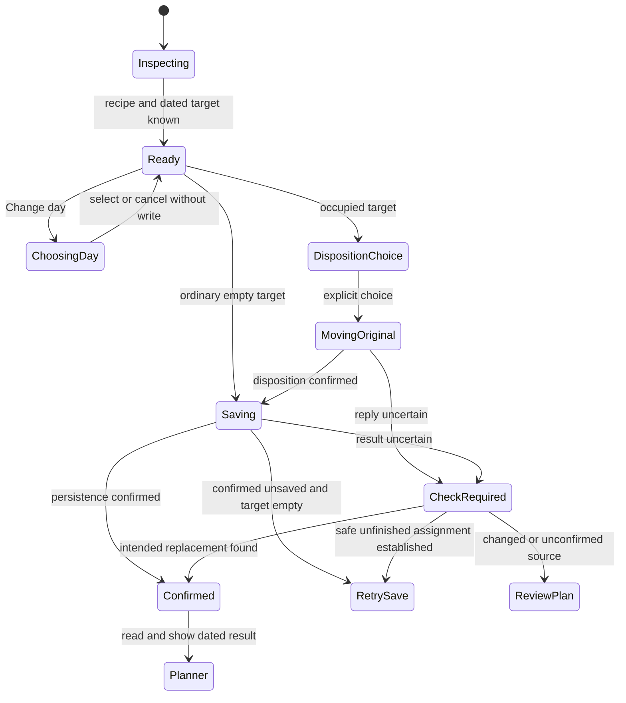

# Design

## Context and Existing Ownership

The [proposal](proposal.md) bounds the change. This document consolidates the conversation and turns the accepted journey into implementation slices; it is not evidence of a rendered redesign or implementation approval.

### Decision recap

| Topic | Direction | Decision status |
|---|---|---|
| Main outcome | Find a recipe, act without searching for the action, finish and return to family | Explicit user priority |
| Reading | Ingredients and instructions together; Cook's Mode remains separate | Explicit user choice |
| Primary library action | Add to meal plan, not starting cooking | Explicit user choice |
| Rating | Near the title, optional, visibly operable | User preference; existing recipe-level semantics preserved |
| Known destination | Preserve the Planner/Home-selected day through Search | Included in the accepted proposition |
| Free library entry | Suggest Tonight if empty, otherwise next open date; show it before saving; allow Change day | Combined user choices and accepted proposition |
| Finish | Open chosen Planner day with clear recipe/date confirmation | Explicit user choice |
| Original recipe | Following day, Next Week, or remove from that day; select replacement first | Accepted after current-flow review |
| Full next week | Continue to next available date; confirm actual date and spillover | Explicit user choice |
| Non-cooking plans | Skip automatically; ask before explicitly replacing | Explicit user choice |
| Visual character | Existing Solar Earth refined family cookbook; no new theme or fonts | Requested repo visual language |
| Presentation | Full-screen phone, bounded spacious tablet/desktop dialog; notes after instructions with a Family notes shortcut when present | Presentation to assess in mockups; notes shortcut explicitly agreed |
| Family features | GOTO near title, distinct appreciation, existing Ask the Family toggle and wording preserved in stack/detail | Explicit review decisions |
| Conditional removal | Add a small optional precondition to protect stale recovery deletes | Engineering proposal from this planning pass, not an earlier user-selected feature |

### Source-observed current behavior

- `pwa/src/components/recipes/RecipeDetailSheet.tsx`: a 90vh inset dialog, 16:9 hero, ingredients beside notes/rating on wide screens, Steps opening `CooksMode`, and a bottom Cook This pivot. Its planning catch displays calendar errors but logs other errors. Its header has GOTO, Share, gear and Close.
- `pwa/src/app/(app)/recipes/RecipesExperience.tsx`: explicit Planner target survives Search; ordinary Cook Tonight targets today; Plan for Later scans from tomorrow. Both use `slotAssignment.assignRecipeToEmptySlot`, which currently does not pass `requireEmpty=true`. Search recovery awaits disposition but does not generally retain completed stages.
- `pwa/src/app/(app)/planner/page.tsx`: replacement uses exact-source defer for Next Week and remembers completed disposition. Standalone Save for Next Week still uses bounded cross-week push. Planner-open detail supplies an empty planning callback.
- `pwa/src/components/home/HomeCommandCenter.tsx`: its Pick Something Else recovery retains disposition/save stages, reconciles unknown persistence and uses guarded `todayStore.saveRecoveryRecipe`. Preserve that behavior and its existing direct-Home return conventions.
- `pwa/src/lib/planner/slotAssignment.ts`: Tomorrow suppresses duplicate/uncertain replay. Next Week selects either defer or legacy push according to the caller. Date deletion currently carries no expected-plan precondition.
- `api/src/RecipeApi/Services/ScheduleService.Tomorrow.cs`: atomic exact-source chain shift through supper gaps across weeks, with Cooked/consensus rejection and separate moved/refreshComplete results. Keep the algorithm.
- `ScheduleService.MoveCrossWeekAsync` returns no movement on a full target week; the controller can still return a “Recipe moved” message. Search recovery does not check a committed destination before assigning. This establishes a control-flow risk; meal loss has not been reproduced in this session.
- `ScheduleService.DeferRecipeAsync` starts at an explicit relative destination week, skips stored entries, continues into later weeks and returns scheduledDate/scheduledWeekOffset. Delete and defer follow-ups can fail after persistence; a rejected response alone does not prove no change.
- `pwa/src/lib/cooking/stepParser.ts` already parses string steps, flat HowToStep and HowToSection arrays. Recipe detail already receives recipeInstructions. Reuse these representations rather than add an extraction API or a second interpretation.

Current inspection started from a clean worktree. The separate `integrate-client-journey-telemetry` change is outside this scope. Local browser access reached onboarding with a profile-load 404; no complete live journey or mobile visual assessment is claimed.

## Decisions and Tradeoffs

### One destination and one primary action

Pass an explicit detail context: selected recipe, origin, optional source Planner date, and optional target reference/week/day. Keep the primary action reachable outside the reading scroller. When a target exists, resolve and display its full local date. Invalid partial URL context shows correction/retry, never an implicit Tonight write. Legacy valid links without a reference obtain one from the authoritative calendar before becoming actionable.

For untargeted entry, reuse calendar/schedule reads and existing first-open traversal, including Tonight. An automatic candidate is a future-or-today ordinary empty supper with no persisted supper entry; the proposed removalToken distinguishes persisted content from an absent supper entry. Skip recipe, non-cooking, cooked and consensus content. A failed/missing week cannot prove the first available date, so recommendation stops with retry. Retain the existing 520-week bound and offer Choose day on exhaustion. Do not copy recommendation, affinity or search eligibility policy into the PWA.

The alternative of always opening a calendar adds a decision to every empty-day path; silently assigning the first available day hides consequences. Showing a dated suggestion combines the accepted shortcuts with explicit choice. Recommendation and recipe reads can proceed independently; a slow calendar read must not hide the recipe.

Day chooser shows the current week and existing plans, with week navigation and full localized dates. Selecting a day updates the visible action; it does not save. Cancelling retains the previous target and recipe. If the selected recipe already occupies that date, show Already planned, View plan and Change day; no write. Cooked/consensus targets route to review rather than resetting state. Planner-origin reading identifies its source date, prioritises Cook's Mode and offers a working Plan another day path, not a no-op callback.

### Reuse staged recovery instead of another planning engine

Keep visual presentation in `SkipRecoveryDialog` and orchestration in a cohesive recovery owner extracted from Home's existing session only to the extent shared callers need it. A session captures reference Monday, source date/identity/state, replacement, disposition choice, confirmed destination and acknowledged stages. Home, Planner and Recipes supply adapters for local reconciliation and completion navigation. Business movement stays server-owned; avoid a generic workflow framework or a second store reimplementing schedule policy.

All Next Week UI callers use exact-source defer starting the source offset plus one. Do not change legacy swap/push APIs or drag behavior. Require a valid returned destination before progressing. Tomorrow uses its existing operation, including source-next-day rather than wall-clock tomorrow for future dates. Drop explicitly removes only the selected day, retaining the recipe library record. Choosing a non-cooking date offers confirmation and another-date escape, not recipe-disposition choices for a nonexistent recipe.

### Guard removal as well as the subsequent assignment

Guarded assignment already prevents the final write from overwriting a competing supper. A pre-read alone cannot protect date-only deletion of the old plan: another member could change that date between read and DELETE. Propose the following additive contract rather than claim a safety guarantee the current API cannot provide:

| Boundary | Proposed addition / retained contract |
|---|---|
| Schedule day DTO | Optional nullable `removalToken`; populated for a persisted supper entry, null for absence; unrelated meal slots do not supply a supper token |
| Token representation | Server-generated `v1.` plus base64url SHA-256 of a canonical persisted supper snapshot including event ID/date/slot, recipe, status, non-cooking kind/label, votes and candidate content. Clients treat it as opaque. No token storage or schema migration. |
| `DELETE /api/schedule/day/{date}/remove` | Optional bounded `expectedPlanToken` query; malformed supplied token returns 400; valid stale/missing source returns 409; matching source is removed atomically; omitted token retains legacy behavior |
| Atomic boundary | Compare the current source fingerprint and delete in a relational transaction that detects a concurrent source change; map serialization conflicts to 409. Keep grocery/publication follow-ups outside the committed deletion. |
| Defer | Existing exact sourceDate/recipeId, captured reference and targetWeekOffset; no new destination-selection policy or response shape |
| Assignment | Existing JSON weekOffset/dayIndex/recipeId/requireEmpty=true with explicit reference Monday; no name/image data in the body; no transport replay |

This is an engineering recommendation for review. It is included as a bounded recovery prerequisite, not a general optimistic-concurrency platform. Legacy delete and assignment contracts remain available. Shared recovery must fail closed when a required removal token is absent, offering a fresh read rather than an unguarded fallback.

## First Observable Slice

After the documentation/mockup group, implement one known empty-day path: Planner chooses Wednesday → Search → open recipe → immediately reachable Add for Wednesday → guarded POST → real schedule/grocery persistence → Planner reads and explicitly confirms that recipe/date. Test the duplicate and competing-fill cases before adding automatic recommendation or broad visual changes.

Affected seams: `RecipesExperience` → `RecipeDetailSheet` → assignment helper → generated Kiota assign operation → controller → `ScheduleService`/PostgreSQL → schedule read → Planner confirmation. Mocked Playwright proves browser integration with stateful handlers; real API/database and separate browser acceptance prove actual internal persistence. No AI call is involved.

## State, Concurrency and Recovery

Disable duplicate actions during a pending stage. Recipe/target changes retire old read completions. Captured calendar references pin writes across midnight/week rollover. An unrelated newer plan must not be overwritten by stale state application. Query flags alone do not create a success acknowledgement.

Retry save runs only an unfinished guarded assignment. Unknown defer is not replayed merely because the source is empty: without a confirmed destination, show Review plan. Unknown removal can be reconciled against the expected captured source; do not DELETE again. If a new plan occupies the source, stop with conflict. Confirmed movement/deletion is never undone by a failed refresh or by closing recovery.

Pending mutation cannot be silently dismissed. Once settled, leaving partial recovery explains that completed original changes remain and the replacement is unsaved or unconfirmed. This requirement covers the mounted session; durable cross-reload recovery is outside this increment and must not be implied. On return after reload, read the current plan rather than replaying a former session.

## Persistence and Side Effects

Replacement remains ordered separate operations, not a transaction spanning move/delete plus assignment. Tomorrow keeps its existing atomic chain boundary. Deferral retains existing exact-source behavior and grocery follow-ups. Conditional deletion commits the expected supper removal before follow-ups. New assignment uses the existing atomic empty-supper guard.

Reconcile calendar state after uncertain replies because grocery recomputation/publication can fail after a write. A confirmed saved meal with failed view refresh stays saved; Retry refresh is a read, never another movement. Reconcile affected week stores/Today only when their captured date/week matches. Grocery correctness and independent second-client updates require real acceptance; local optimism or mocked publication is insufficient.

## User Experience

### Page composition

1. Persistent quiet toolbar: named recipe actions, available Share, Close.
2. Generous food photograph, prominent Outfit title, quiet duration/category information and stable View original control. Preserve source provenance; a generated illustration is not original recipe evidence.
3. Compact existing recipe appreciation and GOTO near the title, visually distinct from each other and family voting. Preserve recipe-level rating semantics. Keep the existing Ask the Family toggle directly visible near this recipe information; its stack-browser control, wording and eligibility behavior stay unchanged. Do not rename it Include in family voting or move it below the whole recipe. Visible EN/FR labels and selected state; no faded enabled choices.
4. Nonempty short description, then Ingredients with the read-only original serving basis until the portions companion supplies a dated projection, followed by numbered Instructions. Use meaningful section headings. On wide screens, two readable columns are allowed; mobile remains one continuous flow, without tabs.
5. Saved notes visible after preparation; a quiet Family notes shortcut near recipe information jumps to that section when saved notes or a nonempty retained draft exist, with meaningful keyboard focus and no popup. When empty, Add a note in the notes section expands the existing autosaving editor. Preserve retained drafts and saved/error/retry distinctions. Keep Find Similar available without making it a competing primary action.
6. Persistent dated planning area: rich terracotta/light text primary, quieter Change day and Cook's Mode where appropriate. Planner-origin reading instead prioritises Cook's Mode and a working Plan another day. The bottom area remains compact but grows with text rather than truncating labels.

Full-screen detail at widths below 768 CSS px or short heights below 500 CSS px; bounded dialog otherwise. These are proposed responsive implementation defaults, not new device-detection logic. The modal may cover the underlying app dock while open; the dock and library state return on Close. This is an explicit exception to library navigation visibility, not a redesign of the app shell. Use one measured action-area clearance and preserve intentional scrolling on constrained screens.

Use existing fonts/tokens/icons and warm white/cream surfaces, soft layered shadows, generous image rounding and readable sentence-case headings. No serif theme, fake paper, extra ornamental badges, new animation library or enforced glass treatment. Inspect actual composite contrast, including light/dark real food photos; passing ratios alone do not establish cookbook refinement.

### Planning and completion

Known empty target: one planning activation from loaded detail. Free entry: automatically shown dated recommendation, one activation if accepted. Chosen other date: choose it, then activate the updated dated action. Replacement: retain the new recipe while asking what happens to the named original. Non-cooking: explicit confirm removal, then guarded recipe save.

Success opens the captured Planner day and says which recipe was added. If replacement, include original removal or actual movement date and any Next Week spillover. No rating prompt or forced next task. Keep confirmation in the current navigation session, not fabricated from URL flags after reload; re-read before presenting a restored acknowledgement. Incomplete confirmation does not require reopening Search.

### Acceptance matrix

| Path/state | Required evidence |
|---|---|
| Targeted and untargeted planning | Correct visible dates, no silent fallback, guarded writes, persisted chosen recipe, explicit Planner result |
| Tonight full / Sunday / future week | First genuinely empty date, source-relative Next Week, captured reference across rollover |
| Non-cooking / same recipe / Cooked / consensus | Skip automatic targets; explicit non-cooking consent; no accidental duplicate or state reset |
| Tomorrow / Next Week / removal | Original conserved or intentionally removed, no replacement after rejected/unconfirmed disposition, correct actual destination |
| Partial/unknown write | Retained replacement, stage counts prove no replay, authoritative check/read-only refresh, clear departure consequences |
| Second client changes a slot | Conditional removal and guarded assignment reject stale writes; both clients reconcile actual dated content |
| Reading and management | Instructions/ingredients together; no cooking side effects; notes, rating, originals, edit, share and issue flows preserved |
| Phone/tablet/accessibility | EN/FR, light/dark food photos, missing image/instructions, long title, 320 px, 200% text, short landscape, iPad portrait/landscape, keyboard and reduced motion |

## Application Order

Apply this change first, groups 1–6 in order, then the portions companion groups 1–7. This establishes dated detail context, the guarded planning/recovery path and the final reading composition before portions consumers extend them. Group selection remains explicit; this order does not authorise implementation. Sync/archive, when separately requested, use the same change order because the companion extends shared requirements.

This first change preserves current completion behavior. The companion owns Already prepared, actual preparation dates, dated portion projections and the cooking/lifecycle contract changes; do not implement a competing completion solution here. The Ingredients badge preserves original basis only when no dated projection is active, so applying the companion requires no contradictory non-scaling promise.

## Compatibility, Rollout and Reversal

Sequence the additive removal contract/generated clients/stateful mocks before any guarded-removal consumer. Legacy omission remains valid; do not ship the new UI against an older backend that cannot enforce its guard. Missing token is a visible read/retry state, not permission to remove unsafely. Existing legacy swap/push and unguarded assignment consumers outside the selected path retain compatibility.

No bulk data edits, schema migration, feature-flag infrastructure or deployment is planned. A later code rollback cannot restore meals already intentionally moved or removed; review current authoritative plans rather than replay historical operations. Keep each task group's diff independently reviewable and stop at the user-selected implementation boundary.
