# Design

## Context and Existing Ownership

The [proposal](proposal.md) bounds this companion change. It adds dated portions, ingredient projections and preparation of a captured supper occurrence to the preceding recipe-detail/planning change. Source findings and future acceptance are separate: no feature is implemented or runtime-qualified here.

| Owner | Current finding and planned responsibility |
|---|---|
| `Recipe.Servings`, recipe extraction/sync/update | Nullable original serving basis already exists. Preserve it when changing portions. A corrected basis or changed ingredients must invalidate/recompute affected usable projections. |
| `CalendarEvent`, schedule DTOs | No serving target or actual-preparation field today. Keep dated portions separate from meal assignment; add occurrence preparation metadata without moving the supper date. |
| `SettingsService`, `FamilySetting`, `familyStore` | Generic household settings exist. Use a reserved typed usual-size key with validated writes through the serving owner, not member-profile cardinality. |
| `GroceryRecomputeService`, `UnitNormalizer` | Reads structured `supply` amounts from raw metadata, falling back to ingredient strings; sums quantities after unit conversion. Insert serving projection before aggregation; retain existing ingredient identity/unit policy. |
| `GroceryCheckCoordinator` | Coordinates existing check-map writes/recomputation using fresh contexts. Increased-needs transitions must participate in that ordering and preserve unrelated checks. |
| `RecipeDetailSheet`, `CooksMode` | Read ingredient strings; cooking also parses instruction metadata. Consume a shared structured projection instead of implementing number replacement in JSX. |
| Planner `page.tsx` | Planner/Grocery switch, week arrows/date heading, conditional voting row, then ordered day cards. Insert a separate mode strip without repurposing voting actions. |
| `RecoverySnapshotService`, demo inventory, `ManagementService` | Exact table inventories and ordinary exports are explicit. New date storage must be integrated before shipping, not silently omitted. Demo currently declares only supported setting keys. |

Current `RecipeService.UpdateRecipe` can change ingredient strings independently of raw structured supply. Therefore “the recipe has amounts” does not establish that every current ingredient has a usable scaling basis. This plan adds source-coherence checks and visible unresolved results; it does not claim automatic parsing can resolve every recipe.

## Decisions and Tradeoffs

### Confirmed product decisions

- One household default for portions, adjustable per date and including leftovers. No separate people count, extra-portions field or profile-derived default. The retained change id does not define the product terminology.
- Minimum one; nights away use existing non-cooking plans with no active portions stepper. Preserve dormant dated counts. No guest names, invitation or RSVP feature.
- **At the table** (`À table`) inline mode: date at the side, recipe hero photo, minus/portions/plus, no recipe name. Done returns to Recipes once portions save; groceries update in the background. Cancel returns unchanged.
- A dedicated Recipes / At the table strip below week dates and above voting; the existing Planner/Grocery navigation stays. Ask the Family, Nudge family and Close voting stay visible under their existing state rules, never hidden in a new menu.
- Counts stay on dates through all meal movement. A Wednesday recipe moving from six to a Thursday configured for four uses four; Wednesday retains six for any replacement.
- Increased required grocery totals uncheck affected items and show updated totals. One brief list-level explanation replaces row-level delta amounts or more-needed labels. Preserve unrelated checks and extras.
- No independent recipe-preview calculator. The selected/proposed date determines portions before planning; undated reading uses original quantities.
- Preparing Friday on Tuesday leaves Friday visibly Already prepared / Prepared Tuesday. Eating it Tuesday instead requires moving the plan before cooking.

### Proposed engineering defaults

These choices make the specification concrete without adding new product workflows: counts use the existing positive database integer range; past dates and Cooked/prepared suppers are read-only in this editor; default changes affect current/future inherited counts, while explicit overrides and historical/Cooked snapshots are preserved. A household without a configured usual size or date override retains legacy one-recipe quantities. Initial At the table use offers an inline usual-portions field; it does not invent four or block unrelated planning with onboarding.

Storing the target on CalendarEvent would move portions with the recipe and could not represent an empty Saturday’s selected portions. Use a new `supper_servings` table keyed by absolute supper date, with nullable override, last applied inherited-count snapshot, concurrency version and timestamps. Explicit preparation freezes the effective count, including an explicit original-basis fallback for unconfigured legacy context, so later default changes cannot change what was prepared. Null override means follow the usual size; absent row means no explicit dated state. Capture inherited snapshots when assignments/count changes materialise a dated meal, never as a side effect of GET. Past legacy dates without a snapshot retain their original recipe basis.

Store the usual size in a reserved `family_settings` key `supper_servings_default`, with version. The serving API is its writer; generic settings writes for that key must route to the same validation/recompute owner or reject with guidance to use the typed operation. There must not be a second unchecked mutation path.

Changing the default updates materialised inherited counts for current/future non-Cooked suppers, finds affected weeks from saved entries (not an unbounded future scan), and preserves date overrides. Recipe moves leave serving rows untouched and materialise a destination inherited snapshot when needed before recomputing groceries. Existing movement rejection, recipe identity, Today and grocery-check rules remain authoritative.

### Server-owned amount projection

Extract a cohesive amount reader/projector from the existing grocery supply logic and use it for the projection endpoint and grocery recomputation. It accepts original recipe data and a resolved target, produces ordered structured ingredient lines, scaling/completeness status and issue codes. No network/AI calls. Use numeric operations without intermediate display rounding; reject nonfinite/overflow results as unresolved rather than emitting invalid JSON or fabricated zero. Preserve existing unit families; no density guesses or retail-package rounding.

Structured supply must be demonstrably coherent with its ingredient basis. For existing metadata, compare the retained source ingredient list with current stored ingredients using a deterministic representation; use known import provenance where available. If ingredient editing breaks that relationship, invalidate those quantities until corrected/re-imported, expose current ingredient text and unresolved status, and recompute affected future groceries. Do not replace quantities by regex in PWA text or merge unrelated supplier rows by approximate names. Original recipe/metadata evidence remains retained.

When the basis is missing, retain original content and identify that a count correction is needed. Scale reliable numeric amounts; keep salt to taste, oil for frying and other intentional nonnumeric directions as ordinary text without warnings. Distinguish these from unreliable/missing amounts that genuinely prevent a complete calculated need. A grocery line containing unresolved contributions exposes an incomplete known subtotal, not a complete numeric shopping requirement. Package descriptions and numeric step text remain original; show one concise limitation when reading scaled ingredients with original instruction text and keep adjusted ingredients easy to consult, without per-step warnings or confirmation prompts. Do not scale cooking duration or equipment assumptions.

### Proposed API contracts

Contract definitions and examples precede implementation; paths below are proposed additions, not existing endpoints.

| Boundary | Contract |
|---|---|
| `GET /api/schedule/servings` | `weekOffset` plus explicit/authoritatively resolved reference Monday; envelope includes absolute week, nullable usual count, seven dated effective counts/overrides, editability, serving version and grocery refresh status. Read-only even for an empty week. |
| `PUT /api/schedule/servings` | Body `{ referenceWeekStartDate, weekOffset, expectedVersion, defaultServings?, days: [{ date, servings }] }`; days is a sparse edit set, null servings resets an override. Validate dates belong to captured week, counts are positive integers and targets remain editable. Compare version and commit all count/default edits atomically. 400 validation; 409 stale state; no partial batch. |
| PUT acknowledgement | Acknowledge the committed saved version, dates/default and affected absolute weeks independently of grocery completion; return refresh status/job correlation using existing workflow support. A post-commit refresh failure is not an unsaved batch and does not hold the editor open. |
| `POST /api/schedule/servings/refresh` | Captured absolute affected weeks; recompute/read from current saved serving state without changing counts or replaying the prior batch. Existing household authentication and demo generation apply. |
| `GET /api/recipes/{id}/ingredient-projection` | Require `supperDate` and `context=proposed` or `context=assigned`. Proposed context resolves the date’s portions without requiring this candidate recipe to occupy it; assigned context also requires captured `occurrenceId` and matching recipe/date or returns 409. Return baseServings, targetServings, factor, context/version, status and ordered lines. No arbitrary targetServings input or preview calculator. Existing detail GET stays compatible. |
| Schedule/live projections | Add serving metadata/version and completeness to schedule days/adjuncts without changing existing envelopes or making reads recompute groceries. Existing `RecipeDto.servings` continues to mean the base recipe yield. |
| Grocery data | Retain row totals/state keys/manual-extra identities; add completeness only for genuinely unreliable contributions. A projection version and list-level reset summary support one brief explanation per observed update; no per-row increased-need notice or delta amount. |

Serving-state version includes the relevant usual-size version and dated rows, not recipe-array position. Sparse edits preserve unrelated dates; a concurrent changed relevant snapshot returns conflict rather than last-writer overwrite. After conflict keep drafts with a current saved baseline for review. No guest names or roster are collected.

Persist a serving-projection version with derived weekly grocery data and compare it against current serving inputs. A lost response, worker interruption or later follow-up failure must remain detectable by a fresh read, so a stale grocery list is never shown as current solely because counts loaded successfully. Use the existing schedule/grocery event transport for updated states; version guards prevent late snapshots overwriting newer drafts/results.

### Dated preparation and actual cooking date

Source: `CooksMode.finishCooking` calls `todayStore.markCooked(recipeId)`; `ScheduleService.ValidateDayAsync` records recipe-specific cooking against a date, while `RecalculateLastCookedDateAsync` derives history from Cooked calendar dates. Simply marking a future date Cooked would incorrectly make that future date the cooking-history value. This change explicitly adds preparation metadata rather than relying on that inference.

Use existing Cooked status for a completed planned occurrence, plus nullable server-captured `preparedAtUtc`, deployment-local `preparedOn` and an occurrence-owned frozen `preparedPortions`/original-basis context. Freeze that context at the same commit and use it when projecting a prepared occurrence; it is not a second editable portions control. Future explicit Cooked occurrences render Already prepared / Prepared Tuesday; legacy/overdue Cooked entries without explicit preparation metadata do not invent an actual date. Existing Cooked movement/replacement protections remain, and the portions editor is read-only for prepared meals. Reopening instructions never prompts another completion.

Proposed additive `POST /api/schedule/day/{date}/prepare` carries `occurrenceId`, `recipeId`, `expectedPlanToken` and `expectedServingVersion`; schedule reads expose occurrence identity as well as the companion’s opaque token. Auth/demo boundaries remain. Atomically validate current identity/date/recipe, Planned/Locked eligibility and the displayed portions version, capture actual preparation date/time, mark Cooked, freeze portions and update recipe cooking history. Invalid inputs are 400; stale/missing/changed occurrence or portions are 409 without mutation. Already prepared matching occurrence reads/repeated requests return the original stored outcome without changing preparation time; a recreated same-recipe assignment has a different occurrence identity and cannot be completed by a stale request.

Return occurrence/date, preparedOn, frozen portions and refresh/publication status. Preserve preparation metadata and frozen snapshots in schedule/Today/SSE reads and the guarded-removal fingerprint. Post-commit follow-up failure cannot erase preparation. Unknown replies require an authoritative occurrence read, not blind replay. Today changes only for a matching completed occurrence whose supper date is today, even when another date uses the same recipe. Unscheduled cooking keeps its existing current-day endpoint; a proposed unsaved destination is not a saved occurrence.

History recomputation uses explicit preparedAtUtc when present and the existing midnight-UTC Cooked-date fallback otherwise. Removal and overdue finalization share that calculation; later finalization cannot turn Tuesday’s explicit preparation into Friday cooking. Keep grocery contribution in the planned supper week using frozen portions, without creating a second Tuesday assignment or automatically planning leftover meals. Include metadata in ordinary calendar exports, exact recovery and demo reset in the same slice. Legacy validation remains compatible but must not erase or rewrite existing explicit preparation metadata on a repeated completion.

## First Observable Slice

A known two-serving recipe contributes 200 g pasta. In At the table set Wednesday to six and Done. The request crosses generated client → serving API → dated PostgreSQL state → shared amount projection → persisted weekly grocery lines/check map → Planner/Grocery read. The outcome is Wednesday six and pasta 600 g; if the prior four-serving 400 g line was checked, it is now unchecked with one brief list-level explanation. Saved recipe basis stays two/200 g and voting state is unchanged.

Land the dated store/API, minimal inline consumer, check transition and required lifecycle inventory together for this tracer. Extend usual-size editing, multiple-day drafts, unknown quantities, proposed-date and saved-date ingredient projections and complex movement only after this path works. Each slice carries its tests and affected documentation, not separate backend/frontend/test phases.

## State, Concurrency and Recovery

```mermaid
stateDiagram-v2
    Recipes --> TableDraft: At the table
    TableDraft --> Recipes: Cancel without write
    TableDraft --> Saving: Done
    Saving --> Recipes: portions persistence confirmed
    Recipes --> GroceryUpdating: open groceries while refresh pending
    GroceryUpdating --> Recipes: return to recipes
    GroceryUpdating --> GroceryCurrent: recompute/read succeeds
    GroceryUpdating --> GroceryNeedsRetry: refresh fails
    Saving --> CheckSavedState: reply uncertain
    Saving --> TableDraft: validation or stale-version conflict
    CheckSavedState --> Recipes: desired portions confirmed; refresh state retained
    CheckSavedState --> TableDraft: changed or unconfirmed state
    GroceryNeedsRetry --> GroceryUpdating: explicit read/recompute retry
```

While editing, −/+ and numeric entry change local drafts only. One Done captures default edits and dated edits. Duplicate Done is disabled while pending. Newer remote counts do not erase drafts; saving against the old baseline conflicts. Changing week, opening Groceries or leaving Planner with a dirty draft offers inline save-and-continue, discard or keep editing. Keep voting actions visible and operational; their updates cannot silently discard the portions draft.

Compare old/new grocery totals in canonical ingredient/unit buckets under the existing fresh grocery-check coordination. If a known requirement increases and is checked at that processing position, set it false and record a list-level reset summary for that projection version. Show one brief localized explanation, not row-level extra amounts or labels. Repeated reads/recomputes of the same version do not repeat it. An unchanged recompute must not reset a later check. A decrease preserves check state and never automatically marks shopping complete. Unresolved changes expose review feedback rather than claim proof of a numeric increase. Preserve manual extras and unrelated check entries.

After a lost PUT response, read authoritative serving state/version and grocery freshness. Desired counts already saved are not written again. A known conflict does not authorise automatic overwrite with the draft. Read/recompute recovery is explicit; a failed refresh never becomes an invitation to apply the same increase again.

Cooking receives captured absolute date and recipe identity, not just recipe ID. If a remote count changes mid-session, show updated quantities available and refresh explicitly, retaining reading position, check work and unsaved instruction edits. Two uses of the same recipe on different dates must not share a serving target by recipe ID alone.

## Persistence and Side Effects

Portions/default writes and a durable existing-workflow refresh request are one commit boundary. The response acknowledges that commit; grocery recalculation/publication execute afterward using the existing background workflow/worker support; they are not falsely presented as one atomic transaction with it. Coordinate per-week grocery/check changes on fresh data. Record stale projection metadata before exposing saved counts and clear it only after successful recomputation. Reuse WorkflowOrchestrator/WorkflowWorker persistence and execution rather than adding a new job framework. TriggerAsync currently starts its own transaction; extract/reuse bounded instance construction so portion writes, freshness and refresh work enlist in one context/transaction without nesting that call. Coalesce/version affected-week refresh work and retain explicit read/refresh recovery after worker failure. An awaited request that waits for all grocery work would violate Done returning after portion persistence; an untracked in-process fire-and-forget task would lose work on restart.

Assignment, Tomorrow, swap, defer, removal, recipe-basis correction and ingredient changes invalidate affected serving projections. Reuse existing affected-week discovery and server-owned calendar rules. Actual ingredient/grocery quantities depend on the destination date after movement, not a copied recipe multiplier. Counts neither clear non-cooking plans nor change votes; no portions count implies a meal was cooked.

Source math examples: base 2, amount 200 g → target 4 gives 400 g; target 6 gives 600 g. Both occurrences in the same week total 1000 g. Recompute from original data is invariant under repetition. Mass and volume buckets stay separate; names, package descriptors, original ingredient text and instructions stay original unless their existing explicit editing operation changes them.

## User Experience

Normal Planner remains recipe-focused. Layout order is Planner/Grocery navigation → week dates/arrows/Back to this week → dedicated Recipes / At the table strip → existing visible voting actions → day rows. At the table reuses the strip for Cancel/Done. Each row keeps its date at the side and hero photo next to minus/portions/plus, without a visible recipe name. Missing photos and empty dates use a neutral fallback; non-cooking dates use their existing recognizable icon/accessible description and no active stepper. Do not fabricate food imagery. Preserve scroll anchor, responsive reading order and usable space; do not add a popup, permanent per-card stepper, weekly recipe-count badge or voting menu.

Use **At the table / À table**, **Recipes / Recettes**, and **How many portions? / Combien de portions ?**, with brief **Include extra for leftovers / Prévoyez des portions pour plus tard** guidance. Show the usual size once in the inline editor, with reset-to-usual available for a chosen date; do not repeat a default explanation on seven recipe cards. The number is the total to prepare, including leftovers; four people wanting two lunches enter six. Existing non-cooking choices handle nights away; recipe-free dates still allow future portions configuration. Past/Cooked dates are read-only in this editor.

Show the selected/proposed date and its portions together, for example Friday · 6 portions, before Add to Friday. Changing day updates the server projection without assignment. There is no separate quantity calculator. Undated reading shows original basis/amounts. A link to At the table preserves selected recipe/date/origin and provides a return to detail after Done/Cancel; it never assigns implicitly. Prepared dates are read-only. Original basis remains available in serving details rather than as a competing prominent target.

Reuse Solar Earth tokens, Outfit/Inter and existing control primitives. No new font/animation/icon system. Test ordinary phone, 320 px, short landscape, tablet portrait/landscape, EN/FR and 200% text. Count buttons need named date/value context and 48 CSS px targets; visible focus, keyboard numeric entry, reduced motion and actual-surface contrast remain necessary. Button placement/hierarchy and voting prominence require rendered assessment, not just DOM assertions.

## Compatibility, Rollout and Reversal

Add migration/model mappings for `supper_servings`, projection freshness and explicit preparation metadata on calendar occurrences. Legacy households without configuration stay at original quantities; reads do not derive a count from profiles. Add API/client/mock support before enabling consumers. Only configured positive targets scale; unavailable basis remains visibly unresolved. No ingredient rescaling/backfill or AI inference modifies saved recipes during migration.

Ordinary `supper-servings.json` includes default and dated rows because ordinary exports do not currently provide a general family-settings snapshot. Validate complete serving artifacts before applying them; absent legacy artifacts preserve destination intent. Exact recovery includes the new table/default and schema/version preflight; unsupported older schemas fail before live publication rather than pretending to be complete. Include demo clear-table policy for visitor dated rows and explicitly allow/restore the prepared default setting. Never accept arbitrary settings merely to make a demo baseline pass.

Deploying or resetting any real environment is outside this request. A rollback cannot silently discard saved portions or restore old checked states; retain the data/export and use an intentional compatibility path. Real PostgreSQL, generated-client browser, independent second-client updates and backup/demo acceptance are required before qualifying implementation.

### Integration with the recipe-detail companion

Apply `redesign-recipe-detail-planning` groups 1–6 first, then this change’s groups 1–7. Its context, guarded assignment/removal and reading layout are prerequisites for this combined delivery; no alternative legacy-detail UI branch is planned. The companion’s badge wording now explicitly allows this dated projection. Main specs remain untouched in this update. When separately authorised, sync/archive the detail change first and this one second; its meal-rescheduling delta carries forward the earlier guarded-delete semantics before extending history handling.

## Review Revision Evidence

The review established product decisions only. Earlier strict validation predates these revisions; rerun strict validation and scoped documentation checks after updating all artifacts. No application, database, browser or rendered acceptance is claimed here.

## Acceptance Map

| Area | Required cases |
|---|---|
| Counts | default/override/reset; empty date; minimum one; invalid entire batch; unset legacy; past/Cooked preservation |
| Inline layout | stable strip; no popup; both modes; visible Ask/Nudge/Close; narrow EN/FR; keyboard; dirty navigation |
| Math/source | 2→4→6; repeated occurrences; mixed units; fractions; unknown basis/amount; package text; independently edited ingredients |
| Groceries | increased checked need becomes unchecked; explanatory notice; unchanged/decreased totals; concurrent later check; extras preserved; read detects stale projection; Done returns before refresh; background worker interruption |
| Movement | Tomorrow chain and Sunday; swap; Next Week spillover; drop/replacement; counts remain on dates; all affected weeks recomputed |
| Reading/cooking | proposed-date projection no write and no calculator; dated identity conflict; same recipe/different dates; original step amounts unchanged; remote change retains cooking work; Tuesday preparation for Friday; same recipe two dates; actual-date history and retries |
| Durability | stale version; invalid batch; lost response; commit then failed groceries; SSE two-client convergence; ordinary/exact restore; demo reset |
